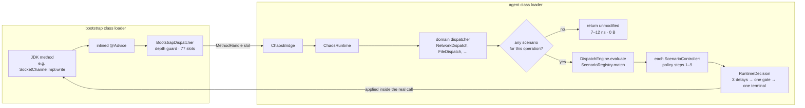

<!--
━━━━━━━━━━━━━━━━━━━━━━━━━━━━━━━━━━━━━━━━━━━━━━━━━━━━━━━━━━━━━
  Engineered by  Christian Schnapka
                 Embedded Principal+ Engineer
                 Macstab GmbH · Hamburg, Germany
                 https://macstab.com
━━━━━━━━━━━━━━━━━━━━━━━━━━━━━━━━━━━━━━━━━━━━━━━━━━━━━━━━━━━━━
-->

<div align="center">

# macstab-chaos-jvm-agent

**Pipeline-grade chaos engineering for the JVM. The failures that page your on-call become commits that fail in PR review.**

[](https://openjdk.org/projects/jdk/21/)
[](LICENSE)
[](https://bytebuddy.net/)
[](https://spring.io/projects/spring-boot)
[](https://quarkus.io/)
[](https://micronaut.io/)

*Designed and engineered by* **[Christian Schnapka](https://macstab.com)** —
Principal+ Engineer · [Macstab GmbH](https://macstab.com) · Hamburg, Germany

</div>

---

<div align="center">

### Part of the Macstab Chaos Engineering Stack

|            **JVM bytecode** *(this repo)*            | [**Container orchestration**](https://github.com/macstab/chaos-testing) | [**LD_PRELOAD libc**](https://github.com/macstab/macstab-chaos-testing-libraries) |
|:----------------------------------------------------:|:-----------------------------------------------------------------------:|:---------------------------------------------------------------------------------:|
|        In-process chaos for JVM applications         |         Annotation-driven Testcontainers chaos for any service          |               Pure C99 syscall-level chaos for any Linux container                |
| 91 operation types · Spring 3/4 · Micronaut · Quarkus |        Network · disk · DNS · CPU · memory · pre-built scenarios        |                glibc + musl × amd64 + arm64 · 100 % line coverage                 |

**One mental model — three layers.** Same selector × effect × policy DSL spans the JVM, the container, and the libc layer. Each layer ships and runs independently; combine them when you need full distributed-system chaos coverage.

</div>

---

**Contents:** [Quick Start](#quick-start) · [What it does](#floor-0--what-it-does-plain-english) · [Architecture in brief](#floor--1--architecture-senior-engineer-territory) · [Core Concepts](#core-concepts) · [Selectors](#selectors) · [Effects](#effects) · [Activation Policy](#activation-policy) · [Session Isolation](#session-isolation) · [Recipes](#recipes) · [Startup Configuration](#startup-configuration-json) · [Diagnostics](#diagnostics) · [Architecture](#architecture) · [Spring Boot](#spring-boot-integration) · [Performance](#performance) · [Build](#build) · [Documentation](#detailed-documentation) · [Three-layer stack](#part-of-a-three-layer-chaos-engineering-stack)

---

## The Short Version

Your Redis cluster is fine 99.9 % of the time.

Then a pod drains. Replication lag spikes to 300 ms. Your retry logic hammers the primary. p99 doubles. PagerDuty fires at 3 AM.

You've been in this room before. Toxiproxy didn't catch it — it's TCP-blind, it never sees `HikariPool.getConnection()` blocking. Your unit tests didn't catch it — they mocked the Redis client. Your integration tests didn't catch it — Testcontainers gave you a perfect Redis. The last game day was three months ago.

**Add eight lines to your test suite. Catch it on the next PR.**

```java
@ChaosTest
void retryLogicSurvivesReplicationLag(ChaosControlPlane chaos) {
    chaos.activate(ChaosScenario.builder("replica-lag-300ms")
        .selector(ChaosSelector.network(
            Set.of(OperationType.SOCKET_READ),
            NamePattern.prefix("redis-replica.")))
        .effect(ChaosEffect.delay(Duration.ofMillis(300)))
        .activationPolicy(ActivationPolicy.always())
        .build());

    assertThat(service.read1000Keys().latencyP99()).isLessThan(BUDGET);
}
```

No sidecar. No mocks. No application code changes. The bytecode of `java.net.Socket` reads is rewritten the moment a scenario needs it; chaos applies surgically inside the JVM that's already running your production code paths. **91 operation types** auto-wired across DNS, SSL, JDBC, HTTP, NIO, sockets, virtual threads, monitors, scheduler, GC, class loading, file I/O, ThreadLocal, JNDI, JMX, serialization, native libraries, queues, executors, async completion, and more. One annotation. Zero `--add-opens` flags. The agent self-grants every JDK module open it needs at install time.

Works in JUnit 5 with **Spring Boot 3, Spring Boot 4, Micronaut, and Quarkus** out of the box.

### Why you can trust it

A chaos tool that is wrong about its own behaviour is worse than none. Every claim below is enforced by the build — break it, and `./gradlew build` fails:

| Guarantee | Enforced by |
|-----------|-------------|
| The faults are the JDK's own: real exceptions, messages, short writes and resets, raised inside the real call | child-JVM integration tests against the real JDK, on JDK 21 and 25 ([ADR 0005](docs/adr/0005-real-faults.md)) |
| The plan format is one definition: the parser, its JSON Schema and the docs agree | `PlanSchemaTest` generates the schema from the parser; every JSON example in the docs is parsed |
| The parser and validator never crash or hang, whatever the input | `PlanFuzzTest`: mutated examples and schema-generated plans, seeded and replayable, nightly with a fresh seed |
| The public API cannot change by accident | `apiCheck` against the committed JVM signatures in `api/*.api` |
| The architecture holds: the bootstrap bridge is closed, inlined advice uses only public members | `ArchitectureTest` |
| No known bug patterns in any line that compiles | Error Prone on every compilation, warnings as errors |
| No unchecked null in production code | NullAway proves every dereference; optional values are `@Nullable` in the types ([ADR 0008](docs/adr/0008-nullness-in-the-types.md)) |
| The tests catch real bugs, not just run code | mutation testing (`./gradlew pitest`) with ratcheted thresholds |
| An idle hook costs 7–12 ns and allocates nothing | JMH benchmarks with a regression gate in CI ([benchmarks](docs/benchmarks.md)) |
| What ships is what you can verify | reproducible jars (`scripts/check-reproducible.sh`), a CycloneDX SBOM published next to every jar (classifier `cyclonedx`), shaded dependencies listed |

The decisions behind the design are recorded as [architecture decision records](docs/adr/README.md).

### What questions does it answer?

The questions your on-call has to answer at 3 AM — turned into PR-blocking assertions:

- *"Will a 3-second network outage kill my HikariCP pool, or will it recover?"*
- *"If one connection has 1 s latency, does my repeatable-read transaction still produce consistent data, or does it return stale rows?"*
- *"Is `read_from = REPLICA_PREFERRED` actually routing reads correctly when the primary is slow?"*
- *"Does my circuit breaker open before my caller's timeout fires?"*
- *"When DNS resolution slows from 1 ms to 800 ms, does anything in my stack actually time out, or does it deadlock?"*
- *"If GC pauses 200 ms during a burst, do my queue consumers fall behind permanently or catch up?"*

Every one of those becomes a `@ChaosTest` method that runs on every PR. No game day required. No SRE team required. No production blast radius. **Failures become commits, not incidents.**

---

## Quick Start

### 1. Add the dependency

```kotlin
// build.gradle.kts
testImplementation("com.macstab.chaos.jvm:chaos-agent-testkit:1.0.0")
```

### 2. Annotate your test

```java
@ExtendWith(ChaosAgentExtension.class)
class MyServiceTest {

    @Test
    void shouldHandleExecutorDelays(ChaosSession session) {
        session.activate(ChaosScenario.builder("slow-executor")
            .scope(ChaosScenario.ScenarioScope.SESSION)
            .selector(ChaosSelector.executor(Set.of(OperationType.EXECUTOR_SUBMIT, OperationType.EXECUTOR_WORKER_RUN)))
            .effect(ChaosEffect.delay(Duration.ofMillis(200)))
            .build());

        try (ChaosSession.ScopeBinding scope = session.bind()) {
            myService.doWork(); // executor submissions delayed 200ms
        }
    }
}
```

`ChaosAgentExtension` self-attaches the agent, opens a fresh `ChaosSession` per test, and closes it after. No `-javaagent` flag required for tests.

### 3. Or attach at startup for production-like testing

```bash
java -javaagent:chaos-agent-bootstrap-1.0.0.jar=configFile=/etc/chaos/plan.json \
     -jar your-app.jar
```

---

## Floor 0 — What it does (plain English)

You have a Java service. You want to know what happens when:
- the database connection pool is always slow
- the executor that processes your orders gets delayed
- `System.currentTimeMillis()` lies to your TTL checks
- `Selector.select()` wakes up for no reason, like the Linux kernel actually does
- the GC is under pressure while your request is in-flight

This library lets you **turn those scenarios on and off programmatically**, scoped to a single test thread, without touching production code. Multiple tests run in parallel in the same JVM — each test's chaos is invisible to every other test.

---

## Floor -1 — Architecture (senior engineer territory)

The agent loads via the standard Java Instrumentation API (`-javaagent:` or dynamic self-attach). ByteBuddy weaves `@Advice` hooks into selected JDK methods on demand — each hook group is retransformed the first time an activated scenario needs one of its operations (`instrumentation=eager` weaves everything at start, as in 1.x). Those hooks call a static dispatcher that routes to the live scenario registry, evaluates the scenarios indexed under the intercepted operation against a 9-step activation pipeline, and executes the decision inline on the calling thread.



The JDK class reaches the agent only through the bridge's method-handle slots ([ADR 0001](docs/adr/0001-bootstrap-bridge.md)); the policy steps and the composition rules are the numbered laws of [docs/semantics.md](docs/semantics.md).

**77 interception handles** span: thread lifecycle, executor submission, scheduled ticks, blocking queues, `CompletableFuture`, NIO selectors, TCP sockets, clock (`currentTimeMillis`/`nanoTime`), GC, `System.exit`, reflection, `ObjectInputStream`, class loading, `LockSupport.park`, AQS acquire, JNDI, JMX, ZIP compression, `ThreadLocal`, native library loading, HTTP client send, JDBC execute, DNS resolve, SSL handshake, `Thread.sleep`, file I/O, and arbitrary method entry/exit.

**Session isolation**: each test gets a `ChaosSession` backed by a `ThreadLocal<String>`. Session-scoped chaos evaluates only when the session ID on the current thread matches. Work handed off within a `session.bind()` scope — executor submissions, `ForkJoinPool` tasks (`CompletableFuture.*Async`, parallel streams), started threads and virtual threads — carries the session ID into the thread that runs it, so chaos propagates exactly where intended and nowhere else.

### Further down: runtime mechanics and JVM internals

The evaluation pipeline gate by gate, the class-loader bridge and its reentrancy guard, and what the JVM does underneath (ByteBuddy retransformation, happens-before across the bridge, lock inflation, `park()`, safepoints, carrier-thread pinning, why `SplittableRandom`) are in [docs/internals.md](docs/internals.md).

---

## Core Concepts

| Concept               | What it is                                                                    |
|-----------------------|-------------------------------------------------------------------------------|
| **Scenario**          | One selector + one effect + one activation policy                             |
| **Selector**          | Matching rule: which JVM operation(s) trigger this scenario                   |
| **Effect**            | What happens: delay, reject, suppress, gate, exception, corrupt, stress, skew |
| **Activation policy** | Gating: probability, rate limit, warm-up, time window, max applications       |
| **Session**           | Thread-local isolation scope — chaos targets only session-bound threads       |
| **Handle**            | `AutoCloseable` returned by `activate()`; close to stop the scenario          |

---

## Selectors

A selector names the operations a scenario applies to (`Set<OperationType>`; an empty set accepts every operation the selector understands) and narrows them with optional filters, given as `NamePattern`s (`NamePattern.prefix(...)`, `NamePattern.regex(...)`, `NamePattern.any()`) or as peer address, port, path or size bounds. Every selector, its factory, its operations and its filters are listed in [docs/configuration-reference.md §13.3](docs/configuration-reference.md#133-selector-reference).

---

## Effects

### Choosing an effect

The decision guide below maps **testing goals** to effects. Every effect in the two reference tables that follow is listed here at least once; effects with multiple distinct use cases (for example `skewClock` with three modes) appear on multiple rows so the goal-to-effect mapping is direct.

#### Latency and timing

| I want to test…                                                        | Effect                                                     |
|------------------------------------------------------------------------|------------------------------------------------------------|
| What happens when a downstream is slow                                 | `delay(Duration)` — fixed pause                            |
| Behaviour under variable latency (realistic network jitter)            | `delay(Duration min, Duration max)` — uniform-random pause |
| A caller's timeout logic when the callee blocks indefinitely           | `gate(Duration maxBlock)` — block until released or capped |
| Clock-based logic (TTLs, retries, token expiry) under continuous drift | `skewClock(Duration, ClockSkewMode.DRIFT)`                 |
| Behaviour when the clock stops advancing                               | `skewClock(Duration, ClockSkewMode.FREEZE)`                |
| Behaviour under a fixed clock offset (positive or negative)            | `skewClock(Duration, ClockSkewMode.FIXED)`                 |
| Code that handles `Selector.select()` spurious wakeups                 | `spuriousWakeup()`                                         |

#### Errors and failure handling

| I want to test…                                                 | Effect                                                                                                |
|-----------------------------------------------------------------|-------------------------------------------------------------------------------------------------------|
| A downstream returning "not available"                          | `reject(String message)` — throws a semantically correct exception for the intercepted operation type |
| A call that silently fails (returns `null` / `false` / empty)   | `suppress()`                                                                                          |
| A `CompletableFuture` completing exceptionally mid-pipeline     | `exceptionalCompletion(FailureKind, String)`                                                          |
| A callee throwing a *specific* exception class                  | `injectException(String className, String message)`                                                   |
| A return value that is technically valid but semantically wrong | `corruptReturnValue(ReturnValueStrategy.NULL / ZERO / EMPTY / BOUNDARY_MAX / BOUNDARY_MIN)`           |

#### Resource pressure (background stressors)

| I want to test…                                                | Effect                                                   |
|----------------------------------------------------------------|----------------------------------------------------------|
| Behaviour under sustained heap pressure                        | `heapPressure(long bytes, int chunkSize)`                |
| GC behaviour under high allocation churn                       | `gcPressure(long bytesPerSecond, Duration)`              |
| Metaspace (class metadata) pressure from dynamic class loading | `metaspacePressure(int classCount, int fieldsPerClass)`  |
| Direct (off-heap) buffer pressure                              | `directBufferPressure(long totalBytes, int bufferSize)`  |
| JIT code cache filling up (inline-cache thrash, deopt)         | `codeCachePressure(int classCount, int methodsPerClass)` |
| String intern pool growth (permanent root retention)           | `stringInternPressure(int count, int length)`            |
| Reference-queue flood (phantom-reference reclamation delay)    | `referenceQueueFlood(int count, Duration interval)`      |
| Finalizer backlog stalling GC                                  | `finalizerBacklog(int objectCount, Duration delay)`      |

#### Threading and concurrency

| I want to test…                                    | Effect                                                                                                        |
|----------------------------------------------------|---------------------------------------------------------------------------------------------------------------|
| A real JVM monitor deadlock between N participants | `deadlock(int participantCount)` — requires `ActivationPolicy.withDestructiveEffects()`                       |
| Thread-leak behaviour (unbounded thread creation)  | `threadLeak(int count, String prefix, boolean daemon)` — requires `ActivationPolicy.withDestructiveEffects()` |
| `ThreadLocal` leaks on a pooled thread             | `threadLocalLeak(int entries, int valueSize)`                                                                 |
| Monitor contention on a shared lock                | `monitorContention(...)`                                                                                      |
| A keep-alive thread preventing clean shutdown      | `keepAlive(String name, boolean daemon, Duration heartbeat)`                                                  |

#### JVM-wide pause pressure

| I want to test…                                    | Effect                                                                                                  |
|----------------------------------------------------|---------------------------------------------------------------------------------------------------------|
| Application behaviour during stop-the-world pauses | `safepointStorm(Duration gcInterval)` — periodic `System.gc()` + `Instrumentation.retransformClasses()` |

Two behavioural notes that the table cannot express:

- **Effects compose across matching scenarios.** They are applied in the order delay → gate → terminal action, and a delay is never dropped because a terminal action wins. Delays from all matching scenarios accumulate; gates and terminal actions (`reject` / `suppress` / `exception` / `corruptReturnValue`) resolve by `precedence` — higher wins. Only contributions that take effect count as applied; a losing scenario does not consume its `maxApplications`. This lets you layer e.g. "slow every call + reject 10 % of calls" without conflict.
- **Some effects are restricted to specific operations.** `suppress()` is accepted only where the interception point can skip the call (thread start/sleep, executor/schedule submit and ticks, queue offer/poll, async completion/cancel, resource load, `System.gc`/`exit`, NIO select, `ThreadLocal` get/set, HTTP client send, and the JDBC operations); elsewhere use `delay` or `reject`. Clock reads accept only `skewClock`, and `skewClock` only clock reads. Invalid combinations are rejected at activation.
- **Stressors are background-attached, not per-call.** Their selector pairing (`ChaosSelector.stress(StressTarget)`) is a lifecycle binding — the stressor starts when the scenario activates and persists until the handle is closed or `activeFor` elapses, independent of operation traffic on the JVM.

### Every effect

Inline effects act on the calling thread inside the intercepted call (delays, gates, rejections, `errno` failures, timeouts, torn writes, corrupted or trickled reads, resets, DNS answers and rewrites, redirects, clock skew); background stressors put the whole JVM under pressure (heap, metaspace, direct buffers, GC, finalizers, deadlocks, thread leaks, monitors, code cache, safepoints). Each effect, its parameters and the operations it applies to are in [docs/configuration-reference.md §13.5](docs/configuration-reference.md#135-effect-reference) and the generated compatibility matrix.

> ⚠️ `deadlock()` and `threadLeak()` with `daemon=false` prevent a clean JVM exit until the activation handle is closed. Both require `ActivationPolicy.withDestructiveEffects()` at registration time. Closing the handle interrupts all participating threads and releases all locks.

---

## Activation Policy

`ActivationPolicy` is a record. Use the static factories for the common cases, or construct the canonical record directly for fine-grained control. Probability must be in `(0.0, 1.0]` — pass `null` / omit the JSON field for the `1.0` default; omit the scenario entirely to disable it.

```java
// Always fire (default)
ActivationPolicy fire = ActivationPolicy.always();

// Fire on every match, but start paused until handle.start() is called
ActivationPolicy armed = ActivationPolicy.manual();

// Explicit opt-in for deadlock() / threadLeak()
ActivationPolicy destructive = ActivationPolicy.withDestructiveEffects();

// Fine-grained: 30% probability, rate-limit 10/s, warm-up, auto-expire, cap, seed
ActivationPolicy tuned = new ActivationPolicy(
    ActivationPolicy.StartMode.AUTOMATIC,
    0.30,                                              // probability (in (0, 1])
    5L,                                                // activateAfterMatches (warm-up)
    100L,                                              // maxApplications
    Duration.ofSeconds(30),                            // activeFor
    new ActivationPolicy.RateLimit(10, Duration.ofSeconds(1)),
    42L,                                               // randomSeed
    false);                                            // allowDestructiveEffects
```

All guards compose as AND. Fields may be `null` (Long / Duration / RateLimit / Long) to opt out of that axis.

---

## Session Isolation

```java
@Test void testA(ChaosSession sessionA) {
    sessionA.activate(delayScenario);
    try (var b = sessionA.bind()) {
        // only threads carrying sessionA's ID see this chaos
        executor.execute(sessionA.wrap(() -> myService.doWork()));
    }
}

@Test void testB(ChaosSession sessionB) {
    // completely independent, even in parallel — different session UUID
    sessionB.activate(rejectScenario);
}
```

---

## Recipes

Three worked examples showing how selectors, effects, and activation policy compose for real testing goals. Each recipe is self-contained — copy, adapt the selector pattern, and run.

### Recipe 1 — Flaky downstream under a retry policy

**Goal.** Verify that a client's retry logic correctly recovers when 30 % of outgoing HTTP calls to a specific host fail with a connection reset, mixed with variable latency on the successes.

```java
var flakyDownstream = ChaosScenario.builder("flaky-payments-api")
    .selector(ChaosSelector.httpClient(
        Set.of(OperationType.HTTP_CLIENT_SEND, OperationType.HTTP_CLIENT_SEND_ASYNC),
        NamePattern.prefix("https://payments.internal/")))
    .effect(ChaosEffect.reject("chaos: connection reset by peer"))
    .activationPolicy(new ActivationPolicy(
        ActivationPolicy.StartMode.AUTOMATIC,
        0.30,                                               // 30 % of matched calls reject
        0L, null, null, null,
        42L,                                                // deterministic seed — reproducible failure pattern
        false))
    .precedence(10)                                         // reject wins over delay when both match
    .build();

var slowDownstream = ChaosScenario.builder("slow-payments-api")
    .selector(ChaosSelector.httpClient(
        Set.of(OperationType.HTTP_CLIENT_SEND, OperationType.HTTP_CLIENT_SEND_ASYNC),
        NamePattern.prefix("https://payments.internal/")))
    .effect(ChaosEffect.delay(Duration.ofMillis(50), Duration.ofMillis(400)))
    .build();

session.activate(flakyDownstream);
session.activate(slowDownstream);
// 100 % of calls experience jitter; 30 % of calls additionally fail.
// The retry policy under test sees a realistic mixed-failure signal.
```

**What this exercises.** Delays accumulate across matching scenarios, but terminal actions resolve by precedence — the `reject` (precedence=10) wins over the default `delay`, so the 30 % of calls that lose the probability roll see `reject` *after* the latency jitter is applied. `randomSeed=42L` makes the pattern reproducible across runs — same input produces same failure sequence, so a failing test bisects cleanly.

### Recipe 2 — Circuit breaker verification under sustained failure

**Goal.** Prove that a Resilience4j `CircuitBreaker` transitions to `OPEN` state after 20 downstream failures, then rejects further calls fast with `CallNotPermittedException`.

```java
var sustainedFailure = ChaosScenario.builder("circuit-breaker-trigger")
    .selector(ChaosSelector.jdbc(OperationType.JDBC_STATEMENT_EXECUTE))
    .effect(ChaosEffect.injectException(
        "java.sql.SQLTransientConnectionException",
        "chaos: pool exhausted"))
    .activationPolicy(new ActivationPolicy(
        ActivationPolicy.StartMode.AUTOMATIC,
        1.0,                                                // 100 % — every call fails
        0L,
        20L,                                                // hard cap: after 20 applications, stop
        null, null, null,
        false))
    .build();

session.activate(sustainedFailure);

// Drive 25 calls through the circuit breaker.
// Calls 1-20: fail with SQLTransientConnectionException — circuit breaker counts failures.
// Calls 21-25: fail with CallNotPermittedException — circuit breaker is now OPEN, fast-rejecting.
for (int i = 0; i < 25; i++) {
    try {
        circuitBreaker.executeCallable(() -> jdbcTemplate.queryForList("SELECT 1"));
    } catch (CallNotPermittedException e) {
        // assert: transition happened after exactly 20 failures
    }
}
```

**What this exercises.** `maxApplications=20L` caps the chaos at exactly 20 effect applications — the 21st matched call passes through uninstrumented, so the circuit-breaker's fast-reject behaviour is observable on real calls instead of being masked by further injected failures. The CAS loop on `appliedCount` (Floor -2, step 8) guarantees the cap holds even under concurrent test threads hitting the connection pool in parallel.

### Recipe 3 — Memory pressure soak without crashing CI

**Goal.** Verify that a service holds its SLO under sustained heap pressure for 30 seconds, then the chaos self-releases so CI does not OOM-kill the test JVM.

```java
var heapSoak = ChaosScenario.builder("heap-pressure-soak")
    .selector(ChaosSelector.stress(StressTarget.HEAP))
    .effect(ChaosEffect.heapPressure(
        512L * 1024 * 1024,                                 // 512 MiB total retention
        1024 * 1024))                                       // 1 MiB chunks — avoids single-allocation OOM
    .activationPolicy(new ActivationPolicy(
        ActivationPolicy.StartMode.AUTOMATIC,
        1.0, 0L, null,
        Duration.ofSeconds(30),                             // auto-release after 30 s — CI safety
        null, null, false))
    .build();

try (var handle = session.activate(heapSoak)) {
    // Run your soak test here. The stressor holds 512 MiB for up to 30 s,
    // then self-releases. If your test finishes sooner, the try-with-resources
    // closes the handle and the heap is freed immediately.
    runWorkloadFor(Duration.ofSeconds(20));
}
// After handle.close() or activeFor expiry, the 512 MiB is eligible for GC.
// CI's next test starts from a clean heap.
```

**What this exercises.** Stressors are background-attached (they do not fire per call) — activation spins up the stressor once, it holds memory for the lifetime of the handle, and closing the handle (via try-with-resources or `activeFor` expiry) releases the retained arrays. Using 1 MiB chunks instead of one 512 MiB allocation avoids a single `OutOfMemoryError` if the JVM is already close to its ceiling — pressure builds gradually, so the service under test experiences GC thrash rather than instant death.

---

## Startup Configuration (JSON)

```json
{
  "metadata": { "name": "soak-test-plan" },
  "scenarios": [
    {
      "id": "executor-latency",
      "scope": "JVM",
      "selector": { "type": "executor", "operations": ["EXECUTOR_SUBMIT"] },
      "effect": { "type": "delay", "minDelay": "PT0.1S", "maxDelay": "PT0.5S" },
      "activationPolicy": { "probability": 0.5 }
    }
  ]
}
```

```bash
-javaagent:agent.jar=configFile=/etc/chaos/plan.json
-javaagent:agent.jar=configBase64=<base64-json>
-javaagent:agent.jar=configJson={"scenarios":[...]}
-javaagent:agent.jar=configFile=/etc/plan.json;debugDumpOnStart=true
```

Agent-arg escaping, environment variables (`MACSTAB_CHAOS_CONFIG_FILE`, `MACSTAB_CHAOS_CONFIG_JSON`, `MACSTAB_CHAOS_CONFIG_BASE64`), eager weaving (`instrumentation=eager`) and live reload of a watched file (`configWatchInterval`, atomic and limited to the scenarios the file activated) are in [docs/startup-config.md](docs/startup-config.md).

---

## Diagnostics

```java
ChaosDiagnostics diag = controlPlane.diagnostics();
ChaosDiagnostics.Snapshot snap = diag.snapshot();

snap.scenarios().forEach(r ->
    System.out.printf("%s: state=%s matched=%d applied=%d reason=%s%n",
        r.id(), r.state(), r.matchedCount(), r.appliedCount(), r.reason()));

System.out.println(diag.debugDump()); // full text dump
```

JMX MBean: `com.macstab.chaos.jvm:type=ChaosDiagnostics` — inspect from `jconsole` without code changes.

**Diagnosing zero applications**:
- `matchedCount > 0 && appliedCount == 0` → selector works; activation policy is filtering
- `matchedCount == 0` → selector not matching; verify operation type, class name pattern, and `session.bind()` is active

---

## Part of a Three-Layer Chaos Engineering Stack

`macstab-chaos-jvm-agent` is the **JVM bytecode layer** of a vertically-integrated chaos engineering toolkit. This repo is self-contained — everything in this README works standalone — but it composes with two sibling layers when broader coverage is needed.

| Layer                        | Repo                                                                                                    | What it covers                                                                                                                                                                                                                                                                                                                |
|------------------------------|---------------------------------------------------------------------------------------------------------|-------------------------------------------------------------------------------------------------------------------------------------------------------------------------------------------------------------------------------------------------------------------------------------------------------------------------------|
| **JVM bytecode** (this repo) | [`macstab/macstab-chaos-jvm-agent`](https://github.com/macstab/macstab-chaos-jvm-agent)                 | 91 operation types instrumented in-process. Spring Boot 3/4 + Micronaut + Quarkus integration. JUnit 5 `@ChaosTest`. Selector × effect × policy DSL. Live config reload.                                                                                                                                                       |
| **Container orchestration**  | [`macstab/chaos-testing`](https://github.com/macstab/chaos-testing)                                     | Annotation-driven chaos on top of Testcontainers. CPU throttling, memory pressure, disk I/O, network partitions, DNS failures, pre-built Redis Sentinel + replication-lag scenarios, Toxiproxy adapter, Redis-aware fault injection.                                                                                          |
| **LD_PRELOAD libc**          | [`macstab/macstab-chaos-testing-libraries`](https://github.com/macstab/macstab-chaos-testing-libraries) | Pure C99 LD_PRELOAD shared objects: file I/O (latency / `errno` / torn / corrupt), network (reset / trickle / duplicate / timeout), DNS, clock (offset / regress), process, memory. Rule qualifiers `@first`, `@from`/`@until`, `@size`; status and hits files. A SECCOMP supervisor (`chaos-init`) reaches static binaries and Go programs that bypass libc. **glibc + musl × amd64 + arm64**, 100 % line coverage on shipped sources. Language-agnostic: any process in any container. |

**Start here** if you're on the JVM. This is the entry point and the richest layer.

**Compose layers** for full distributed-system coverage:
- Add the LD_PRELOAD layer to inject *kernel-real* time skew, slow disks, and DNS slowdowns into containers — chaos for failure modes the JVM can't see (e.g. `clock_gettime` is a syscall the JVM can't intrinsically intercept; the LD_PRELOAD lib can).
- Add the orchestration layer to wire `@ChaosTest` annotations directly to Testcontainers-managed Redis, Postgres, Kafka — including pre-built scenarios like *replication lag during pod drainage*.

Three repos, one mental model: **the same selector × effect × policy DSL spans the libc layer, the JVM layer, and the orchestration layer.** No cross-layer coupling — each layer is independently adoptable, independently versioned, independently released. The same fault in both in-process layers:

| Native rule (`/tmp/.chaos-<lib>.conf`)                 | JVM scenario (plan JSON)                                                                                         |
|--------------------------------------------------------|------------------------------------------------------------------------------------------------------------------|
| `/var/lib/app:fsync:EIO:0.05`                          | selector `{"type": "fileIo", "operations": ["FILE_IO_SYNC"], "pathPattern": {"prefix": "/var/lib/app"}}`, effect `{"type": "errno", "errno": "EIO"}`, policy `{"probability": 0.05}` |
| `tcp4://10.0.0.7:9092:send:LATENCY:200 @size>65536`    | selector `{"type": "network", "operations": ["SOCKET_WRITE"], "remoteCidr": "10.0.0.7", "remotePort": 9092, "minBytes": 65537}`, effect `{"type": "delay", "minDelay": "PT0.2S", "maxDelay": "PT0.2S"}` |
| `tcp4://10.0.0.5:5432:connect:ECONNREFUSED:1.0 @first=3` | effect `{"type": "errno", "errno": "ECONNREFUSED"}`, policy `{"maxApplications": 3}`                           |
| `dns://db.internal:FILTER_FAMILY:inet6`                | operation `DNS_ANSWER`, effect `{"type": "dnsAnswer", "family": "IPV6"}`                                         |
| `clock_gettime/realtime:REGRESS:1000`                  | effect `{"type": "clockSkew", "skewAmount": "PT1S", "mode": "REGRESS"}` (on `java.time` reads, and on `System.currentTimeMillis()` call sites under `clockCallSites`) |

The full mapping, including what does not translate in either direction, is [docs/cross-layer.md](docs/cross-layer.md).

---

## Architecture

A strict directed module graph: the stable API at the top, bytecode instrumentation and the bootstrap bridge at the bottom, the runtime core, startup configuration and framework integrations between. Module responsibilities, the five frames of the dispatch path, the module diagram and the module reference are in [docs/overall-agent.md](docs/overall-agent.md#module-decomposition).

---

## Spring Boot Integration

Two starters per Spring Boot line (3.5 and 4.1): the **test starter** adds `@ChaosTest`, which installs the agent and gives every test class its own `ChaosSession`; the **runtime starter** exposes `ChaosControlPlane` as a bean and an opt-in `/actuator/chaos` endpoint to activate and stop plans in a running application, switched on only from a trusted property source. Setup, properties and the endpoint are in [docs/spring-integration.md](docs/spring-integration.md).

---

## Performance

An intercepted call with no scenario for its operation costs 7–12 ns and allocates nothing. For a service handling 2 000 requests/s, the agent with no scenarios takes about 0.003 % of one CPU core, and four active scenarios about 0.017 %. Close a handle when its scenario is done: an exhausted scenario left registered costs as much per call as an active one. Measurements, targets and how they are taken are in [docs/benchmarks.md](docs/benchmarks.md); `./gradlew :chaos-agent-benchmarks:run` runs the JMH suite.

---

## Build

```bash
./gradlew build                        # compile + test all modules
./gradlew test                         # tests only
./gradlew :chaos-agent-bootstrap:shadowJar   # produce the agent JAR (dependencies relocated)
./gradlew :chaos-agent-benchmarks:run  # run JMH benchmarks
```

Requires JDK 21+ at runtime. Build toolchain targets JDK 25; `--release 21` is enforced.

---

## Detailed Documentation

The documentation in [`docs/`](docs/README.md) is indexed by what you want to do: use the agent, run it and see what it does, or understand how it works.

---

## License

Apache License 2.0 — see [LICENSE](LICENSE). Use it in production, ship it in your products, fork it, build a business around it. The only thing you cannot do is claim you wrote it.

---

## About the Engineer

This three-repo stack — `macstab-chaos-jvm-agent`, [`chaos-testing`](https://github.com/macstab/chaos-testing), [`macstab-chaos-testing-libraries`](https://github.com/macstab/macstab-chaos-testing-libraries) — is the work of one engineer: **Christian Schnapka**, Hamburg, Germany.

### Timeline

| Year                     | What I was shipping                                                                                                                                                                                                        |
|--------------------------|----------------------------------------------------------------------------------------------------------------------------------------------------------------------------------------------------------------------------|
| **1984** *(age 10)*      | 6502 assembler on the Commodore 64                                                                                                                                                                                         |
| **1987** *(age 14)*      | Motorola 68000 (M68k) assembler / C on the Commodore Amiga                                                                                                                                                                 |
| **1989** *(from age 15)* | International demoscene — active in **Razor 1911**, **Sanity**, **Anthrox**, **Incal**; multiple demo-competition wins with my groups                                                                                      |
| **1990**                 | x86 assembler + C / C++ on PC. Part-time at German game studios (**Software 2000**, **Rainbow Arts**) and short stints at studios in Birmingham, UK — shipping on cartridges and floppies, where there was no patch button |
| **1996**                 | Transitioned to business / enterprise software engineering — the arc that runs to today                                                                                                                                    |
| **1996**                 | Java — since 1.0, 30 years and counting                                                                                                                                                                                    |
| **2002**                 | Python — 24 years and counting                                                                                                                                                                                             |
| **2008**                 | LXC (Linux Containers) — early adopter, production use through to the Docker era and beyond                                                                                                                                |
| **2013**                 | Docker — since first release; production use across enterprise stacks                                                                                                                                                      |
| **~2015**                | Go — distributed-system internals, network programming                                                                                                                                                                     |
| **2018**                 | Kotlin — JVM ecosystem coverage alongside Java; coroutines, multiplatform, server-side                                                                                                                                     |
| **~2014**                | Kubernetes                                                                                                                                                                                                                 |

**Diplom Informatiker** — German pre-Bologna 5-year computer-science degree, equivalent to a master's. 42 years of programming, 36 years of professional systems work, 30 years of enterprise software, 24 of Python, 10 of Go, 7 of Kotlin.

The depth shown in this project — JVMTI re-entrancy debugging on JDK 25, `@IntrinsicCandidate` JIT bypass analysis for the clock-skew limitation, ByteBuddy advice composition with `disableClassFormatChanges()`, the post-install retransform pass for classes that escape `installOn()`, the agent self-granting JDK module opens via manifest *and* `Instrumentation.redefineModule` — comes from a path that started with peeking C64 memory at 10, ran through the demoscene where every cycle counted on the wire, through game studios that shipped on cartridges with no recall option, and then 30 years of production enterprise software. Most engineers enter at the framework layer and look down. **This stack reads from below.** Principal-engineer titles are job descriptions; assembler at 10, the demoscene at 15, and shipping for game studios at 16 — that is a starting line.

### Specific evidence in this project

Concrete artifacts a reviewer can read:

- **62 of 67 `OperationType` values auto-wired** across modern JDK internals — including JDK 25 changes most chaos tools haven't caught up to (`Socket$SocketInputStream` rename, `sun.nio.ch.NioSocketImpl` as default `SocketImpl`, `jdk.internal.loader.NativeLibraries.load` going `native`)
- **Single-annotation `@ChaosTest` integration** working on Spring Boot 3, Spring Boot 4, Micronaut, and Quarkus — four frameworks with four different test-context conventions, one annotation
- **Honest documentation** of what *cannot* work and why — `SYSTEM_CLOCK_MILLIS` documented with the actual JVM constraints (native `@IntrinsicCandidate`, compiled into a direct call to the VM clock), not papered over
- **Cross-libc and cross-arch validation** in the sister C repo — `glibc + musl × amd64 + arm64`, 100 % line coverage on shipped sources, Docker runtime validation as a quality gate
- **Apache 2.0 throughout** — usable in production, in commercial products, no lock-in

### Available for senior engineering engagements

Limited capacity. Typically:

- **Fractional / interim Principal Engineer** — architecture, mentoring, hardest-problem ownership
- **Reliability engineering** — chaos-engineering / SRE-tooling enablement, post-incident systemic fixes, "we keep getting paged for X" investigations
- **JVM performance** — agents, GC tuning, instrumentation, deep profiling
- **Systems-level work** — C / C++ / assembler-adjacent investigations, native libraries, Linux internals

If your team is fighting production issues that "more tests" hasn't fixed:

- **[macstab.com](https://macstab.com)** — engagement enquiries
- **info@macstab.com** — direct contact
- **[GitHub @macstab](https://github.com/macstab)** — more open-source work

A small number of engagements per year. The work is deep — production systems with receipts in `git log`, not slide decks.

---

<div align="center">

**[Christian Schnapka](https://macstab.com)**
Principal+ Engineer
[Macstab GmbH](https://macstab.com) · Hamburg, Germany

*Building systems that operate correctly at the edges — including the ones you deliberately break.*

</div>
