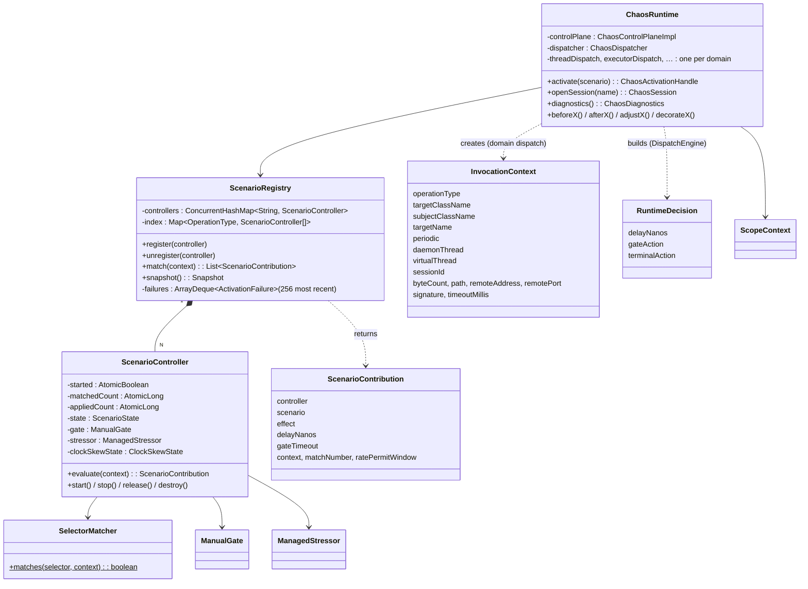
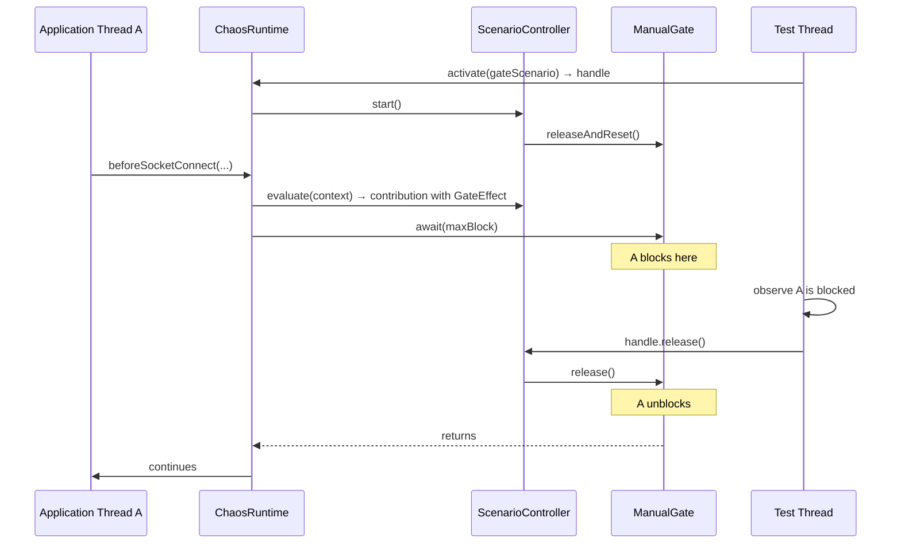

<!--
━━━━━━━━━━━━━━━━━━━━━━━━━━━━━━━━━━━━━━━━━━━━━━━━━━━━━━━━━━━━━
  Engineered by  Christian Schnapka
                 Embedded Principal+ Engineer
                 Macstab GmbH · Hamburg, Germany
                 https://macstab.com
━━━━━━━━━━━━━━━━━━━━━━━━━━━━━━━━━━━━━━━━━━━━━━━━━━━━━━━━━━━━━
-->

# chaos-agent-core — Execution Engine Reference

> Internal reference for the scenario registry, matching pipeline, activation policies, session scoping, effect execution, and stressor lifecycle.
> 
> *Engineered by* **[Christian Schnapka](https://macstab.com)** — Embedded Principal+ Engineer · [Macstab GmbH](https://macstab.com) · Hamburg, Germany

---

# 1. Overview

## Purpose

`chaos-agent-core` is the policy and execution engine. It owns everything between "the instrumented JDK method fired" and "the chaos effect was applied": scenario registration and lifecycle management, per-invocation matching, activation policy evaluation, effect dispatch, session scoping, diagnostics, and background stressor management.

## Scope

In scope:
- `ChaosRuntime` — thin facade that composes the control-plane and dispatch halves. Implements `ChaosControlPlane` by delegation. Exists as a single entry point so downstream modules (`chaos-agent-bootstrap`, `chaos-agent-instrumentation-jdk`, testkit, benchmarks) bind to one type.
- `ChaosControlPlaneImpl` (package-private) — actual control-plane implementation. Owns scenario registration, session lifecycle, diagnostics, event listeners, instrumentation handle.
- `ChaosDispatcher` (package-private) — hot-path half. Owns the `before*` / `after*` / `adjust*` / `decorate*` interception methods invoked from `BootstrapDispatcher`.
- `ScenarioController` — per-scenario runtime guard with the 9-step evaluation pipeline
- `ScenarioRegistry` — thread-safe store of controllers plus an immutable `OperationType` → controllers index used by `match()`; implements `ChaosDiagnostics`
- `SelectorMatcher` — stateless invocation-context matcher
- `InvocationContext` — value object capturing per-call data
- `RuntimeDecision` — merged decision: delay + gate + terminal action
- `ScopeContext` — per-thread session ID propagation
- `DefaultChaosSession` — session lifecycle, binding, task wrapping
- `CompatibilityValidator` — structural validation at activation time
- `ObservabilityBus` — event publication + metrics increment
- `ManualGate` — count-down + condition-variable gate for blocking effects
- `ClockSkewState` — mutable state for drift/freeze clock modes
- `ReturnValueCorruptor` — return-value corruption strategies
- `FailureFactory` — operation-specific exception construction
- `StressorFactory` + all `ManagedStressor` implementations

Out of scope:
- JVM bytecode interception (that is `chaos-agent-instrumentation-jdk`)
- Startup configuration resolution (`chaos-agent-startup-config`)
- Agent packaging and MBean registration (`chaos-agent-bootstrap`)

## Non-Goals

- Transactional multi-scenario activation
- Scenario persistence across JVM restarts
- Removal of stopped controllers from registry (they stay until the handle is explicitly closed or the session is closed)

---

# 2. Architectural Context

**Dependencies** (inbound):
- `chaos-agent-instrumentation-jdk` calls `ChaosRuntime`'s `before*`/`after*`/`adjust*`/`decorate*` methods via the `ChaosBridge` → `BootstrapDispatcher` bridge
- `chaos-agent-bootstrap` creates `ChaosRuntime`, calls `setInstrumentation()`

**Dependencies** (outbound):
- `chaos-agent-api` only

**Trust boundary**: all inputs are trusted JVM-internal calls. `ChaosRuntime` applies no security checks on callers.

**Stable vs internal**: `ChaosRuntime` has `public` visibility because bootstrap and testkit instantiate it, but it should be treated as internal runtime machinery. No API stability guarantee.

---

# 3. Key Concepts and Terminology

| Term                     | Definition                                                                                                                                                                                                     |
|--------------------------|----------------------------------------------------------------------------------------------------------------------------------------------------------------------------------------------------------------|
| **InvocationContext**    | Immutable record built at each instrumentation point that has a scenario: operation type, class names, target name, periodic flag, daemon/virtual thread flags, session ID, byte count, path, peer address and port, method signature, the call's own timeout. |
| **ScenarioContribution** | The value returned by `ScenarioController.evaluate()` when all 9 checks pass: carries the controller, effect, sampled delay, and gate timeout.                                                                 |
| **RuntimeDecision**      | Merged output of all matching contributions: accumulated delay, highest-precedence gate, highest-precedence terminal action.                                                                     |
| **TerminalAction**       | The final action to execute: THROW, RETURN (with value), SUPPRESS, COMPLETE_EXCEPTIONALLY, CORRUPT_RETURN, or one of the data-shaping kinds (CAP_LENGTH, CORRUPT_READ, ABORTIVE_CLOSE, TIMEOUT, DNS_SHAPE, REWRITE, REDIRECT); NOT_APPLICABLE marks an effect that cannot change this call. |
| **TerminalKind**         | Enum discriminating TerminalAction variants.                                                                                                                                                                   |
| **GateAction**           | A pair of (ManualGate, maxBlockDuration) triggering a conditional block on the calling thread.                                                                                                                 |
| **SessionId**            | A string assigned by `DefaultChaosSession` and stored in `ScopeContext` as a `ThreadLocal`. Null means "not bound to any session" (JVM-scope applies).                                                         |
| **ScopeContext**         | Single mutable source of truth for the current thread's session ID. Used by `ChaosRuntime` dispatch methods and `DefaultChaosSession.bind()`.                                                                  |
| **baseSeed**             | Per-controller seed for `SplittableRandom`, `ActivationPolicy.randomSeed`, or a seed drawn from `ThreadLocalRandom` when it is `null`. Each evaluation seeds `baseSeed ^ rotl(matched, 32) ^ (id.hashCode() * 0x9e3779b97f4a7c15L)` (the match number rotated, the id spread by the 64-bit golden-ratio constant) to produce varied-but-reproducible samples. |

---

# 4. End-to-End Behavior

## Scenario Registration

```
controlPlane.activate(scenario) or session.activate(scenario)
  ↓
ChaosControlPlaneImpl.registerScenario(scenario, scopeKey, sessionId)
  ↓
CompatibilityValidator.validate(scenario, featureSet, JVM | SESSION)
  — throws ChaosActivationException when the scenario's scope does not fit where it is activated
  — throws ChaosUnsupportedFeatureException when the JVM cannot run it (heap or direct-memory
    pressure above the limit, a stressor this JVM's flags leave without load)
  — throws ChaosValidationException on selector/effect/operation incompatibility
  ↓
hookDemand.require(SelectorOperations.of(scenario.selector()))
  — the instrumentation layer weaves the hook groups serving these operations, once each
    (no-op for stress selectors and for groups already woven); a MethodSelector's methods
    are woven before registering
  — a weaving failure fails the activation (failure category INSTRUMENTATION_FAILURE)
  ↓
new ScenarioController(scenario, scopeKey, sessionId, clock, observabilityBus, stressorFactory)
  — state = REGISTERED; started = false
  ↓
ScenarioRegistry.register(controller)
  — atomic ConcurrentHashMap.compute(key, ...)
  — rebuilds and swaps the immutable operation index (pre-sorted per operation)
  — an existing STOPPED or INACTIVE controller under the key is replaced (and destroyed)
  — throws ChaosActivationConflictException("scenario key already active") if the existing
    controller is REGISTERED or ACTIVE
  ↓
observabilityBus.publish(REGISTERED, ...)
if startMode == AUTOMATIC:
  ScenarioController.start()          // only a REGISTERED controller starts
    stressor = StressorFactory.createIfNeeded(effect)   // built with the dispatch depth raised;
                                                        // an OutOfMemoryError fails the start with
                                                        // ChaosUnsupportedFeatureException
    ExpiryScheduler.ensureStarted()   // for a time-bounded scenario or a stressor
    phase 1, under the monitor: gate.releaseAndReset(); startedAt = clock.instant();
             state = ACTIVE; ClockSkewState built (not yet in effect)
    observabilityBus.publish(STARTED, ...)
    phase 2, under the monitor: started.set(true); clockSkewState set; expiry scheduled
  ↓
return the DefaultChaosActivationHandle

// Any failure unregisters the controller, records the failure once (with its category) and
// publishes FAILED, then rethrows (semantics.md L21).
//
// Plan activations (activate(ChaosPlan)) first validate every scenario and check its key, then
// weave every hook the plan needs at once, so an invalid or unweavable plan registers nothing.
// Then each scenario follows the path above, and the handles are wrapped in a
// CompositeActivationHandle, which delegates start/stop/release/close to each member handle.
// The composite ID is "plan:<plan name>". If a scenario still fails, the ones already
// registered are destroyed and the exception propagates (the plan is atomic).
```

## Dispatch Structure

The entry points the instrumentation layer calls (`before*`, `after*`, `adjust*`, `decorate*`) live in one class per domain, all over one shared evaluation engine:

| Class | Domain |
|-------|--------|
| `ThreadDispatch` | thread starts, sleeps, parks, monitor entries, thread-locals; session hand-off between threads |
| `ExecutorDispatch` | executor submission and worker runs, scheduling, fork-join, queues, futures, shutdown hooks |
| `MethodDispatch` | entry and exit of the methods a `MethodSelector` names |
| `ClockDispatch` | clock skew of `System` call sites, `java.time`, the system `Clock`, `java.util.Date` |
| `RuntimeDispatch` | gc and exit requests, reflection, direct buffers, serialization, class loading, resources, native libraries, zip, JNDI, JMX |
| `NetworkDispatch` | sockets, socket channels, datagrams, selectors, TLS — with each call's peer and byte count |
| `DnsDispatch` | forward lookups, their answer, reverse lookups |
| `FileDispatch` | file reads, writes, opens, closes, maps, transfers, fsync, truncation, deletion, moves |
| `ProcessDispatch` | child process starts and waits |
| `ClientDispatch` | HTTP clients, JDBC, messaging, RPC, cache and cloud clients |

`DispatchEngine` holds what every domain shares: the operation index check (`idle`), matching scenarios against an `InvocationContext` (`evaluate`), resolving their contributions to one `RuntimeDecision` (`terminalActionFor`), and carrying it out (`applyPreDecision`, `applyDelayAndGate`, `transferCount`). `ChaosDispatcher` composes them; `ChaosRuntime` delegates each entry point to its domain.

## Per-Invocation Evaluation

`ScenarioController.evaluate(InvocationContext context)` runs 9 checks, in the order of [semantics.md §3](semantics.md#3-the-policy-of-one-scenario):

```
1. if (!started.get()) return null
   — AtomicBoolean read; lock-free
   — Fast exit for REGISTERED, STOPPED controllers

2. if (sessionId != null && !sessionId.equals(context.sessionId())) return null
   — String equality; no lock
   — Session-scoped controllers are invisible to unbound threads

3. if (!SelectorMatcher.matches(scenario.selector(), context)) return null
   — Exhaustive sealed switch; stateless; no allocation
   — Checks: operationType in selector.operations(), pattern fields

4. if (window() == EXPIRED) { state=INACTIVE; reason="expired"; return null }
   — activeUntil / activeFor, read from the real clock (L7)

5. if (window() == NOT_YET) return skipped("notYetActive")
   — before activeFrom: not counted as a match

6. long matched = matchedCount.incrementAndGet()
   if (matched <= activateAfterMatches) return skipped("warmUp")
   — every call from here on counts as a match

7. if (!passesProbability(matched)) return skipped("probability")
   — new SplittableRandom(baseSeed ^ rotl(matched, 32) ^ id.hashCode() * φ).nextDouble() < probability
   — or, with replayMatches, membership of matched in the replay log
   — checked before the rate limit so permits are only consumed by calls that will apply

8. if (!passesRateLimit()) return skipped("rateLimit")
   — synchronized(this): FIXED window anchored at start(), advanced in whole windows, O(1)

9. if (!reserveApplication()) return skipped("maxApplications")
   — maxApplications budget: a reservation, not yet a count
   — once appliedCount reaches maxApplications: state=INACTIVE; reason="max applications reached"

return new ScenarioContribution(this, scenario, effect, sampled delay (nanos), gateTimeout(), context, matched, permit window)

// The dispatcher then merges all contributions (delay, then gate, then terminal action) and calls
//   commitApplication(context)  — for every delay, the winning gate, the winning terminal action:
//                                 appliedCount++, publish(APPLIED), metric "chaos.effect.applied"
//   releaseApplication()        — for contributions that lost on precedence: budget returned
```

**Note on matchedCount semantics**: `matchedCount` is incremented at step 6, after the activation window and before warm-up, probability and rate-limit checks. This means it reflects the total number of times the selector matched, not the number of times the effect was applied. This is intentional: diagnostics consumers can distinguish "the selector is working" from "the effect is being suppressed by policy."

## RuntimeDecision Merge

`DispatchEngine.evaluate(InvocationContext, returnCorruptible)` aggregates the contributions `ScenarioRegistry.match()` returns (sorted by precedence descending, then id ascending, then scope key):

```java
long delayNanos = 0L;                 // ADDITIVE across all contributions (saturating)
GateAction gateAction = null;         // the FIRST gate wins: highest precedence, then smallest id
int gateIndex = -1;
int gatePrecedence = Integer.MIN_VALUE;
TerminalAction terminalAction = null; // the FIRST terminal wins: highest precedence, then smallest id
int terminalIndex = -1;
int terminalPrecedence = Integer.MIN_VALUE;

for (int index = 0; index < contributions.size(); index++) {
    delayNanos = saturatingAdd(delayNanos, contribution.delayNanos());
    if (effect instanceof GateEffect) {
        if (gateIndex < 0 || precedence > gatePrecedence) { gateAction = ...; gateIndex = index; ... }
        continue;
    }
    TerminalAction candidate = terminalActionFor(context, effect, scenario, controller, matchNumber, returnCorruptible);
    if (candidate is NOT_APPLICABLE) continue;           // neither applies nor counts
    if (candidate == null) { applied[index] = true; }    // a delay: always takes effect
    else if (terminalIndex < 0 || precedence > terminalPrecedence) {
        // the first candidate wins whatever its precedence (Integer.MIN_VALUE included);
        // a later one with equal precedence never replaces it
        terminalAction = candidate; terminalIndex = index; terminalPrecedence = precedence;
    }
}
// commit() the delays, the winning gate and the winning terminal; release() every other reservation
```

Delay composition: multiple delay scenarios stack. Three scenarios each contributing 50 ms delay = 150 ms total. This is intentional load amplification — composing delays is a feature, not a bug.

Gate composition: only the first gate in the sorted contribution list (highest precedence, then smallest id) applies. Two gate scenarios = the higher-precedence gate blocks; the lower-precedence gate is ignored. This is a limitation of the current implementation (not a deliberate multi-gate feature).

Terminal action selection: the highest-precedence scenario wins. If two scenarios share the same precedence, the lexicographically first `id` wins, and for the same id the JVM scope before a session (the `ScenarioRegistry` operation index keeps each operation's controllers pre-sorted by descending precedence, then id, then scope key; `match()` preserves that order and does not sort per call).

## Decision Execution

```
applyPreDecision(decision):
  applyDelayAndGate(decision):
    sleepNanos(delayNanos)   — Thread.sleep; an interrupt restores the flag and ends the delay
    applyGate(gateAction)    — gate.await(maxBlock): blocks until release(), the timeout or an
                               interrupt; an interrupt restores the flag and the call proceeds
  if terminalAction is THROW → throw the failure it builds (FailureFactory)
  CORRUPT_RETURN here      → IllegalStateException (only afterMethodExit applies it)
  any other terminal       → handled by the call site that asked (return a value, skip the call,
                             reshape the bytes, …)
```

The delay of every matching scenario is applied even when a terminal action then throws or returns early. Operations that return a value handle the terminal action inline after `applyDelayAndGate`: for example, `beforeBooleanQueueOperation` checks for RETURN and directly returns the boolean rather than throwing.

---

# 5. Architecture Diagrams

## Class Diagram — Core Component Relationships



**Takeaway**: `ChaosRuntime` is a thin facade over the control plane and the domain dispatchers. The substantive decisions are in `ScenarioController.evaluate()` (policy) and `SelectorMatcher.matches()` (routing).

## Sequence Diagram — Gate Effect Lifecycle



**Takeaway**: `ManualGate` is a reusable barrier backed by a `CountDownLatch` that is replaced on each re-arm. `handle.release()` on an `ACTIVE` scenario opens the gate for every waiting thread and closes it again in the same step (`releaseAndReset()`); on an `INACTIVE` one it opens the gate for good. A held call also proceeds when the gate's `maxBlock` elapses. `stop()` releases every waiting thread.

---

# 6. Component Breakdown

## SelectorMatcher

Exhaustive `switch` over the sealed `ChaosSelector` hierarchy. Each case extracts the matching conditions from the selector variant and applies them to `InvocationContext` fields.

Key matching rules:

| Selector type          | Primary match fields                                                              | Additional constraints                                               |
|------------------------|-----------------------------------------------------------------------------------|----------------------------------------------------------------------|
| `ThreadSelector`       | `operationType` in operations, `threadNamePattern.matches(targetName)`            | `kind` (ANY/PLATFORM/VIRTUAL), `daemon` flag                         |
| `ExecutorSelector`     | `operationType` in operations, `executorClassPattern.matches(targetClassName)`    | `taskClassPattern.matches(subjectClassName)`                         |
| `QueueSelector`        | `operationType` in operations, `queueClassPattern.matches(targetClassName)`       | —                                                                    |
| `AsyncSelector`        | `operationType` in operations                                                     | No class/name filtering                                              |
| `SchedulingSelector`   | `operationType` in operations, `executorClassPattern.matches(targetClassName)`    | `periodicOnly` flag                                                  |
| `ShutdownSelector`     | `operationType` in operations, `targetClassPattern.matches(targetClassName)`      | —                                                                    |
| `ClassLoadingSelector` | `operationType` in operations, `targetNamePattern.matches(targetName)`            | `loaderClassPattern.matches(targetClassName)`                        |
| `MethodSelector`       | `operationType` in operations, `classPattern.matches(targetClassName)`            | `methodNamePattern.matches(targetName)`, optional `signaturePattern` |
| `MonitorSelector`      | `operationType` in operations, `monitorClassPattern.matches(targetClassName)`     | —                                                                    |
| `JvmRuntimeSelector`   | `operationType` in operations                                                     | No class/name filtering                                              |
| `NioSelector`          | `operationType` in operations, `channelClassPattern.matches(targetClassName)`     | —                                                                    |
| `NetworkSelector`      | `operationType` in operations, `remoteHostPattern.matches(targetName)`            | —                                                                    |
| `ThreadLocalSelector`  | `operationType` in operations, `threadLocalClassPattern.matches(targetClassName)` | —                                                                    |
| `StressSelector`       | `operationType == LIFECYCLE`, `target != null`                                    | No class/name filtering                                              |

**null == wildcard**: Pattern fields that are `null` match anything. This is consistent across all selector types.

## CompatibilityValidator

Validates selector/effect combinations before registration. Throws `ChaosValidationException` on violation, `ChaosUnsupportedFeatureException` when the runtime cannot carry the scenario out (direct-buffer pressure above the direct memory limit, heap pressure, a thread-local leak, interned strings or a reference-queue flood cycle above the free heap, a `safepointStorm` without retransforms under `-XX:+DisableExplicitGC`, a `finalizerBacklog` under `--finalization=disabled`), and `ChaosActivationException` when the scope does not fit where it is activated (a `SESSION` scenario outside a session, a `JVM` one in a session). All checks run at activation time, not at match time.

Key checks:

- Stressor effects require `StressSelector`, each stress target its own effect type; stress scenarios must be JVM scoped
- A `reject` only where the real call can fail: refused on `THREAD_PARK`, `MONITOR_ENTER`, `SYSTEM_GC_REQUEST`, `SYSTEM_EXIT_REQUEST`, `THREAD_LOCAL_GET` / `SET`, `ASYNC_CANCEL`, `ZIP_DEFLATE`, `EXECUTOR_SHUTDOWN`, `EXECUTOR_WORKER_RUN`, `FORK_JOIN_TASK_RUN`, `QUEUE_TAKE`, `QUEUE_POLL`, `NETTY_CHANNEL_READ` and the clock reads, each with the alternative to use, and on `RPC_CALL` with a gRPC version whose `FailingClientStream` the agent cannot build
- `SpuriousWakeupEffect` requires a `NioSelector` with `NIO_SELECTOR_SELECT` as its only operation
- `ReturnValueCorruptionEffect` requires `MethodSelector` with `METHOD_EXIT` operation
- `ExceptionInjectionEffect` requires `MethodSelector` with `METHOD_ENTER` operation
- `ExceptionalCompletionEffect` requires `AsyncSelector`
- `ExceptionInjectionEffect` names a `java.` or `javax.` class the agent's class loader resolves at activation, public, non-abstract, with a public `(String)` or no-argument constructor
- `ClockSkewEffect` requires `JvmRuntimeSelector` with one of: `SYSTEM_CLOCK_MILLIS`, `SYSTEM_CLOCK_NANOS`, `INSTANT_NOW`, `CLOCK_READ`, `LOCAL_DATE_TIME_NOW`, `ZONED_DATE_TIME_NOW`, or `DATE_NEW`
- Session-scope scenarios may not select an operation the JVM evaluates without a session (`CLASS_LOAD`, `CLASS_DEFINE`, `RESOURCE_LOAD`, `SHUTDOWN_HOOK_REGISTER`), nor a `StressSelector` (stress scenarios must be JVM scoped)
- Delivery effects apply to their operations only (`trickle`: `SOCKET_READ`; `corruptRead`: `SOCKET_READ`, `FILE_IO_READ`, `DATAGRAM_RECEIVE`; `timeout`: `SOCKET_READ`, `SOCKET_CONNECT`, `NIO_SELECTOR_SELECT`, `PROCESS_WAIT`; `tornWrite`: `FILE_IO_WRITE`, `SOCKET_WRITE`, `NIO_CHANNEL_WRITE`; `connectionReset`: `SOCKET_CLOSE`; `redirect`: `SOCKET_CONNECT`; `dnsAnswer`: `DNS_ANSWER`; `dnsRewrite`: `DNS_RESOLVE`), an errno to the calls the kernel reports it for, and `suppress` to the operations that can skip their call
- **Destructive effects guard**: `DeadlockEffect` and `ThreadLeakEffect` require `activationPolicy.allowDestructiveEffects() == true`; activation without the flag throws `ChaosValidationException` at registration time

The destructive effects guard exists because deadlocked and leaked threads hold their locks and memory until the scenario is stopped, and leaked non-daemon threads keep the JVM from exiting until then. The check is intentionally fail-fast and unconditional — there is no way to bypass it short of constructing an `ActivationPolicy` with `allowDestructiveEffects=true`.

## ScopeContext

Holds one session stack per thread: a `ThreadLocal<Deque<String>>` whose `Deque` is a `ConcurrentLinkedDeque`, so a binding can be closed from another thread. Key operations:
- `currentSessionId()`: the top of the calling thread's stack (`peek()`), or `null`
- `bind(sessionId)`: pushes the id and returns a `ScopeBinding` whose `close()` removes it from that thread's stack; `bindRoot(sessionId)` is the session's own binding of the thread that opened it, and `bindNone()` masks an inherited session for a request without a session header
- `wrap(sessionId, Runnable)`: returns a `Runnable` that binds `sessionId` for the duration of its run — used for propagating session context to executor threads

**Why ThreadLocal and not a method argument**: The session ID must be available at every instrumentation point without changing the signature of any JDK method. `ThreadLocal` is the only transparent carrier for per-thread state in a JVM agent context.

**Propagation**: besides explicit wrapping (`session.wrap(task)`, `ScopeContext.wrap(sessionId, task)`) and executor decoration, `SessionHandoff` carries the session across `ForkJoinPool` submissions and forks, `Thread.start()` and virtual threads: the session is recorded against the task or thread when it is handed off and bound for the duration of its run. The record is keyed by the carrier's identity and holds it weakly (`IdentityWeakKey`): two equal tasks keep their own sessions, a task's `equals` and `hashCode` are never called, and a record whose carrier is collected before it runs is dropped. The tables are concurrent maps and the hand-off takes no lock of its own; with no hand-off pending the run-side check is one `isEmpty()`. Executor decoration (`ExecutorDispatch.decorateExecutorRunnable/Callable`) wraps a submitted task for the bound session only while that session has a registered scenario (`ScenarioRegistry.hasScenarios`, a set of session ids rebuilt with the operation index on every register and unregister): activate before you submit — a task submitted before the session's first scenario carries no session, and a task submitted from a session without scenarios carries no `X-Chaos-Session` on the HTTP calls it makes. A scheduled task is wrapped regardless (`ScheduledRunnableWrapper` / `ScheduledCallableWrapper`, by the scheduled-executor hook) so that each tick is evaluated for `SCHEDULE_TICK`: once the `SCHEDULED_EXECUTOR` group is woven — by a scheduling scenario, or by opening a session — every `schedule`, `scheduleAtFixedRate` and `scheduleWithFixedDelay` hands the pool the wrapper instead of the task, also without any scenario; with no `SCHEDULE_TICK` scenario the wrapper only runs the task. A suppressed `FutureTask` is cancelled and handed to the pool unchanged; any other suppressed runnable is replaced by a no-op, so a priority pool that `execute`s `Comparable` runnables cannot be suppressed on `EXECUTOR_SUBMIT`. Work handed off from a thread without a session carries none; a `Thread` subclass whose `run()` does not call `super.run()` does not receive the session. Like an executor task, a started thread carries its session only while the session has a registered scenario (`ThreadDispatch.beforeThreadStart`): a thread started before the session's first scenario runs outside it. A thread started inside a session that has one runs in it for its whole life — except pool workers: a thread a `ThreadPoolExecutor` (or Tomcat's copy) creates in `addWorker`, and every `ForkJoinWorkerThread`, serves many tasks that each carry their submitter's session, so the worker itself inherits none. Other long-lived threads a session starts directly (a Netty event loop started from a test thread, a hand-made worker loop) stay in it. The Spring Boot test extensions therefore start the application context outside the class's session (they unbind the opening thread with `bindSession(null)` and bind the session around each test and lifecycle method), so the context's own threads belong to no test class.

**Across HTTP**: requests the JDK `HttpClient` or `HttpURLConnection` sends from a thread in a session carry `X-Chaos-Session: <id>` (`ChaosSession.HEADER`) — to internal hosts only: loopback, private and link-local addresses, single-label names and the `.local`, `.localhost`, `.internal`, `.svc` and `.cluster.local` domains, plus the globs of the agent setting `sessionHeaderHosts` (`-Dmacstab.chaos.sessionHeaderHosts`, `MACSTAB_CHAOS_SESSION_HEADER_HOSTS`; `*` for all). A header the caller set is left alone. A server joins it with `controlPlane.bindSession(id)` for the duration of the request — the Spring Boot test starters register `ChaosSessionFilter` for that, the runtime starters only together with `macstab.chaos.enabled`. The header decides every request: a session open in this JVM is bound; an unknown id, a closed session or no header at all runs the request outside any session, masking one the thread may have inherited. Other HTTP clients (OkHttp, Apache, Reactor Netty) do not add the header yet; set it yourself from `session.id()`.

## ManualGate

Backed by a `volatile CountDownLatch` of count 1.

- `await(maxBlock)`: snapshots the current latch and waits on it, for `maxBlock` when it is positive, else without a bound. Returns when the latch is counted down or the timeout elapses; throws `InterruptedException` on an interrupt (which `applyGate()` turns into a restored flag).
- `release()`: counts the current latch down, so every thread waiting on it proceeds, and so does every later `await()` until the gate is re-armed.
- `releaseAndReset()`: under the gate's monitor, counts the current latch down and installs a fresh closed one. Used by `start()` and by `release()` on an `ACTIVE` scenario, so the gate holds the next calls again.

**Thread safety**: the latch reference is `volatile` and replaced only under the monitor; a waiter that read the old latch is still released by its `countDown()`. Multiple threads may block simultaneously in `await()`.

**AQS usage**: `CountDownLatch` waits through `AbstractQueuedSynchronizer`'s shared acquire, which the `MONITOR_ENTER` hook (`AbstractQueuedSynchronizer.acquire(int)`) does not cover. The gate is only reached inside a dispatch anyway, where the DEPTH guard in `BootstrapDispatcher` short-circuits any re-entry into chaos evaluation.

## ClockSkewState

Holds the skew in nanoseconds and the reference timestamps captured at `ScenarioController.start()` (`System.currentTimeMillis()` and `System.nanoTime()`, read with the dispatch depth raised so no skew applies to them). Wall-clock reads (`Instant`, `java.time`, `currentTimeMillis`) are skewed by the offset floored to whole milliseconds at each read, so a millisecond read agrees with `Instant.toEpochMilli()`; `nanoTime` is skewed to the nanosecond.

Mode semantics:
- **FIXED**: adds the skew to every clock read
- **DRIFT**: adds the skew once more on every read — the offset grows monotonically; the wall clock and `nanoTime` each accumulate in an `AtomicLong`
- **FREEZE**: always returns the reference value plus the skew, the same `Instant` on every read; time appears stopped at the moment the scenario became active (`activeFrom` when that is later than the activation)

`ClockSkewState` is `volatile` in `ScenarioController`; it takes effect in the second phase of `start()` and is set to `null` on `stop()`. `ClockDispatch.applyClockSkew()` reads the clock scenarios from the operation index and checks the state for null before using it.

`applyClockSkew()` skews the `long` readings (`SYSTEM_CLOCK_MILLIS`, `SYSTEM_CLOCK_NANOS`, the clock's `millis()`, `DATE_NEW`); only `SYSTEM_CLOCK_NANOS` uses the `nanoTime` channel. The `Instant`-based wrappers (`adjustInstantNow`, `adjustClockInstant`, `adjustLocalDateTimeNow`, `adjustZonedDateTimeNow`) skew the instant itself to the nanosecond and rebuild the high-level time object from it, keeping the zone of a `ZonedDateTime`.

Test coverage: `ClockSkewRuntimeTest$HigherLevelTimeApis` covers FIXED skew on `Instant.now`, `LocalDateTime.now`, `ZonedDateTime.now`, and `Date`; FREEZE mode on `Instant.now`; isolation between `INSTANT_NOW` and `DATE_NEW` operation types; and passthrough when no scenario matches.

## ReturnValueCorruptor

Applies a `ChaosEffect.ReturnValueStrategy` to the method's declared return type (from its descriptor; boxed and primitive types alike):

| Strategy     | int/long (and byte, short, char)       | float/double                             | boolean | String / CharSequence | Collection / Map | other reference |
|--------------|----------------------------------------|------------------------------------------|---------|-----------------------|------------------|-----------------|
| NULL         | 0 / 0L (a primitive cannot be null; boxed: null) | 0.0f / 0.0d (boxed: null)      | false (boxed: null) | null      | null             | null            |
| ZERO         | 0 / 0L                                 | 0.0f / 0.0d                              | false   | null                  | null             | null            |
| EMPTY        | 0 / 0L                                 | 0.0f / 0.0d                              | false   | ""                    | an empty instance of the declared type (`ArrayList`, `HashMap`, …) | an empty array, `Optional`, `OptionalInt`/`Long`/`Double` or stream; else null |
| BOUNDARY_MAX | `MAX_VALUE` of the type                | `Float.MAX_VALUE` / `Double.MAX_VALUE`   | false   | null                  | null             | null            |
| BOUNDARY_MIN | `MIN_VALUE` of the type                | `-Float.MAX_VALUE` / `-Double.MAX_VALUE` | false   | null                  | null             | null            |

A strategy that does not apply to the type falls back to ZERO (logged at `FINE`). A `void` method, or a return type that cannot be loaded, has nothing to corrupt: the effect neither applies nor counts.

## FailureFactory

The single place that builds the failures the agent injects (ADR 0005): each is what the real call raises. `reject(InvocationContext, message)` is an exhaustive switch over `OperationType` (a new operation does not compile until it is mapped) and looks at the call where the operation alone does not decide:

| Operation type                                                    | Exception type                                                       |
|-------------------------------------------------------------------|----------------------------------------------------------------------|
| `SOCKET_CONNECT`                                                  | `ConnectException`                                                   |
| `SOCKET_READ`                                                     | `SocketTimeoutException` with an `SO_TIMEOUT`, else `SocketException` |
| `SOCKET_WRITE`, `SOCKET_SHUTDOWN`                                 | `SocketException`                                                    |
| `SOCKET_BIND`                                                     | `BindException`                                                      |
| `DNS_RESOLVE`, `DNS_ANSWER`, `DNS_REVERSE`                        | `UnknownHostException`                                               |
| `EXECUTOR_SUBMIT`, `SCHEDULE_SUBMIT`, `VIRTUAL_THREAD_START`      | `RejectedExecutionException`                                         |
| `THREAD_START` (platform)                                         | `OutOfMemoryError("unable to create native thread: …")`              |
| `THREAD_SLEEP`, `QUEUE_PUT`, `EXECUTOR_AWAIT_TERMINATION`, `PROCESS_WAIT` | `InterruptedException`                                       |
| `SHUTDOWN_HOOK_REGISTER`                                          | `IllegalStateException("Shutdown in progress")`                      |
| `METHOD_ENTER`, `METHOD_EXIT`, `SCHEDULE_TICK`                    | `IllegalStateException` with the reject message                      |
| `REFLECTION_INVOKE`                                               | `InvocationTargetException` with a `RuntimeException` cause          |
| `ZIP_INFLATE`                                                     | `DataFormatException`                                                |
| `FILE_IO_OPEN`                                                    | `FileNotFoundException` (`java.io`), `FileSystemException` (`java.nio`) |
| `FILE_IO_SYNC`                                                    | `SyncFailedException`                                                |
| other file, socket, NIO, HTTP, Netty and process operations       | `IOException`                                                        |
| `JNDI_LOOKUP`, `JMX_*`, `SSL_HANDSHAKE`, `JDBC_*`                 | `NamingException`, `MBeanException`, `SSLHandshakeException`, `SQLException` (built reflectively) |
| `CLASS_LOAD`, `CLASS_DEFINE`                                      | `ClassNotFoundException` / `ClassFormatError`                        |
| `OBJECT_DESERIALIZE`, `OBJECT_SERIALIZE`                          | `InvalidClassException` / `NotSerializableException`                 |
| `NATIVE_LIBRARY_LOAD`, `DIRECT_BUFFER_ALLOCATE`                   | `UnsatisfiedLinkError` / `OutOfMemoryError`                          |
| client libraries                                                  | the library's own type (`clientReject`), else `IOException`          |

Operations whose reject the validator refuses, or answers with a value (`QUEUE_OFFER`, `ASYNC_COMPLETE*`, `RESOURCE_LOAD`), never build a failure. `errno` maps an `ErrnoEffect` (a call on an open file fails with `IOException(reason)`, a path call with the `java.nio.file` exception), and `timeout`, `completionFailure`, `injected`, `suppressedStart` and `suppressedExit` build the other effects' failures. A failure is built only for the terminal that wins the decision (`TerminalAction` carries its builder), and its stack trace is cut to the call site: the frames up to the last `BootstrapDispatcher` frame (or, for a manual `ChaosRuntime` hook, the last frame of `com.macstab.chaos.jvm.core`) are removed, so the top frame is the intercepted method.

---

# 7. Data Model and State

## ChaosScenario (API)

```
id: String                         — unique within a registry scope key
description: String                — human-readable label
scope: JVM | SESSION               — isolation scope
precedence: int                    — tie-breaking for terminal action selection; default 0
selector: ChaosSelector            — sealed hierarchy; which operations trigger this scenario
effect: ChaosEffect                — sealed hierarchy; what to do when triggered
activationPolicy: ActivationPolicy — when and how often to apply
```

Immutable after construction.

## ActivationPolicy (API)

```
startMode: AUTOMATIC | MANUAL      — whether to start on activate() or require explicit start()
probability: double (0.0, 1.0]    — fraction of matching invocations that apply the effect (0.0 is refused)
activateAfterMatches: long ≥ 0    — skip first N matches (warm-up)
maxApplications: Long              — stop after this many total applications; null = unlimited
activeFor: Duration                — expire this long after start()
rateLimit: (permits, window)       — max applications per fixed window anchored at start (up to 2× permits across a boundary)
randomSeed: Long                   — seed for probability sampling; null = a random seed drawn at activation (always() and builder(): 0)
allowDestructiveEffects: boolean   — consent to deadlocks and thread leaks
activeFrom: Instant                — no call is matched before it
activeUntil: Instant               — expire at it
replayMatches: List<Long>          — replay log: step 7 passes exactly on these match numbers
```

All fields are optional and compose independently (AND logic). A scenario passes all guards or fires on none. Stress scenarios reject `activeFrom`, `maxApplications`, `rateLimit`, `activateAfterMatches > 0`, `probability < 1.0` and `replayMatches`; for them `activeFor` and `activeUntil` end the stressor (state `INACTIVE`, reason `"expired"`). An empty `replayMatches` list is accepted and never fires (semantics.md L9a).

## ScenarioReport (Diagnostics)

```
id: String
description: String
scopeKey: String ("jvm" or "session:<id>")
scope: JVM | SESSION
state: REGISTERED | ACTIVE | INACTIVE | STOPPED
matchedCount: long
appliedCount: long
reason: String  — last observed reason for no-fire or state transition
```

Snapshot value; not live-updating after capture.

---

# 8. Concurrency and Threading Model

See [overall-agent.md §8](overall-agent.md#8-concurrency-and-threading-model) for the full concurrency model. Core-specific notes:

## Rate Limit Synchronization

`synchronized(this)` on the `ScenarioController` instance guards `rateWindowStartMillis` and `rateWindowPermits`. The critical section is ~5 operations (compare, subtract, conditional reset, increment, compare). Lock hold time is sub-microsecond under contention-free conditions.

Under high concurrency with many threads hitting the same rate-limited scenario, this `synchronized` block becomes a serialization point. This is acceptable because rate-limited scenarios are typically not on ultra-hot paths (if you need lock-free rate limiting at microsecond granularity, this design would need to change).

## matchedCount vs appliedCount

`matchedCount.incrementAndGet()` runs at step 6, before the warm-up, probability and rate-limit checks. This is deliberate:
- `matchedCount` answers "is the selector working?"
- `appliedCount` answers "is the effect being applied?"
- `matchedCount > 0 && appliedCount == 0` diagnoses activation policy suppression

## Reservation for maxApplications

`reserveApplication()` and `commitApplication()` update `appliedCount` and the outstanding reservations under a small lock, so committed applications plus reservations never exceed the cap — concurrent threads cannot overshoot it. A reservation is committed only when the dispatcher actually applies the contribution; a scenario that loses on precedence releases its reservation and keeps its budget. The scenario becomes `INACTIVE` only once committed applications reach the cap.

## RateLimit Precision under High Concurrency

The `synchronized(this)` guard that protects the rate-limit window does more than prevent double-counting — it upholds the exact-permits guarantee: given `N` permits per window, _exactly_ `N` applications occur, never more and never fewer (when more threads compete than there are permits).

**Invariant (test coverage in `RateLimitUnderHighConcurrencyTest`)**:

| Scenario                                        | Expected `appliedCount` | Assertion                           |
|-------------------------------------------------|-------------------------|-------------------------------------|
| 100 threads, 7 permits, 10 s window             | `<= 7`                  | overshoot prevention                |
| 100 threads, 10 permits, 10 s window            | `== 10`                 | no permit wasted                    |
| 50 threads, `maxApplications=3`, `rateLimit=20` | `<= 3`                  | `maxApplications` wins when tighter |

The last row confirms that `maxApplications` and `rateLimit` are independent guards: the tighter constraint wins. When `maxApplications < permitsPerWindow`, the budget on `appliedCount` is exhausted before the rate-limit window is.

## stop() Monotonic State Transition

`ScenarioController` state transitions monotonically: `REGISTERED → ACTIVE → STOPPED`, `REGISTERED → STOPPED`, or `ACTIVE → INACTIVE` on expiry, an exhausted budget or a stressor's own end (then `INACTIVE → STOPPED` on stop). Once a controller observes the stopped flag it never reverts, and `start()` acts on a `REGISTERED` controller only, so an `INACTIVE` one is not revived and builds no stressor. Expiry needs no traffic: `ExpiryScheduler`, one agent-owned daemon thread for the JVM, runs a check at the end of each time-bounded scenario (`activeFor`, `activeUntil`; also stress scenarios, replacing a per-stressor thread), which reschedules itself when the controller's clock is behind and is cancelled on stop. When that thread cannot start, `start()` fails with `ChaosUnsupportedFeatureException` and the controller stays `REGISTERED`. `state()` and `snapshot()` apply a passed expiry first; the registry's map update reads the side-effect-free `rawState()` / `isExpired()`, and `register()` applies the expiry of the controller it may replace before the update, so its `INACTIVE` event is published outside the map's lock. `window()` reads the clock with the dispatch depth raised, so a clock skew cannot move it. Re-activating the same id after `stop()` or `close()` registers a **new** controller that replaces the stopped one.

**Guarantees (test coverage in `StopDuringEvaluationTest`)**:

- `handle.stop()` completes a sequentially-consistent write; the calling thread reads `STOPPED` immediately after `stop()` returns.
- Threads that began an evaluation pass _before_ observing the stopped flag may complete with an effect applied. This is the legally-in-flight window; it is bounded and resolves without exception.
- Threads that enter `evaluate()` _after_ the stopped flag is visible receive a null contribution — no effect is applied.
- Concurrent reader threads never observe a `STOPPED → ACTIVE` state reversal: `state` is a `volatile` field written only under the controller's monitor, and `start()` acts only on a `REGISTERED` controller.

**Implementation note**: `evaluate()` reads `started` at the first step of the pipeline (before the selector check), and again right before reserving an application. This minimizes work done on stopped controllers and ensures the evaluation short-circuits cleanly without producing partial state.

## Multi-Scenario Terminal Action Precedence

When two or more scenarios match the same invocation and both carry terminal actions, the merge rule is below. Every effect other than a delay or a gate is a terminal and they are exclusive: reject, suppress, an errno, exception injection, exceptional completion, return-value corruption, timeout, connection reset, redirect, a DNS answer or rewrite, a spurious wakeup, and the data-shaping effects trickle, torn write and corrupted read (a trickle and a corrupted read on the same read never both apply; `docs/semantics.md` L13).

1. **Order**: delay first, then gate, then terminal action. A delay is never dropped because a terminal action wins.
2. **Delays accumulate**: all matching scenarios' delay durations are summed before sleeping.
3. **Gate**: the highest-precedence gate holds the thread.
4. **Terminal action**: the scenario with the highest `precedence()` integer wins. Equal precedence is resolved by scenario id ascending (deterministic: the registry index is sorted by precedence descending, then id ascending, and the first candidate wins), and always results in exactly one terminal action being applied — never zero, never two. A sole terminal wins whatever its precedence, `Integer.MIN_VALUE` included.

**Test coverage in `TwoScenariosConflictingTerminalActionsTest`**:

- Higher-precedence REJECT (`precedence=100`) beats lower-precedence SUPPRESS (`precedence=0`) regardless of registration order.
- Delay accumulation: two 30 ms scenarios produce `>= 48 ms` observed latency (×0.8 tolerance for scheduler jitter).
- Under 80 concurrent threads × 5 iterations (400 total calls), all calls produce REJECT when reject has higher precedence — no call escapes with suppress or no effect.

**Why registration order is irrelevant**: `DispatchEngine.evaluate()` iterates the matching controllers in the operation index's order (precedence descending, then id ascending, then scope key), which is fixed by the scenarios themselves, not by when they were registered; the first gate and the first terminal in that order win.

## Session Isolation Invariants

Sessions provide hard isolation boundaries via `ScopeContext`, a thread-local stack of active session IDs.

**Invariants (test coverage in `SessionIsolationParallelTest`)**:

| Scenario                                        | Invariant                                                                        |
|-------------------------------------------------|----------------------------------------------------------------------------------|
| 10 sessions × 10 threads × 5 iterations         | Each session's `appliedCount == 50` — no cross-session bleed                     |
| 50 unbound threads, 10 active session scenarios | All session `appliedCount == 0` — unbound threads invisible to session selectors |
| Session closed after pre-close applications     | Post-close calls on any thread are not delayed — effect stops immediately        |

**Why cross-session bleed is impossible**: `ScopeContext.currentSessionId()` returns the top of the calling thread's session ID stack (a `ThreadLocal<Deque<String>>`). The `ScenarioController` for a SESSION-scoped scenario stores its session ID at registration time. The evaluation pipeline (step 2) compares the context's session ID with the controller's with `String.equals`. A thread in session A can never satisfy the guard for a controller registered to session B.

**Root binding and lifecycle**: `DefaultChaosSession(...)` calls `scopeContext.bindRoot(id)` in its constructor — the opening thread is automatically in-scope from construction. `session.close()` calls `rootBinding.close()` last, after all controllers are destroyed, ensuring no thread reads a dangling session ID.

---

# 9. Error Handling and Failure Modes

## Exception Injection Failure

An `ExceptionInjectionEffect` names a `java.` or `javax.` class (others are refused when the effect is built). `FailureFactory.injectedConstructor` resolves it at activation through the agent's class loader, without initialising it, and requires a public, non-abstract `Throwable` with a public `(String)` or no-argument constructor. A class that fails any of these fails the activation with `ChaosValidationException` (`INVALID_CONFIGURATION`), so a running scenario always injects the configured class; the exception is created per call and thrown from the woven method with its stack trace cut to the call site.

## Stressor Creation Failure

`StressorFactory.createIfNeeded()` does not catch stressor-creation errors. An `OutOfMemoryError` (heap or direct memory exhausted, or a thread the JVM cannot start) fails `start()` with `ChaosUnsupportedFeatureException` (`UNSUPPORTED_RUNTIME`); any other failure keeps its type. It propagates out of `start()` and therefore out of `activate()`: the scenario is unregistered again and the failure recorded in the diagnostics failure list (an `Error` as `INTERNAL_ERROR`). A `MANUAL` scenario whose `handle.start()` fails stays `REGISTERED`, and the failure is recorded with the same category. A stressor never silently runs as a no-op.

Stressor notes:
- `activeFor` and `activeUntil` end a stressor: when the window elapses the stressor is closed and the scenario becomes `INACTIVE` with reason `"expired"`. A stressor that stops on its own ends its scenario with `stressor failed: <type>`, `duration elapsed` or `lifespan elapsed` (semantics.md L17).
- `VirtualThreadCarrierPinningStressor` holds carriers with **virtual** threads: on JDK 21–23 by sleeping inside a monitor (true pinning, no CPU), on JDK 24+ (JEP 491, monitors no longer pin) with a spin-wait — the carrier is equally unavailable but each held carrier costs one CPU while active.
- `MetaspacePressureStressor` with `retain=false` releases the class loader immediately after defining the classes (a transient spike); with `retain=true` the classes stay loaded until `close()`.

## Scenario Duplicate Registration

`ScenarioRegistry.register()` throws `ChaosActivationConflictException("scenario key already active: " + key)` (a `ChaosActivationException`) if a controller with the same key is present and still `REGISTERED` or `ACTIVE`. A `STOPPED` or `INACTIVE` controller under the key is replaced instead, so the same id can be activated again after `stop()`, `close()`, expiry or an exhausted budget. The key is `scopeKey + "::" + scenarioId` (for example `jvm::slow-db` or `session:<sid>::slow-db`) and is what `handle.id()` returns. The conflict is recorded in the diagnostics failure list as `ACTIVATION_CONFLICT` and rethrown.

## Session Close and Registry Cleanup

`DefaultChaosSession.close()` calls `ScenarioRegistry.unregister(controller)` for every session-scoped controller. `unregister()` uses `ConcurrentHashMap.remove(key, controller)` — identity-based conditional removal. If the controller was already replaced (e.g., by a duplicate-ID registration race), only the exact registered instance is removed.

JVM-scoped controllers are NOT removed on session close. They stay registered until `handle.close()` (which stops **and** unregisters) or `controlPlane.close()`. `handle.stop()` alone leaves a `STOPPED` entry in the registry until it is closed or replaced by a new activation of the same id. A closed control plane rejects `activate`, `openSession` and `addEventListener` with `IllegalStateException`.

---

# 10. Security Model

- No authentication or authorization on the `ChaosControlPlane` API
- `CompatibilityValidator` is a structural validator, not a security boundary
- Exception injection via `ExceptionInjectionEffect` resolves the class at activation with `Class.forName(name, false, <agent class loader>)`, without initialising it, and only `java.` and `javax.` classes are accepted; it is a correctness guard against a misspelt or non-JDK class, not a defence against a hostile plan (plan authors are trusted)
- Return-value corruption via `ReturnValueCorruptionEffect` can corrupt application data structures; misuse in production can cause data integrity issues

---

# 11. Performance Model

## Scenario Lookup Cost

`ScenarioRegistry.match()` reads the immutable operation index once and evaluates only the controllers whose selector names the intercepted operation, in their pre-sorted order — scenarios for other operations cost nothing and nothing is sorted per call. Clock-skew reads use the same index and return immediately when no scenario names the clock operation.

## Selector Matching Cost

`SelectorMatcher.matches()` is a sealed-hierarchy switch. Each case is at most 3–4 field comparisons and `NamePattern.matches()` calls. For simple string patterns (exact match), this is sub-microsecond. GLOB patterns are matched by an allocation-free wildcard matcher over code points, with no regex. For regex patterns, the cost depends on the regex complexity, and each match allocates a `Matcher`.

**Recommendation**: Use exact class name matches or simple prefix patterns rather than complex regexes in performance-sensitive scenarios.

## Evaluation Pipeline Cost (per controller, per intercepted call)

- Steps 1–3: ~10–50 ns (AtomicBoolean read + string equality + SelectorMatcher)
- Steps 4–5 (activation window): ~3 ns (instant comparison)
- Step 6 (matchedCount + warm-up): ~5 ns (AtomicLong increment + comparison)
- Step 7 (probability): ~50 ns (SplittableRandom allocation + nextDouble)
- Step 8 (rate limit): ~10–100 ns depending on synchronized contention
- Step 9 (maxApplications reservation): ~5–20 ns (a short synchronized block)

Total per matching controller that passes all checks: ~100–300 ns exclusive of the effect itself.

## ObservabilityBus Publishing Cost

`observabilityBus.publish(APPLIED, ...)` and `incrementMetric()` are called on every successful application. With a NOOP metrics sink and no event listeners, the publish call is near-zero cost. With real listeners or a real metrics sink, the cost of the event handler adds to the hot path. **Listeners must be non-blocking.**

---

# 12. Configuration Reference

See `chaos-agent-api` for the full `ChaosScenario`, `ChaosSelector`, `ChaosEffect`, and `ActivationPolicy` builder APIs.

Key invariants enforced at construction time by the builder API or `CompatibilityValidator`:

- `probability` must be in (0.0, 1.0]: `0.0` is refused
- `rateLimit.permits > 0`
- `activateAfterMatches >= 0`
- `maxApplications > 0` if set
- `randomSeed` may be any `long`; 0 is not a reserved value
- For `ClockSkewEffect.DRIFT` mode: a positive `skewAmount` adds drift forward on every read; a negative one adds drift backward
- For `ClockSkewEffect.FREEZE` mode: the clock freezes at the reference value plus `skewAmount`

---

# 13. Extension Points

- `ChaosMetricsSink`: implement to forward `chaos.effect.applied` metrics to a custom sink (deprecated for removal since 2.0: use `chaos-agent-micrometer`, `chaos-agent-opentelemetry` or a `ChaosEventListener` on `APPLIED` events (`chaos.applications`))
- `ChaosEventListener`: implement to subscribe to REGISTERED/STARTED/APPLIED/SKIPPED/RELEASED/INACTIVE/STOPPED/FAILED events; wrap it with `AsyncChaosEventListener.async(listener)` to receive them on an agent-owned thread
- The metrics sink is given to `ChaosRuntime` at construction; listeners are added with `addEventListener()`

---

# 14. Stack Walkdown

**Application layer**: `ChaosRuntime.activate()` → `ChaosControlPlaneImpl.registerScenario()` → validation, hook weaving, `ScenarioController` creation + `ScenarioRegistry.register()` + optional `start()`. Cost: the first weave of each hook group, then one `ConcurrentHashMap.compute()` and a rebuild of the operation index.

**Hot path**: See Section 4 for the full call sequence from `ChaosRuntime.before*()` through the domain dispatch and `DispatchEngine.evaluate()` to decision execution.

**JVM layer**: `AtomicBoolean.get()`, `AtomicLong.incrementAndGet()`, `AtomicLong.compareAndSet()` — all mapped to x86 `LOCK CMPXCHG` / `LOCK XADD` instructions. `ScenarioRegistry.match()` — one `volatile` read of the immutable operation index; no lock, no stream.

**OS layer**: `Thread.sleep` (the injected delay) → a timed park of the thread (`futex(2)` on Linux); a virtual thread unmounts instead. `synchronized(this)` → HotSpot lightweight locking, inflated to an OS-backed monitor under contention.

---

# 15. References

- Reference: Java SE API — `java.util.concurrent.atomic.AtomicBoolean`, `AtomicLong`
- Reference: Java SE API — `java.util.concurrent.ConcurrentHashMap` §lock-free read path
- Reference: Java SE API — `java.util.SplittableRandom` (not thread-safe)
- Reference: JSR-133 — Java Memory Model §17.4 — happens-before rules for `volatile` reads/writes
- Reference: Java SE API — `java.util.concurrent.atomic.AtomicBoolean`, `AtomicLong` — https://docs.oracle.com/en/java/docs/api/java.base/java/util/concurrent/atomic/AtomicLong.html
- Reference: Java SE API — `java.util.concurrent.ConcurrentHashMap` (lock-free read via segment traversal) — https://docs.oracle.com/en/java/docs/api/java.base/java/util/concurrent/ConcurrentHashMap.html
- Reference: Java SE API — `java.util.SplittableRandom` (not thread-safe; SplitMix64) — https://docs.oracle.com/en/java/docs/api/java.base/java/util/SplittableRandom.html
- Reference: JSR-133 — Java Memory Model §17.4 — happens-before rules for `volatile` reads/writes — https://jcp.org/aboutJava/communityprocess/mrel/jsr133/index.html
- Reference: JLS §17.7 — Non-atomic treatment of double and long; `volatile long` guarantees — https://docs.oracle.com/javase/specs/jls/se21/html/jls-17.html#jls-17.7
- Reference: Java SE API — `java.util.concurrent.CountDownLatch`, `await(timeout, unit)` — https://docs.oracle.com/en/java/docs/api/java.base/java/util/concurrent/CountDownLatch.html
- Reference: JEP 444 — Virtual Threads; `Thread.isVirtual()`; carrier-thread pinning under `synchronized` — https://openjdk.org/jeps/444
- Reference: Intel® SDM Vol. 3 — `LOCK CMPXCHG` (compare-and-swap), `LOCK XADD` (fetch-and-add) — https://www.intel.com/content/www/us/en/developer/articles/technical/intel-sdm.html
- Reference: JVMS §6.5 `monitorenter` opcode — https://docs.oracle.com/javase/specs/jvms/se21/html/jvms-6.html#jvms-6.5.monitorenter

---

<div align="center">

*Architecture, implementation, and documentation crafted with Love and Passion by*

**[Christian Schnapka](https://macstab.com)**  
Embedded Principal+ Engineer  
[Macstab GmbH](https://macstab.com) · Hamburg, Germany

*Building systems that operate correctly at the edges — including the ones you deliberately break.*

</div>
