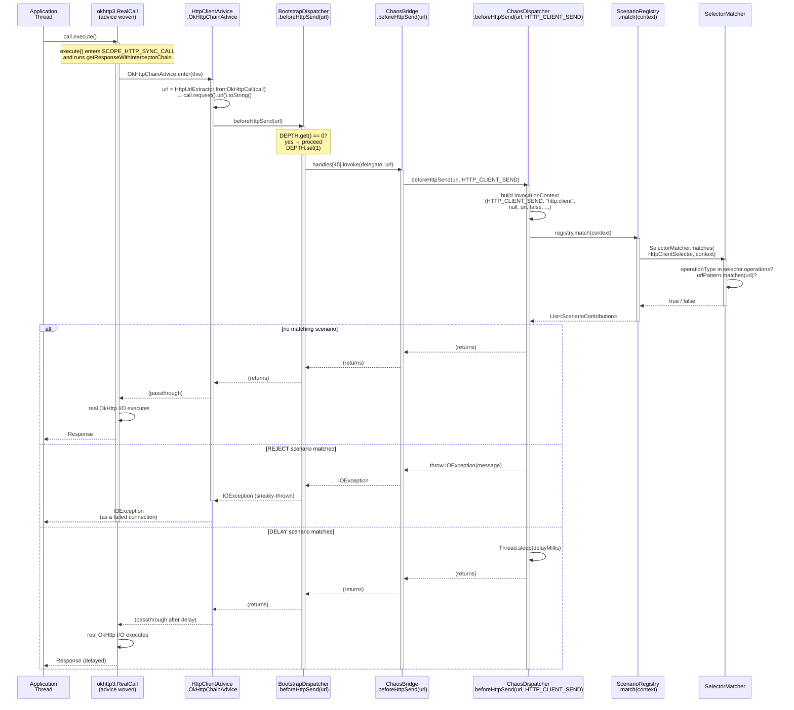
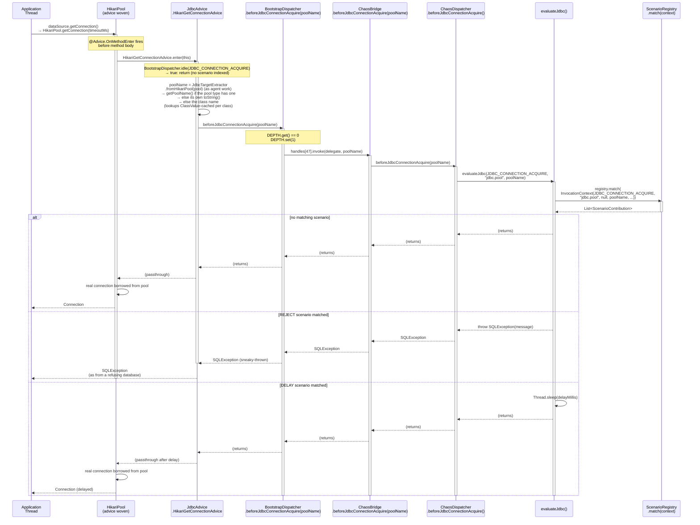

<!--
━━━━━━━━━━━━━━━━━━━━━━━━━━━━━━━━━━━━━━━━━━━━━━━━━━━━━━━━━━━━━
  Engineered by  Christian Schnapka
                 Embedded Principal+ Engineer
                 Macstab GmbH · Hamburg, Germany
                 https://macstab.com
━━━━━━━━━━━━━━━━━━━━━━━━━━━━━━━━━━━━━━━━━━━━━━━━━━━━━━━━━━━━━
-->

# chaos-agent-instrumentation-jdk — Instrumentation Layer Reference

> Internal reference for the bootstrap bridge, ByteBuddy advice classes, reentrancy guard, and the 78-handle interception surface.
> 
> *Engineered by* **[Christian Schnapka](https://macstab.com)** — Embedded Principal+ Engineer · [Macstab GmbH](https://macstab.com) · Hamburg, Germany

---

# 1. Overview

## Purpose

`chaos-agent-instrumentation-jdk` is the adapter between ByteBuddy's advice model and `ChaosRuntime`'s normalized dispatch API. Its responsibilities:

1. Package `BootstrapDispatcher` into a temp JAR and append it to the bootstrap classpath
2. Build a 78-slot `MethodHandle[]` array and wire it into `BootstrapDispatcher` via reflection
3. Register a `HookDemand` callback on the runtime and weave each hook group (one `AgentBuilder` installation per `HookGroup`) the first time a scenario needs one of its operations — or every group at once in `eager` mode

Apart from weaving hook groups on demand, this module has no further runtime role. All runtime execution paths go through `BootstrapDispatcher` → `ChaosBridge` → `ChaosRuntime`.

## Scope

In scope:
- `JdkInstrumentationInstaller` — entry point; orchestrates all startup steps
- `BootstrapDispatcher` — bootstrap-classloader-resident static dispatcher (78 handle slots + reentrancy guard and call-depth scopes)
- `ChannelBuffers` — bootstrap-resident shaping of a channel call's buffers (single, scattering, gathering): limits for torn and trickled calls, the bit flip of a corrupted read
- `BridgeDelegate` — interface defining the 78-method contract, one method per handle slot
- `ChaosBridge` — agent-classloader implementation of `BridgeDelegate`; thin delegation to `ChaosRuntime`
- All `@Advice` classes, grouped into `JdkInstrumentationInstaller.HookGroup`s
- `ScheduledCallableWrapper`, `ScheduledRunnableWrapper` — task wrappers for tick-level interception

Out of scope:
- Scenario policy evaluation (that is `chaos-agent-core`)
- Config loading (`chaos-agent-startup-config`)

## Non-Goals

- Removing the bootstrap bridge: `JdkInstrumentationInstaller.uninstall(Instrumentation)` resets the ByteBuddy transformations (retransforming the woven classes back) and clears the bridge delegate, and a failed `install()` is rolled back the same way, but the bridge classes already appended to the bootstrap class path stay there for the JVM lifetime (`appendToBootstrapClassLoaderSearch` has no inverse)
- Intercepting non-JDK code paths
- Arbitrary user-defined instrumentation points

---

# 2. Architectural Context

**Dependencies**:
- ByteBuddy (`net.bytebuddy`) for advice weaving and class transformation
- `chaos-agent-core` for `ChaosRuntime`, `OperationType`
- `chaos-agent-api` for `ChaosSelector`, `ChaosEffect`

**Called by**: `chaos-agent-bootstrap` during agent startup; specifically `ChaosAgentBootstrap` calls `JdkInstrumentationInstaller.install()`.

**The classloader problem**: JDK classes are loaded by the bootstrap classloader. Advice woven into JDK methods executes in whatever classloader loaded the JDK class — the bootstrap classloader, which cannot see agent-classloader classes by name. The bootstrap bridge solves this by placing `BootstrapDispatcher` in the bootstrap classpath so JDK-loaded advice can call it as a static method, then routing to agent-classloader code via `MethodHandle`.

## Module access strategy

The agent reflects into and instruments classes in non-exported JDK internal packages. Rather than asking users to add `--add-opens` JVM flags, the agent self-grants every required open at install time. Two mechanisms combined cover all attach paths:

| Attach path                                                                     | Mechanism                                            | Where                                                                                              |
|---------------------------------------------------------------------------------|------------------------------------------------------|----------------------------------------------------------------------------------------------------|
| `-javaagent:` (premain at JVM startup)                                          | `Add-Opens` attribute in agent JAR `MANIFEST.MF`     | `chaos-agent-bootstrap/build.gradle.kts`                                                           |
| `agentmain` / dynamic attach / `ByteBuddyAgent.install()` (runtime self-attach) | `Instrumentation.redefineModule(module, …, opens=…)` | `ModuleOpener#grantInternalModuleOpens`, called as the first step of `install(...)` |

Both mechanisms grant the same set of opens. The manifest opens to every unnamed module (`=ALL-UNNAMED`); `redefineModule` opens to each module agent code runs in: the unnamed module of the system class loader (the agent jar on the class path), the agent's own module (the agent classes in a class loader of their own, as in a fat jar that self-attaches) and the unnamed module of the bootstrap class loader (the bridge; the opens follow its injection).

| Module / package                      | Why the agent needs it                                                                        |
|---------------------------------------|-----------------------------------------------------------------------------------------------|
| `java.net.http/jdk.internal.net.http` | Transform `HttpClientImpl.send(...)` / `sendAsync(...)` for `HTTP_CLIENT_SEND[_ASYNC]` chaos. |
| `java.base/jdk.internal.misc`         | Named reflectively by the shaded ByteBuddy (`ClassInjector.UsingUnsafe`).                     |
| `java.base/sun.nio.ch`                | `DirectBuffer.cleaner()` reflection (`DirectBufferPressureStressor`).                         |
| `java.base/jdk.internal.ref`          | Modern `Cleaner` mechanism (Java 9+ replacement for `sun.misc.Cleaner`).                      |
| `java.base/java.util.concurrent`      | `DelayScheduler$ScheduledForkJoinTask.runnable` (JDK 25), read by `ExecutorDispatch`.         |

While the agent is attached, these packages are open to class-path code as well (the system class loader's unnamed module; with `-javaagent:`, every unnamed module): its `setAccessible` on their non-public members, the `java.util.concurrent` internals among them, succeeds where it would otherwise throw `InaccessibleObjectException`.

When an open is refused (a JVM that denies `redefineModule`), `DirectBufferPressureStressor` logs one WARNING and a stopped stressor's memory is freed by a later GC only.

**Adding a new internal**: when a new feature requires access to another non-exported package, add it to **both** the manifest in `chaos-agent-bootstrap/build.gradle.kts` and the list inside `ModuleOpener#grantInternalModuleOpens`. Same pattern applies if a new advice class references additional helper types: those types must be injected into the bootstrap classloader from `injectBridge(...)` (see `HttpUrlExtractor`, `JdbcTargetExtractor` and `ClientCallExtractor` for prior art).

**Advice rules** (checked by `ArchitectureTest`): advice is inlined into classes of any loader, so
- every agent type an `*Advice` class references is listed in `BridgeInjector.BRIDGE_CLASSES`, and the bridge references no agent class outside the list. A library defined by a loader that cannot see the agent's (one whose parent is the platform loader) resolves those types through the bootstrap class path; any other agent type is a `NoClassDefFoundError` in application code;
- advice accesses only public members of public agent classes (it runs in other packages);
- advice holds no `invokedynamic`: no `+` on strings (use `"…".concat(String.valueOf(x))`), no lambdas or method references. Drivers, pools and clients compiled for Java 6 (class file version 50) do not allow it. Bridge classes are not inlined and may use both.

---

# 3. Key Concepts and Terminology

| Term                      | Definition                                                                                                                                                                                                                                               |
|---------------------------|----------------------------------------------------------------------------------------------------------------------------------------------------------------------------------------------------------------------------------------------------------|
| **Bootstrap classloader** | The JVM root classloader; loads `java.*`, `javax.*`. Has no parent. Can only see classes from `rt.jar`/`java.base` and explicitly appended JARs.                                                                                                         |
| **Agent classloader**     | The classloader created for the agent JAR. Has the bootstrap classloader as parent (indirect). Can see all agent classes.                                                                                                                                |
| **Advice class**          | A ByteBuddy concept: a class containing `@Advice.OnMethodEnter` and/or `@Advice.OnMethodExit` static methods, whose bytecode is inlined into the instrumented method. Not a real class instantiation at runtime — the advice body is copied as bytecode. |
| **BootstrapDispatcher**   | A class that must be visible to the bootstrap classloader. Provides the static dispatch methods advice calls, served by 78 handle slots, and the scope helpers.                                                                                         |
| **BridgeDelegate**        | Interface in the agent classloader defining the 78-method contract (one method per slot). Implemented by `ChaosBridge`.                                                                                                                                  |
| **MethodHandle**          | A typed reference to a method, invokable across classloader boundaries. Built from the agent classloader; stored in `BootstrapDispatcher.handles[]`.                                                                                                     |
| **DEPTH guard**           | `ThreadLocal<int[]>` in `BootstrapDispatcher`. Prevents infinite recursion when chaos code calls instrumented JDK methods.                                                                                                                               |
| **Hook group**            | A `JdkInstrumentationInstaller.HookGroup`: related interception points (e.g. `SOCKET`, `JDBC`) tagged with the `OperationType`s they serve. Woven once, on the first activation needing them (or at start when eager); stays woven until uninstall.      |
| **HookDemand**            | Callback (`chaos-agent-core`) registered on the runtime by the installer. The control plane calls `require(operations)` before a scenario starts or a session opens; the installer weaves the groups not yet woven.                                      |
| **Retransformation**      | Replacing the bytecode of an already-loaded class. Requires `Can-Retransform-Classes: true` in the agent manifest. Used for every hook group in every attach mode (`-javaagent:`, dynamic attach, self-attach).                                          |

---

# 4. End-to-End Behavior

## Agent Startup Sequence

```
JdkInstrumentationInstaller.install(instrumentation, runtime, eager)
  ↓
0. ModuleOpener.grantInternalModuleOpens(instrumentation)   — see Module access strategy

1. BridgeInjector.injectBridge(instrumentation)   (once per JVM)
   — Read BootstrapDispatcher.class bytes from agent JAR resources
   — Read the types woven advice references (ScheduledRunnableWrapper,
     ScheduledCallableWrapper, API exceptions, helper types)
   — Write them into a temp JAR at java.io.tmpdir (0600 on POSIX)
   — instrumentation.appendToBootstrapClassLoaderSearch(new JarFile(tempJar))
   — On POSIX the file is unlinked right away (the open JarFile keeps it readable);
     Windows cannot delete an open file, so there it stays until a later start
     sweeps the stale jars of earlier JVMs
   → BootstrapDispatcher is now visible to bootstrap classloader

1b. rejectForeignDelegate()
   — If the JVM-wide dispatcher already carries a delegate from a copy of the agent
     loaded by a different class loader, install() fails with IllegalStateException:
     only one copy of the agent can be active per JVM

2. installDelegate(new ChaosBridge(runtime))
   — buildMethodHandles(): 78 MethodHandle[] via MethodHandles.publicLookup() against BridgeDelegate
   — Class.forName("...BootstrapDispatcher", true, null)  // null CL = bootstrap CL
   — bootstrapDispatcherClass.getMethod("install", Object.class, MethodHandle[].class)
                              .invoke(null, bridgeDelegate, mh)
   → handles written before delegate (two-field safe publication)

3. runtime.setHookDemand(...)
   — registers the HookDemand callback: require(operations) → weave(instrumentation, operations)
   — eager == true: weave every hook group now (the 1.x behaviour)
   — eager == false (default): nothing is woven yet; JDK classes stay unmodified
   — If this step throws, uninstall() resets woven groups and clears the delegate

Later, on scenario activation / session open:
ChaosControlPlane → HookDemand.require(SelectorOperations.of(selector))
  ↓
4. weave(instrumentation, operations)   (serialised; each group at most once)
   — for every HookGroup serving one of the operations and not yet woven:
       group.apply(baseAgentBuilder).installOn(instrumentation)
       → its own ResettableClassFileTransformer, kept until uninstall()
   — RETRANSFORMATION strategy: retransforms already-loaded JDK classes
   — disableClassFormatChanges(): no structural changes; only adds advice bytecode inline
   — Error listener: logs warnings on per-class transformation failure; does not abort
   — Redefinition listener ErrorEscalating.FAIL_FAST: a class the JVM refuses to retransform
     makes installOn() remove the group's transformer and throw
   — If installOn() throws, the group is not recorded as woven (the next activation that
     needs it tries again), the failure is listed under hookFailures as `GROUP: error`, and
     the activation fails with ChaosInstrumentationException (failure category
     INSTRUMENTATION_FAILURE); for a startup plan this aborts premain, after the status file
     is written
   — then the classes that escape an installation (POST_INSTALL_RETRANSFORM_TARGETS) are
     loaded (not initialized) and retransformed in one call, each on its own if that call
     fails
   — the agent's own work (semantics L3): weave(), the method weaving and every reset run
     inside beginInternalCall / endInternalCall, and the base builder's TransformerDecorator
     (AGENT_WORK) brackets each transform() call the same way, also when an application
     thread loads a class; ByteBuddy's own reflection is then no REFLECTION_INVOKE target
```

## Per-Call Dispatch (hot path)

```
Instrumented method fires @Advice.OnMethodEnter
  ↓
Advice calls BootstrapDispatcher.someDispatchMethod(...)  [static call, visible from bootstrap CL]
  ↓
BootstrapDispatcher.someDispatchMethod(...)   (guard inlined in every method):
  int[] depth = DEPTH.get()
  if (depth[0] > 0):
    return fallback    // reentrancy: return safe default immediately
  depth[0]++
  try:
    snapshot: MethodHandle[] h = handles; Object d = delegate;
    if (d == null || h == null): return fallback   // not yet installed
    return h[SLOT_INDEX].invoke(d, ...args...)     // ChaosBridge.method(args)
      → ChaosRuntime.method(args)
  catch Throwable t:
    sneakyThrow(t)         // rethrow without checked-exception wrapping
    return fallback        // unreachable, but satisfies compiler
  finally:
    depth[0]--    // int[] kept for the thread's lifetime: it also holds the
                  // call-depth scope counters of enclosing instrumented calls
```

## ThreadLocal Reentrancy Special Case

`ThreadLocal.get()` and `ThreadLocal.set()` are globally instrumented once the `THREAD_LOCAL` hook group is woven. The DEPTH guard itself uses `DEPTH.get()`, which is a `ThreadLocal.get()` call. Without a special check, this would create infinite recursion: `ThreadLocal.get()` → advice → `BootstrapDispatcher.beforeThreadLocalGet()` → `DEPTH.get()` → `ThreadLocal.get()` → ...

The special case in `ThreadLocalGetAdvice` and `ThreadLocalSetAdvice`:
```java
if (BootstrapDispatcher.isDepthThreadLocal(threadLocal)) {
    return false;
}
```

This identity check fires before any delegation. When `DEPTH` reads itself, the advice detects `threadLocal == DEPTH` and skips the dispatch, returning `false` (no suppression). These two advices are the only callers of `BootstrapDispatcher.isDepthThreadLocal(Object)`.

---

# 5. Architecture Diagrams

## Bootstrap Bridge Architecture

```mermaid
flowchart TB
  subgraph g1["Bootstrap ClassLoader"]
    JDK["JDK classes<br/>(java.lang.Thread,<br/>java.net.Socket, etc.)"]
    BD["BootstrapDispatcher<br/>(injected via temp JAR)<br/><br/>volatile Object delegate<br/>volatile MethodHandle[] handles<br/>ThreadLocal<int[]> DEPTH"]
  end
  subgraph g2["Agent ClassLoader"]
    CB["ChaosBridge<br/>implements BridgeDelegate"]
    CR["ChaosRuntime"]
  end
  JDK -->|""@Advice static call<br/>(Bootstrap-visible)""| BD
  BD -->|""handles[N].invoke(delegate, args)<br/>(MethodHandle cross-CL call)""| CB
  CB -->|""direct method call<br/>(same classloader)""| CR
  note3["Two-field safe publication:<br/>handles written BEFORE delegate.<br/>null-check on both before dispatch."]
  note3 -.- BD
```

**Takeaway**: The only crossing of the classloader boundary is via `MethodHandle.invoke()`. No class cast is performed across classloaders. Type erasure (`Object` typed parameters) absorbs the type mismatch.

## Interception Map

The interception points belong to 41 hook groups (`JdkInstrumentationInstaller.HookGroup`), each woven the first time a scenario needs one of its operations (or at start with `instrumentation=eager`), plus the method hooks of `MethodSelector`s (`METHODS` in `wovenHookGroups`). The methods each group weaves are in the slot table (§7); the client libraries in §12 and §13 and in [configuration-reference.md §13.3](configuration-reference.md#133-selector-reference).

| Hook group | Operations |
|------------|------------|
| `THREAD_START` | `THREAD_START`, `VIRTUAL_THREAD_START` |
| `THREAD_SLEEP` | `THREAD_SLEEP` |
| `THREAD_POOL_EXECUTOR` | `EXECUTOR_SUBMIT`, `EXECUTOR_WORKER_RUN`, `EXECUTOR_SHUTDOWN`, `EXECUTOR_AWAIT_TERMINATION` |
| `EXECUTOR_SUBMIT` | `EXECUTOR_SUBMIT`, `SCHEDULE_SUBMIT` (`ScheduledThreadPoolExecutor` and `ThreadPerTaskExecutor` `execute` / `submit`) |
| `SCHEDULED_EXECUTOR` | `SCHEDULE_SUBMIT`, `SCHEDULE_TICK` |
| `FORK_JOIN` | `FORK_JOIN_TASK_RUN` |
| `BLOCKING_QUEUE` | `QUEUE_PUT`, `QUEUE_OFFER`, `QUEUE_TAKE`, `QUEUE_POLL` |
| `COMPLETABLE_FUTURE` | `ASYNC_COMPLETE`, `ASYNC_COMPLETE_EXCEPTIONALLY` |
| `COMPLETABLE_FUTURE_CANCEL` | `ASYNC_CANCEL` |
| `SHUTDOWN_HOOK` | `SHUTDOWN_HOOK_REGISTER` |
| `CLASS_LOADER` | `CLASS_LOAD`, `RESOURCE_LOAD` |
| `CLASS_DEFINE` | `CLASS_DEFINE` |
| `JDK_INTERNAL_CLASS_LOAD` | the `FILE_IO_*` and `ZIP_*` operations: the `SCOPE_JDK_INTERNAL` bracket of class loading (§6) |
| `RUNTIME_LIFECYCLE` | `SYSTEM_GC_REQUEST` (`System.gc()`), `SYSTEM_EXIT_REQUEST` (`Runtime.exit`, `Runtime.halt`) |
| `REFLECTION_INVOKE` | `REFLECTION_INVOKE` |
| `DIRECT_BUFFER` | `DIRECT_BUFFER_ALLOCATE` |
| `SERIALIZATION` | `OBJECT_SERIALIZE`, `OBJECT_DESERIALIZE` |
| `THREAD_PARK` | `THREAD_PARK` |
| `MONITOR_ENTER` | `MONITOR_ENTER` (`AbstractQueuedSynchronizer.acquire(int)`) |
| `NIO` | `NIO_SELECTOR_SELECT`, `NIO_CHANNEL_READ`, `NIO_CHANNEL_WRITE`, `NIO_CHANNEL_CONNECT`, `NIO_CHANNEL_ACCEPT` |
| `SOCKET` | `SOCKET_CONNECT`, `SOCKET_ACCEPT`, `SOCKET_READ`, `SOCKET_WRITE`, `SOCKET_CLOSE`, `SOCKET_BIND`, `SOCKET_SHUTDOWN` (`Socket`, `ServerSocket`, `sun.nio.ch.NioSocketImpl` reads and writes) |
| `SOCKET_CHANNEL` | `SOCKET_CONNECT`, `SOCKET_ACCEPT`, `SOCKET_READ`, `SOCKET_WRITE`, `SOCKET_CLOSE`, `SOCKET_SHUTDOWN` (`SocketChannel`, `ServerSocketChannel`) |
| `DATAGRAM` | `DATAGRAM_SEND`, `DATAGRAM_RECEIVE` |
| `SSL_HANDSHAKE` | `SSL_HANDSHAKE` |
| `DNS` | `DNS_RESOLVE`, `DNS_ANSWER`, `DNS_REVERSE` |
| `ZIP` | `ZIP_INFLATE`, `ZIP_DEFLATE` |
| `THREAD_LOCAL` | `THREAD_LOCAL_GET`, `THREAD_LOCAL_SET` |
| `TIME_API` | `INSTANT_NOW`, `CLOCK_READ`, `LOCAL_DATE_TIME_NOW`, `ZONED_DATE_TIME_NOW`, `DATE_NEW` |
| `CLOCK_CALL_SITES` | `SYSTEM_CLOCK_MILLIS`, `SYSTEM_CLOCK_NANOS` (call sites in the `clockCallSites` packages) |
| `JNDI_JMX` | `JNDI_LOOKUP`, `JMX_INVOKE`, `JMX_GET_ATTR` |
| `NATIVE_LIBRARY` | `NATIVE_LIBRARY_LOAD` |
| `PROCESS` | `PROCESS_START`, `PROCESS_WAIT` |
| `FILE_IO` | the ten `FILE_IO_*` operations |
| `HTTP_CLIENT` | `HTTP_CLIENT_SEND`, `HTTP_CLIENT_SEND_ASYNC` (JDK `HttpClient`, `HttpURLConnection`, OkHttp, Apache HttpClient 4/5, Reactor Netty) |
| `JDBC` | `JDBC_CONNECTION_ACQUIRE`, `JDBC_STATEMENT_EXECUTE`, `JDBC_PREPARED_STATEMENT`, `JDBC_TRANSACTION_COMMIT`, `JDBC_TRANSACTION_ROLLBACK` |
| `R2DBC` | `R2DBC_STATEMENT_EXECUTE` |
| `KAFKA` | `MESSAGE_SEND`, `MESSAGE_RECEIVE` |
| `GRPC` | `RPC_CALL` |
| `REDIS` | `REDIS_COMMAND` |
| `AWS_SDK` | `AWS_SDK_CALL` |
| `NETTY` | `NETTY_CHANNEL_WRITE`, `NETTY_CHANNEL_READ` |

Opening a session weaves the groups that carry the session to other threads (`EXECUTOR_SUBMIT`, `SCHEDULE_SUBMIT`, `THREAD_START`, `FORK_JOIN_TASK_RUN` and `HTTP_CLIENT_SEND`).

---

# 6. Component Breakdown

## JdkInstrumentationInstaller

**Responsibility**: Setup of the instrumentation stack. `install()` is called once per JVM from a single thread (serialised by the bootstrap); it injects the bridge, installs the delegate and registers the `HookDemand` callback. `weave()` then installs one `AgentBuilder` per `HookGroup` on demand and retains each group's `ResettableClassFileTransformer`, so that `uninstall(Instrumentation)` can reset every woven group and clear the bridge delegate — used by the bootstrap to roll back a failed initialization. `uninstall` runs every step even when one fails, resets the hook coverage, and then throws the first failure (a class the JVM refused to retransform back keeps its advice) with the others suppressed. The woven groups are reported in `ChaosDiagnostics.snapshot().runtimeDetails()` under `wovenHookGroups` (comma-separated, sorted group names; empty when none).

**Hook coverage.** Every advice is applied through `advise(advice, methods)`, which wraps the method matcher in a recording one (`HookCoverage`). A hook is *registered* when it is woven into a type and *matched* once it matches a method of any type it is woven into — per hook, not per type, because a hook on the subtypes of a JDK type reaches subtypes that inherit the method. A registered hook that never matched is inactive: the JDK or library changed the method's name or signature (as JDK 25 did to `InetAddress.getHostFromNameService`). Such hooks are listed under `unmatchedHooks`, failed transformations under `hookFailures`. A class whose supertype cannot be resolved (it extends a type of an optional dependency that is absent, as Netty's Log4j 2 logger without Log4j 2) is no target of the matchers that walk the hierarchy (`TypeMatchers`): it cannot be loaded anyway, so it is neither listed nor logged. `HookCoverageIntegrationTest` weaves every group in a child JVM, loads every class a hook targets (JDK and client libraries) and requires every advice class to match, on each JDK the build tests.

**`injectBridge()`**: Reads class bytecode from the agent JAR's own classloader resources (the `.class` files are in the same JAR, under `META-INF/macstab-chaos-bridge/`; the thin `chaos-agent-instrumentation-jdk` classes under their class names). Writes verbatim into a temp JAR. Nothing is appended when the bootstrap class loader already resolves `BootstrapDispatcher` (another agent copy injected it, or `-Xbootclasspath/a`); the install then goes on only when that bridge is claimed by this copy's revision (`BootstrapDispatcher.claimRevision`, a digest of the bridge class bytes, set-once by the copy that appended the jar), see `bootstrap.md` "One agent version per JVM". This ensures the bootstrap-injected class is byte-for-byte identical to the agent-classloader version — there is no separate bootstrap-dispatcher source; it is one class compiled once and loaded twice into different classloaders.

**One copy of the bridge**: only the bootstrap copy of `BootstrapDispatcher` carries the delegate, and advice woven into a class links against whatever copy that class's loader resolves. The agent JAR therefore keeps the bridge classes under `META-INF/macstab-chaos-bridge/` (`chaos-agent-bootstrap/build.gradle.kts`), so a child-first loader over it (`WEB-INF/lib`) finds no copy of its own and resolves the bootstrap one through its parents. `BridgeVisibility` guards the rest: on a class loader's first sight in the type matcher (an ignore rule of every hook group and of method weaving) it asks `loader.getResource(".../bridge/BootstrapDispatcher.class")`, as an internal call and outside its cache lock, and never loads a class. No class file, or the one the agent's own loader sees, means the loader resolves the bootstrap copy: its classes are woven (a bridge appended at run time is invisible to `getResource`). Any other class file is a copy of its own (a thin jar bundled in the application): its classes are not woven, and the loader is named once in `hookFailures`. A loader that delegates the bridge package nowhere and holds no copy cannot be detected that way; delegate `com.macstab.chaos.jvm.instrumentation` to the boot path there (JBoss Modules `jboss.modules.system.pkgs`, OSGi `org.osgi.framework.bootdelegation`).

**`buildMethodHandles()`**: Uses `MethodHandles.publicLookup()` against `BridgeDelegate.class`. Public lookup is required because the bootstrap classloader must be able to invoke the handles; a full-access lookup with the agent classloader's module system would not be reachable from the bootstrap context. Each handle is a virtual method handle; when invoked with `delegate` as the first argument, it dispatches to the `ChaosBridge` implementation. The array has `HANDLE_COUNT` (78) slots; see §7 for the full slot table.

The wiring is derived, not written per slot: each `public static final int` slot constant `FOO_BAR` on `BootstrapDispatcher` (other than `SCOPE_*` and `HANDLE_COUNT`) is served by the `BridgeDelegate` method `fooBar`. Adding a dispatch entry point is therefore a constant, a delegate method and its `ChaosBridge` implementation; `buildMethodHandles()` checks the table in full and fails the install naming the mismatch — a slot without a method, a method without a slot, an index used twice or left unset, an overloaded delegate method.

**`installDelegate()`**: Uses `Class.forName("...BootstrapDispatcher", true, null)` — the `null` classloader argument requests loading from the bootstrap classloader, ensuring the instance obtained is the bootstrap-classloader version, not the agent-classloader version. Reflective invocation of `install()` crosses the classloader boundary without sharing type references.

**`instrumentOptional()`**: Classes that may be absent from an application or a JDK (OkHttp, Reactor Netty, HikariCP, c3p0, `javax.naming.InitialContext`, the native-library loader) are matched by name only (`ElementMatchers.namedOneOf`). ByteBuddy evaluates the matcher whenever a class is defined, by any class loader, so a library an application class loader loads later (Spring Boot's fat-jar launcher, which does not exist yet when `premain` runs) is still woven, and an absent library costs one string comparison per class definition. The class is not probed with `Class.forName` at install time: under `premain` in a fat jar such a probe would always fail. The advice uses only `Object`-typed parameters and reflection, so the libraries are not needed on the agent's class path.

**`AgentBuilder` configuration**:
- `disableClassFormatChanges()`: prevents ByteBuddy from adding fields or changing the constant pool structure — required for retransformation
- `RedefinitionStrategy.RETRANSFORMATION`: allows transforming already-loaded classes; required for JDK classes that are already loaded when a hook group is woven
- `ignore(nameStartsWith("net.bytebuddy.") or nameStartsWith("com.macstab.chaos.jvm."))`: prevents self-instrumentation of the agent, its relocated ByteBuddy (under `com.macstab.chaos.jvm.shaded`) and an application's own ByteBuddy. The `net.bytebuddy.` prefix is built at run time (`String.join`), because the agent jar relocates every `"net.bytebuddy..."` string literal along with the classes.

**ByteBuddy's `net.bytebuddy.experimental` switch**: the relocated ByteBuddy in the agent jar reads `com.macstab.chaos.jvm.shaded.net.bytebuddy.experimental`. Every entry point (`premain`, `agentmain`, `installForLocalTests` and so `ChaosPlatform.installLocally()`) first copies `-Dnet.bytebuddy.experimental` to that name, before any ByteBuddy class initialises (ByteBuddy reads the switch in static initialisers), unless the relocated name is already set.

## BootstrapDispatcher

The public static dispatch methods advice calls (one or more per handle slot; overloads share a slot) each guard reentrancy inline:
1. Returns the fallback when `DEPTH[0] > 0`; otherwise increments `DEPTH[0]`
2. Snapshot-reads `handles` and `delegate` into locals and invokes the slot's handle (fallback when not installed)
3. Returns the result or rethrows the exception via `sneakyThrow`; decrements `DEPTH[0]` in `finally`

There is no shared `invoke(supplier, fallback)` trampoline: its single call site saw every dispatch lambda, so the JIT could not elide them and every intercepted call allocated a 24-byte capturing lambda. With the guard inlined, the dispatch path allocates nothing per call.

The snapshot-read pattern (`final MethodHandle[] h = handles; final Object d = delegate;`) is required because `handles` and `delegate` are separate `volatile` fields. Reading them in two separate reads could theoretically see a stale value for one but not the other if reads were not ordered. The safe publication protocol (handles written before delegate) guarantees that if `d != null` is observed, `h != null` is also guaranteed to be visible. The local snapshot prevents a second read from seeing a reset (`uninstall()` calls `install(null, null)`).

**DEPTH lifetime**: `DEPTH` holds an `int[SCOPE_COUNT]` (32): index 0 is the reentrancy depth, indexes 1–31 are the call-depth scope counters (`SCOPE_DNS` = 1 … `SCOPE_EXECUTOR_SUBMIT` = 31). The array is not removed when the depth returns to 0, because it also carries the scope counters of enclosing instrumented calls; its footprint is one small `int[]` per thread that reaches an instrumented call, released with the thread. The decrement runs in the `finally` block, so it runs even if the handle throws.

**Call-depth scopes**: many instrumented methods call another instrumented method for the same logical operation (`InetAddress.getByName` → `getAllByName`, a pool proxy statement → the driver statement, `sendAsync(2-arg)` → `sendAsync(3-arg)`, `Thread.sleep` overloads, `VirtualThread.start()` → `start(container)`, class-loader parent delegation, explicit → implicit TLS handshake). Advice for these operations brackets the method with `enterScope(SCOPE_*)` / `exitScope(SCOPE_*)`; only the outermost call on the thread dispatches. A nested or delegating call is therefore evaluated once: delays do not add up, probability is rolled once and `maxApplications` is consumed once. Scopes exist for DNS, zip inflate/deflate, JMX, queues, class load/define, resource lookup, thread park, JDBC prepare/execute/commit/rollback, HTTP, TLS handshake, thread start and thread sleep, client libraries, pool-worker creation, `java.time` `now()` methods with an operation of their own (their system-clock read is not a `CLOCK_READ`), file transfers and compound `java.io` reads (`SCOPE_FILE_TRANSFER`), file closes, datagram sends, file opens through a file system provider (`SCOPE_FILE_OPEN`: `newByteChannel` opens through `newFileChannel` on JDK 24+) serialization (`SCOPE_SERIALIZATION`: the nested `writeObject` / `readObject` of a class's own serialization methods) a Jedis connection's set-up and pool validation (`SCOPE_REDIS_SETUP`, scope-only: `JedisSendCommand` skips the commands sent inside it) and a Kafka send (`SCOPE_MESSAGE_SEND`, scope-only: the producer's metadata wait is evaluated only inside it), an OkHttp synchronous call (`SCOPE_HTTP_SYNC_CALL`, scope-only), a JDBC driver's or HikariCP's own work (`SCOPE_JDBC_INTERNAL`, scope-only: `Connection.isValid` and HikariCP's validation, set-up, reset and dirty rollback; the JDBC advice skips the calls inside it, semantics L3a), an STPE or virtual-thread-per-task executor `execute` / `submit` (`SCOPE_EXECUTOR_SUBMIT`: one `EXECUTOR_SUBMIT`, and the `schedule` advice inside it skips its `SCHEDULE_SUBMIT` evaluation, checked with `inScope`, but still wraps the task for `SCHEDULE_TICK`) and the JDK's own use of a general primitive (`SCOPE_JDK_INTERNAL`, scope-only, semantics L3a: inside it the file, ZIP, direct-buffer, GC-request and `SCHEDULE_SUBMIT` dispatch returns its fallback).

| `SCOPE_JDK_INTERNAL` bracket                                                   | Hook group                                  | Hides                                  |
|--------------------------------------------------------------------------------|---------------------------------------------|----------------------------------------|
| `ClassLoader.loadClass(String[, boolean])`                                     | `JDK_INTERNAL_CLASS_LOAD` (with FILE_IO, ZIP) | `FILE_IO_*`, `ZIP_*` of class loading |
| `sun.nio.ch.Util.getTemporaryDirectBuffer` / `getTemporaryAlignedDirectBuffer` | `DIRECT_BUFFER`                             | `DIRECT_BUFFER_ALLOCATE` (JDK 21)      |
| `java.nio.Bits.reserveMemory`, `sun.nio.ch.FileChannelImpl.mapInternal`        | `RUNTIME_LIFECYCLE`                         | `SYSTEM_GC_REQUEST`                    |
| `CompletableFuture$Delayer.delay` of a `$Timeout` / `$DelayedCompleter` (JDK 21) | `SCHEDULED_EXECUTOR`                      | `SCHEDULE_SUBMIT`                      |

A scope counter can also carry a **one-shot consumable marker**: `SCOPE_JDK_COMPLETION` is set when `CompletableFuture$Timeout.run` (and `$DelayedCompleter.run` on JDK 21) starts, consumed by the first completion through `BootstrapDispatcher.consumeScope(int)` (that completion is not evaluated), and always cleared by the timer's exit advice (`onThrowable`), so a timer whose future is already done leaves nothing behind for the next completion on its thread. Advice that only asks whether it runs inside a scope uses `BootstrapDispatcher.inScope(int)`, which reads the counter without entering the scope (a public static, not a handle slot). Advice that reads its target reflectively (a Kafka subscription, a gRPC method, a Redis command, an AWS operation, a Netty peer, an OkHttp or Apache URL, a Hikari pool name) first asks `BootstrapDispatcher.idle(String)` (slot `IDLE`) whether a scenario is indexed for its operation, and returns before reading anything when none is; `idle` is also `true` without an agent and inside the agent, and maps `SCHEDULE_SUBMIT_PERIODIC` to `SCHEDULE_SUBMIT`. Scoped advice enters its scope first, so the exit advice stays balanced. `advise()` never applies a hook to a bridge method (`not(isBridge())`); the bridged method itself is hooked.

## ChaosBridge

Thin delegation layer. Every method is a one-line call to the corresponding `ChaosRuntime` method. No logic. Exists to:
1. Provide a concrete implementation of `BridgeDelegate` in the agent classloader
2. Decouple `BootstrapDispatcher` from the `ChaosRuntime` class directly (the bridge interface is the stable contract)

## Advice Classes

Each advice class is a static inner class following ByteBuddy's advice pattern:

```java
// Argument-rewriting dispatch (ExecutorAdvice.ExecuteAdvice, ThreadPoolExecutor.execute):
static final class ExecuteAdvice {
    @Advice.OnMethodEnter
    static void enter(
            @Advice.This final Object executor,
            @Advice.Argument(value = 0, readOnly = false) Runnable task)
            throws Throwable {
        task = BootstrapDispatcher.decorateExecutorRunnable(
            OperationTags.EXECUTOR_SUBMIT, executor, task);   // the task, wrapped or replaced
    }
}

// Scoped dispatch (QueueAdvice.PutAdvice): only the outermost queue call is evaluated
static final class PutAdvice {
    @Advice.OnMethodEnter
    static void enter(@Advice.This final Object queue) throws Throwable {
        if (BootstrapDispatcher.enterScope(BootstrapDispatcher.SCOPE_QUEUE)) {
            try {
                BootstrapDispatcher.beforeQueueOperation(OperationTags.QUEUE_PUT, queue);
            } catch (final Throwable throwable) {
                BootstrapDispatcher.exitScope(BootstrapDispatcher.SCOPE_QUEUE);
                throw throwable;
            }
        }
    }

    @Advice.OnMethodExit(onThrowable = Throwable.class)
    static void exit() {
        BootstrapDispatcher.exitScope(BootstrapDispatcher.SCOPE_QUEUE);
    }
}
```

**No `suppress = Throwable.class`**: no advice uses it. A throwable from the dispatch is the injected failure (a reject, an `errno`, an exception injection) and must reach the caller; ByteBuddy's `suppress` would swallow it, so the fault would silently not happen. Scoped advice leaves its scope again before rethrowing, as above.

**Return-value rewriting advice** (e.g., `SystemClockMillisAdvice`): Uses `@Advice.OnMethodExit` with `@Advice.Return(readOnly = false)` to overwrite the return value. `System.currentTimeMillis()` / `nanoTime()` themselves cannot be woven (§14 Known Limitations, item 1); calls to them in the packages named by `clockCallSites` are rewritten to `BootstrapDispatcher.currentTimeMillis()` / `nanoTime()` with `MemberSubstitution` instead.

**Skip-on advice** (e.g., `GcRequestAdvice`, `NioSelectNoArgAdvice`): Uses `@Advice.OnMethodEnter(skipOn = Advice.OnNonDefaultValue.class)` — if the advice method returns a non-default value (non-zero, non-null, non-false), ByteBuddy skips the actual method body. This is the mechanism for suppressing `System.gc()` and `Selector.select()`.

## ScheduledCallableWrapper / ScheduledRunnableWrapper

These wrappers are inserted around tasks submitted to `ScheduledThreadPoolExecutor`. When the task's timer fires, the wrapper calls `BootstrapDispatcher.beforeScheduledTick(executor, task, periodic)` before delegating to the original task. This enables per-tick interception (delay, suppress) distinct from the submit-time interception.

If `beforeScheduledTick()` returns `false` (SUPPRESS), the wrapper does not call the original task. A `Runnable` tick is dropped. A one-shot `Callable` cannot be dropped without a result, so its future is cancelled, as the JDK cancels a task it will not run (a shutdown that drops delayed tasks): `get()` throws `CancellationException` and `isCancelled()` is `true` (ADR 0005). The scheduling advice binds the future `schedule` returns to the wrapper; a tick that runs before `schedule` returns waits for that binding, at most one second. The cancel runs as application code (dispatch depth 0): the `cancel` and `done` of a future from the pool's `decorateTask` are the application's, and scenarios see them. A future that is never bound (a pool whose `decorateTask` runs the task itself) leaves the tick to throw `CancellationException`, which `get()` reports as the cause of an `ExecutionException`. If `beforeScheduledTick()` throws, the exception propagates to the `ScheduledExecutorService`'s uncaught-exception handler.

If the bridge is not installed (`BootstrapDispatcher.handles == null`), the wrapper delegates directly to the original task without any chaos processing — safe fallback for test environments where the agent is partially installed.

---

# 7. The 78 Interception Handles

| Index | Constant                             | JDK method(s) intercepted                                                                                                                                                       | Direction                                    |
|-------|--------------------------------------|---------------------------------------------------------------------------------------------------------------------------------------------------------------------------------|----------------------------------------------|
| 0     | `DECORATE_EXECUTOR_RUNNABLE`         | `ThreadPoolExecutor.execute(Runnable)`; `ScheduledThreadPoolExecutor` and `ThreadPerTaskExecutor` `execute(Runnable)`, `submit(Runnable[, T])` (`EXECUTOR_SUBMIT`, outermost only, `SCOPE_EXECUTOR_SUBMIT`); `ScheduledThreadPoolExecutor.schedule(Runnable, …)` (not inside `SCOPE_EXECUTOR_SUBMIT`), `scheduleAtFixedRate`, `scheduleWithFixedDelay` (`SCHEDULE_SUBMIT`, once per call) | return-value decoration                      |
| 1     | `DECORATE_EXECUTOR_CALLABLE`         | `ScheduledThreadPoolExecutor` and `ThreadPerTaskExecutor` `submit(Callable)` (`EXECUTOR_SUBMIT`, outermost only); `ScheduledThreadPoolExecutor.schedule(Callable, …)` (`SCHEDULE_SUBMIT`, once per call, not inside `SCOPE_EXECUTOR_SUBMIT`) | return-value decoration                      |
| 2     | `BEFORE_THREAD_START`                | `Thread.start()`, `start(ThreadContainer)`; `VirtualThread.start()`, `start(ThreadContainer)` (`newVirtualThreadPerTaskExecutor`, structured concurrency)                       | enter                                        |
| 3     | `BEFORE_WORKER_RUN`                  | `ThreadPoolExecutor.beforeExecute(Thread, Runnable)`                                                                                                                            | enter                                        |
| 4     | `BEFORE_FORK_JOIN_TASK_RUN`          | `ForkJoinTask.doExec()`                                                                                                                                                         | enter                                        |
| 5     | `BEFORE_SCHEDULED_TICK`              | `ScheduledCallableWrapper.call()`, `ScheduledRunnableWrapper.run()`                                                                                                             | boolean skip                                 |
| 6     | `BEFORE_QUEUE_OPERATION`             | `BlockingQueue.put()`, `take()`                                                                                                                                                 | enter (void)                                 |
| 7     | `BEFORE_BOOLEAN_QUEUE_OPERATION`     | `BlockingQueue.offer()`, `poll()`                                                                                                                                               | enter (Boolean skip)                         |
| 8     | `BEFORE_COMPLETABLE_FUTURE_COMPLETE` | `CompletableFuture.complete()`, `completeExceptionally()`                                                                                                                       | Boolean skip                                 |
| 9     | `BEFORE_CLASS_LOAD`                  | `ClassLoader.loadClass(String)`, `loadClass(String, boolean)`                                                                                                                   | enter                                        |
| 10    | `AFTER_RESOURCE_LOOKUP`              | `ClassLoader.getResource(String)`                                                                                                                                               | exit (URL rewrite)                           |
| 11    | `DECORATE_SHUTDOWN_HOOK`             | `Runtime.addShutdownHook(Thread)`                                                                                                                                               | enter (the hook is registered as itself)     |
| 12    | `BEFORE_SOCKET_SHUTDOWN`             | `NioSocketImpl` and `SocketChannelImpl` `shutdownInput` / `shutdownOutput` (`SOCKET_SHUTDOWN`)                                                                                  | enter                                        |
| 13    | `BEFORE_EXECUTOR_SHUTDOWN`           | `ThreadPoolExecutor.shutdown()`, `awaitTermination(...)`                                                                                                                        | enter                                        |
| 14    | `ADJUST_CLOCK_MILLIS`                | `System.currentTimeMillis()` calls in the `clockCallSites` packages, rewritten to `BootstrapDispatcher.currentTimeMillis()` by the `CLOCK_CALL_SITES` hook group (`MemberSubstitution`); the native method itself is not woven (§14, item 1) | call-site rewrite (long)                     |
| 15    | `ADJUST_CLOCK_NANOS`                 | `System.nanoTime()` calls in the `clockCallSites` packages, rewritten to `BootstrapDispatcher.nanoTime()` by the `CLOCK_CALL_SITES` hook group (`MemberSubstitution`); the native method itself is not woven (§14, item 1) | call-site rewrite (long)                     |
| 16    | `BEFORE_GC_REQUEST`                  | `System.gc()` (`Runtime.gc()` is native)                                                                                                                                        | enter (boolean skip)                         |
| 17    | `BEFORE_EXIT_REQUEST`                | `Runtime.exit(int)` (`System.exit` delegates to it), `Runtime.halt(int)`                                                                                                        | enter                                        |
| 18    | `BEFORE_REFLECTION_INVOKE`           | `Method.invoke(Object, Object[])`                                                                                                                                               | enter                                        |
| 19    | `BEFORE_DIRECT_BUFFER_ALLOCATE`      | `ByteBuffer.allocateDirect(int)`                                                                                                                                                | enter                                        |
| 20    | `BEFORE_OBJECT_DESERIALIZE`          | `ObjectInputStream.readObject()`                                                                                                                                                | enter                                        |
| 21    | `BEFORE_CLASS_DEFINE`                | `ClassLoader.defineClass(String, ...)`                                                                                                                                          | enter                                        |
| 22    | `BEFORE_MONITOR_ENTER`               | `AbstractQueuedSynchronizer.acquire(int)`                                                                                                                                       | enter                                        |
| 23    | `BEFORE_THREAD_PARK`                 | `LockSupport.park(Object)`, `parkNanos(...)`, `parkUntil(...)`                                                                                                                  | enter                                        |
| 24    | `BEFORE_NIO_SELECT`                  | `SelectorImpl.select()`, `select(long)`, `selectNow()`, `select(Consumer)`, `select(Consumer, long)`, `selectNow(Consumer)`                                                     | enter (boolean skip)                         |
| 25    | `BEFORE_NIO_CHANNEL_OP`              | `SocketChannel.connect/read/write`, `ServerSocketChannel.accept`                                                                                                                | enter                                        |
| 26    | `BEFORE_SOCKET_CONNECT`              | `Socket.connect(SocketAddress, int)`, `SocketChannel.connect(SocketAddress)`, `SocketChannelImpl.blockingConnect` (a channel's adaptor)                                          | enter (redirect: argument rewritten)         |
| 27    | `BEFORE_SOCKET_ACCEPT`               | `ServerSocket.implAccept(Socket)` (`ServerSocket.accept()`, `SSLServerSocketImpl.accept()`), `ServerSocketChannel.accept()`, `ServerSocketChannelImpl.blockingAccept(long)` (an adaptor's accept with a timeout) | enter                                        |
| 28    | `BEFORE_SOCKET_READ`                 | `NioSocketImpl.read(byte[], int, int)`, `SocketChannelImpl.blockingRead` (a channel's adaptor and input stream)                                                                 | enter                                        |
| 29    | `BEFORE_SOCKET_WRITE`                | `NioSocketImpl.write(byte[], int, int)`, `SocketChannelImpl.blockingWriteFully` (a channel's adaptor and output stream)                                                          | enter                                        |
| 30    | `BEFORE_SOCKET_CLOSE`                | `Socket.close()`                                                                                                                                                                | enter                                        |
| 31    | `BEFORE_JNDI_LOOKUP`                 | `InitialContext.lookup(String)`                                                                                                                                                 | enter                                        |
| 32    | `BEFORE_OBJECT_SERIALIZE`            | `ObjectOutputStream.writeObject(Object)`                                                                                                                                        | enter                                        |
| 33    | `BEFORE_NATIVE_LIBRARY_LOAD`         | `Runtime.loadLibrary0(ClassLoader, String)`                                                                                                                                     | enter                                        |
| 34    | `BEFORE_ASYNC_CANCEL`                | `CompletableFuture.cancel(boolean)`                                                                                                                                             | enter (boolean skip)                         |
| 35    | `BEFORE_ZIP_INFLATE`                 | `Inflater.inflate(...)`                                                                                                                                                         | enter                                        |
| 36    | `BEFORE_ZIP_DEFLATE`                 | `Deflater.deflate(...)`                                                                                                                                                         | enter                                        |
| 37    | `BEFORE_THREAD_LOCAL_GET`            | `ThreadLocal.get()`                                                                                                                                                             | enter (boolean skip)                         |
| 38    | `BEFORE_THREAD_LOCAL_SET`            | `ThreadLocal.set(Object)`                                                                                                                                                       | enter (boolean skip)                         |
| 39    | `BEFORE_JMX_INVOKE`                  | `MBeanServer.invoke(ObjectName, String, Object[], String[])`                                                                                                                    | enter                                        |
| 40    | `BEFORE_JMX_GET_ATTR`                | `MBeanServer.getAttribute(ObjectName, String)`                                                                                                                                  | enter                                        |
| 41    | `ADJUST_INSTANT_NOW`                 | `Instant.now()` (no-arg static)                                                                                                                                                 | exit (`Instant` rewrite)                     |
| 42    | `ADJUST_LOCAL_DATE_TIME_NOW`         | `LocalDateTime.now()` (no-arg static)                                                                                                                                           | exit (`LocalDateTime` rewrite)               |
| 43    | `ADJUST_ZONED_DATE_TIME_NOW`         | `ZonedDateTime.now()`, `now(ZoneId)` (static)                                                                                                                                   | exit (`ZonedDateTime` rewrite)               |
| 44    | `ADJUST_DATE_NEW`                    | `Date()` (no-arg constructor)                                                                                                                                                   | exit (embedded millis rewrite via `setTime`) |
| 45    | `BEFORE_HTTP_SEND`                   | `HttpClientImpl.send`, `HttpURLConnection.plainConnect0()`, OkHttp 3/4 `RealCall.getResponseWithInterceptorChain` inside `execute()`, Apache HC 4/5 `doExecute(host, request, context)`                                         | enter (`void`; a reject throws)              |
| 46    | `BEFORE_HTTP_SEND_ASYNC`             | `HttpClientImpl.sendAsync` (2- and 3-arg), OkHttp 3/4 `RealCall.getResponseWithInterceptorChain` of an enqueued call, Reactor Netty `HttpClientConnect$MonoHttpConnect.subscribe` (a reject is an error signal)                                                 | enter (`void`; a reject throws)              |
| 47    | `BEFORE_JDBC_CONNECTION_ACQUIRE`     | `HikariPool.getConnection(long)`, c3p0 `checkoutPooledConnection()`                                                                                                             | enter (`void`; a reject throws)              |
| 48    | `BEFORE_JDBC_STATEMENT_EXECUTE`      | `Statement.execute*(String, …)`; `PreparedStatement.execute()`, `executeQuery()`, `executeUpdate()`, `executeLargeUpdate()`; every `Statement`'s `executeBatch()`, `executeLargeBatch()` (target `null`) | enter (`void`; a reject throws)              |
| 49    | `BEFORE_JDBC_PREPARED_STATEMENT`     | `Connection.prepareStatement(String, …)`, `prepareCall(String, …)`                                                                                                              | enter (`void`; a reject throws)              |
| 50    | `BEFORE_JDBC_TRANSACTION_COMMIT`     | `Connection.commit()`                                                                                                                                                           | enter (`void`; a reject throws)              |
| 51    | `BEFORE_JDBC_TRANSACTION_ROLLBACK`   | `Connection.rollback()`                                                                                                                                                         | enter (`void`; a reject throws)              |
| 52    | `BEFORE_THREAD_SLEEP`                | `Thread.sleep(long)`, `sleep(long, int)`, `sleep(Duration)`                                                                                                                     | enter (boolean suppress)                     |
| 53    | `BEFORE_DNS_RESOLVE`                 | `InetAddress.getByName(String)`, `getAllByName(String)`, `getLocalHost()`                                                                                                       | enter                                        |
| 54    | `BEFORE_SSL_HANDSHAKE`               | `SSLSocket.startHandshake()` and implicit handshakes (`startHandshake(boolean)`), `SSLEngine.beginHandshake()`                                                                  | enter                                        |
| 55    | `BEFORE_FILE_IO`                     | every file operation: streams, `RandomAccessFile`, `FileChannel` (also scattering, gathering, transfers, maps), opens, closes, fsync, truncate, delete, move                     | enter (close: exit)                          |
| 56    | `ADJUST_LOCAL_DATE_TIME_NOW_IN_ZONE` | `LocalDateTime.now(ZoneId)` (static; `now(Clock)` is not hooked)                                                                                                                | exit (`LocalDateTime` rewrite)               |
| 57    | `BEFORE_METHOD_ENTER`                | Entry of every method a `MethodSelector` names (woven per scenario by `MethodWeaver`)                                                                                            | enter                                        |
| 58    | `AFTER_METHOD_EXIT`                  | Normal exit of every method a `MethodSelector` names                                                                                                                              | exit (return-value rewrite)                  |
| 59    | `BEFORE_CLIENT_CALL`                 | Kafka `KafkaProducer.waitOnMetadata` inside `send(record, callback)` (`SCOPE_MESSAGE_SEND`; a reject fails the send's future and callback) / `KafkaConsumer.poll(Duration)`, gRPC `ClientStreamProvider.newStream` (a reject returns a `FailingClientStream`), Jedis `Connection.sendCommand(CommandArguments)`, Lettuce `RedisChannelHandler.dispatch` (a command or a batch; a reject completes the commands exceptionally), R2DBC `Statement.execute()` (a reject returns `Mono.error` / `Flux.error`), AWS SDK v2 `BaseSync/AsyncClientHandler.execute`, Netty `doWrite(ChannelOutboundBuffer)` of the channel types that declare it (a reject fails the flushed writes and closes the channel) and stream-channel reads | enter (reject throws the library's exception) |
| 60    | `AFTER_DNS_ANSWER`                   | `InetAddress.getAllByName(String)` exit, on return or `UnknownHostException` (`DNS_ANSWER`)                                                                                       | exit (answer rewrite)                        |
| 61    | `CAPTURE_SESSION`                    | `ForkJoinPool.poolSubmit(boolean, ForkJoinTask)`, `ForkJoinTask.fork()` — records the submitting thread's session for the task                                                      | enter (session hand-off)                     |
| 62    | `ENTER_SESSION`                      | `ForkJoinTask.doExec()` enter, `Thread.run()` enter, `VirtualThread.run(Runnable)` enter and `mount()` exit — binds the handed-off session                                        | enter (session hand-off)                     |
| 63    | `EXIT_SESSION`                       | `ForkJoinTask.doExec()`, `Thread.run()`, `VirtualThread.run(Runnable)` exit — releases it                                                                                         | exit (session hand-off)                      |
| 64    | `BEFORE_NIO_CHANNEL_WRITE`           | `SocketChannel.write(ByteBuffer)` and gathering `write(ByteBuffer[], int, int)` (`NIO_CHANNEL_WRITE`)                                                                         | enter (torn: buffer limits lowered)          |
| 65    | `BEFORE_PROCESS_START`               | `ProcessBuilder.start(Redirect[])` — `start()`, `startPipeline`, `Runtime.exec` (`PROCESS_START`)                                                                             | enter                                        |
| 66    | `CURRENT_SESSION_ID`                 | `HttpClient` / `HttpURLConnection` sends, for the `X-Chaos-Session` header                                                                                                        | enter (header)                               |
| 67    | `CORRUPTION_SEED`                    | the bit flip after a corrupted read: its seed, from the match's `randomSeed`                                                                                                      | exit (corruption)                            |
| 68    | `BEFORE_SOCKET_CHANNEL_READ`         | `SocketChannel.read(ByteBuffer)` and scattering `read(ByteBuffer[], int, int)` (`SOCKET_READ` with the channel's peer)                                                         | enter / exit (trickle, corrupt via `ChannelBuffers`) |
| 69    | `BEFORE_SOCKET_CHANNEL_WRITE`        | `SocketChannel.write(ByteBuffer)` and gathering `write(ByteBuffer[], int, int)` (`SOCKET_WRITE`)                                                                               | enter / exit (torn: short count)             |
| 70    | `BEFORE_SOCKET_BIND`                 | `sun.nio.ch.Net.bind(ProtocolFamily, FileDescriptor, InetAddress, int)` — every socket and channel bind (`SOCKET_BIND`)                                                         | enter                                        |
| 71    | `ADJUST_CLOCK_INSTANT`               | `Clock$SystemClock.instant()`, `Clock$SystemInstantSource.instant()` (`CLOCK_READ`); skipped inside `LocalDateTime.now` / `ZonedDateTime.now` (`SCOPE_CLOCK_API`)              | exit (`Instant` rewrite)                     |
| 72    | `ADJUST_CLOCK_READ_MILLIS`           | `millis()` of the same two classes (`CLOCK_READ`)                                                                                                                                 | exit (`long` rewrite)                        |
| 73    | `BEFORE_DATAGRAM`                    | `DatagramChannelImpl.send` / `write` / `blockingSend` (`DATAGRAM_SEND`), `receive` / `read` / `blockingReceive` (`DATAGRAM_RECEIVE`)                                            | enter (drop: call skipped) / exit (corrupt)  |
| 74    | `BEFORE_DNS_REVERSE`                 | `InetAddress.getHostFromNameService` — `getHostName`, `getCanonicalHostName` (`DNS_REVERSE`)                                                                                    | enter (failure: IP literal returned)         |
| 75    | `BEFORE_PROCESS_WAIT`                | `ProcessImpl.waitFor()` and `waitFor(long, TimeUnit)` (`PROCESS_WAIT`)                                                                                                            | enter (timeout: returns `false`)             |
| 76    | `IDLE`                               | not woven: `BootstrapDispatcher.idle(String)`, which advice that reads its target reflectively calls first (client libraries, OkHttp, Apache HttpClient, Reactor Netty, HikariCP) | `true`: return before reading (no scenario indexed for the operation) |
| 77    | `AFTER_PROCESS_START`                | `ProcessBuilder.start(Redirect[])` on return (`PROCESS_WAIT`): records the program the child was started as, for its wait; written while the group is woven, scenario or not | exit (record only)                           |

`BEFORE_SOCKET_CONNECT` returns the endpoint to connect to: the requested one, or another under `ChaosEffect.redirect(...)`, which the `Socket.connect` and `SocketChannel.connect` advice write back into their argument. File operations without a slot of their own (`FILE_IO_OPEN`, `FILE_IO_CLOSE`, `FILE_IO_MAP`, `FILE_IO_MOVE_TARGET`, transfers, scattering and gathering `FileChannel` calls) go through `BEFORE_FILE_IO` with their operation tag; a transfer is one event (`SCOPE_FILE_TRANSFER`), as is a compound read (`FileInputStream.readAllBytes` / `readNBytes(int)`, `RandomAccessFile.readLine`, evaluated at entry with `Integer.MAX_VALUE` or `len` bytes requested; a `corruptRead` flips one bit of the returned bytes in exit advice), a provider open is one event (`SCOPE_FILE_OPEN`), a stream and its channel are one close (`SCOPE_FILE_CLOSE`).

---

## 7a. Higher-Level Java Time API Interception (slots 41–44, 56)

The handles in slots 41–44 (and slot 56 for `LocalDateTime.now(ZoneId)`) address a specific gap: application code that reads wall-clock time through `java.time` or `java.util.Date` rather than calling `System.currentTimeMillis()` directly. Direct interception of `currentTimeMillis()` and `nanoTime()` is blocked by the JVM constraints documented in §14 Known Limitations (item 1). The higher-level APIs are free of both constraints — they are ordinary Java methods with no `native` modifier and no `@IntrinsicCandidate` annotation — so they can be woven at exit with `@Advice.OnMethodExit`.

### Why each target is instrumentable

**`java.time.Instant.now()` (slot 41)** — A pure Java static method in `java.time.Instant`. It delegates to `Clock.systemUTC().instant()`, which in turn eventually reaches `System.currentTimeMillis()` deep in the JDK. The top-level `now()` method itself carries no special JVM treatment: no `native`, no `@IntrinsicCandidate`. ByteBuddy can weave an `@OnMethodExit` that snapshot-reads the returned `Instant` and passes it to `BootstrapDispatcher.adjustInstantNow()`.

**`java.time.LocalDateTime.now()` (slot 42) and `now(ZoneId)` (slot 56)** — Same family. The no-argument variant delegates to `Clock.systemDefaultZone().instant()` and then converts to local time via the system zone. `now(ZoneId)` goes to `now(Clock)` without calling `now()`, so it has its own advice; `now(Clock)` is deliberately not hooked, because a caller-supplied clock (fixed, offset) must not be skewed. No JVM restriction blocks exit-advice weaving.

**`java.time.ZonedDateTime.now()` and `now(ZoneId)` (slot 43)** — Identical reasoning. The no-argument variant reads the system clock and attaches the system default zone; one advice covers both overloads because the returned value carries its zone. Zone identity is captured from the real return value before skewing and reattached after — see below for the preservation guarantee.

**`java.util.Date()` no-arg constructor (slot 44)** — `Date()` calls `System.currentTimeMillis()` internally to seed `this.fastTime`. Unlike the `java.time` methods, `Date()` is a constructor: it has no return value to rewrite. Instead, `DateNewAdvice` uses `@Advice.OnMethodExit` with `@Advice.This` to obtain the freshly-constructed `Date` instance, reads its time via `getTime()`, passes it to `BootstrapDispatcher.adjustDateNew()`, and if the adjusted value differs, calls `setTime(adjusted)` to overwrite the embedded field.

### The `DateNewAdvice` ClassCircularityError edge case

`@Advice.This` in a constructor exit advice must be typed to bind the constructed object. The naive type is `java.util.Date`. However, `java.util.Date` is referenced eagerly by `java.util.logging.SimpleFormatter`: the logger formatter instantiates a `Date` when formatting log records. During agent `premain`, logging fires while class loading is still being bootstrapped. If an advice class references `java.util.Date` directly in its signature, the JVM may attempt to load `Date` as part of verifying the advice bytecode at a point when `Date`'s own class initialization is in progress — triggering a `ClassCircularityError`.

The fix is to type `@Advice.This` as `Object` and insert an internal cast inside the advice body:

```java
static final class DateNewAdvice {
    @Advice.OnMethodExit
    static void exit(@Advice.This final Object self) throws Throwable {
        final java.util.Date date = (java.util.Date) self;
        final long realMillis = date.getTime();
        final long adjusted = BootstrapDispatcher.adjustDateNew(realMillis);
        if (adjusted != realMillis) {
            date.setTime(adjusted);
        }
    }
}
```

The cast to `java.util.Date` happens at runtime inside the advice body — not in the method descriptor. By the time the advice body executes, `Date` is fully loaded and the cast is safe. The JVM verifier never needs to resolve `java.util.Date` from the advice method signature.

### Zone metadata preservation for `ZonedDateTime`

When `ZonedDateTimeNowAdvice` rewrites the returned value, the implementation in `ChaosRuntime.adjustZonedDateTimeNow()` does not simply add milliseconds to the `ZonedDateTime`. Instead:

1. Take the instant: `realValue.toInstant()`
2. Skew it to the nanosecond (`skewInstant`)
3. Reconstruct via `skewed.atZone(realValue.getZone())`

Step 3 explicitly carries the original `ZoneId` into the result. The zone is never lost or replaced with the system default. A test in `ClockSkewRuntimeTest$HigherLevelTimeApis` ("`adjustZonedDateTimeNowShiftsAndPreservesZone`") verifies that a `ZonedDateTime` in `America/New_York` retains that zone identity after skewing.

### Nanosecond precision for `Instant`

`Instant` carries both an epoch-second count and a nanosecond-of-second field. The skew is applied to the instant itself, in nanoseconds: a FIXED or DRIFT skew is added with `Instant.plusNanos`, so a skew below a millisecond moves the instant exactly and the real sub-millisecond part is kept; a FREEZE returns the same frozen instant on every read, so a frozen clock never moves within its millisecond. `ClockSkewRuntimeTest$HigherLevelTimeApis` covers a 500 µs skew and two frozen reads in different sub-milliseconds.

---

# 8. Concurrency and Threading Model

The dispatcher itself has no mutable per-call state. The two `volatile` fields (`handles`, `delegate`) are written at install and reset only by `uninstall()` (`install(null, null)`). All dispatch methods are re-entrant provided the DEPTH guard is functioning.

**DEPTH ThreadLocal lifecycle**:
- `DEPTH[0]` is incremented to 1 at the start of the outermost dispatch-method call on the current thread
- A nested dispatch call sees `DEPTH[0] > 0` and returns the fallback without recursing
- Decremented in `finally`
- The `int[]` is not removed when the depth returns to 0 (it also holds the call-depth scope counters)

**Memory footprint**: The `ThreadLocal` entry persists on every thread that has reached an instrumented call: one small `int[]` per thread, released with the thread. For long-lived pooled threads the entry lives as long as the thread. The `finally` block keeps the depth counter balanced under normal conditions, including exceptions.

**`MethodHandle.invoke()` and JIT**: After sufficient warm-up (~thousands of calls), the JIT inlines `MethodHandle.invoke()` through the `ChaosBridge` delegation into `ChaosRuntime`. The virtual dispatch overhead disappears. Pre-JIT, the cost is ~10–20 ns for the handle invocation itself.

---

# 9. Error Handling and Failure Modes

## Advice Transformation Failure

`AgentBuilder.Listener.Adapter.onError()` logs a `WARNING` for any class that fails transformation. The `AgentBuilder` continues with other classes — a single transformation failure does not abort agent startup. The affected class simply has no chaos advice installed.

## Bridge Injection Failure

`injectBridge()` throws `IllegalStateException` wrapping the `IOException` if:
- The temp JAR cannot be created (disk full, permissions)
- A required class resource is missing from the agent JAR
- `appendToBootstrapClassLoaderSearch()` fails

This is a fatal startup failure; the agent cannot operate without the bootstrap bridge.

## MethodHandle Construction Failure

`buildMethodHandles()` throws `IllegalStateException` naming the mismatch when the slot constants of `BootstrapDispatcher` and the methods of `BridgeDelegate` do not correspond one to one. `JdkInstrumentationInstallerTest` builds the handles, so a mismatch fails the build long before an install.

## Missing Optional Classes

Optional library targets (OkHttp, HikariCP, c3p0, Reactor Netty, the client libraries) are matched by name: a library that is never loaded is never woven, and nothing is logged. Scenarios for its operations stay `ACTIVE` and simply never match. A hook woven into a type that matched none of its methods (the library changed the method) is listed under `unmatchedHooks` in the runtime details.

---

# 10. Security Model

The instrumentation layer has two potential security implications:

1. **Bootstrap classpath extension**: `appendToBootstrapClassLoaderSearch()` makes `BootstrapDispatcher` visible system-wide. The class itself contains no security-relevant logic; it only routes calls. If an attacker can replace the temp JAR before the JVM reads it (TOCTOU), they could inject arbitrary bootstrap code. The temp file is created with `Files.createTempFile()` which uses secure-random-suffix naming and restrictive OS permissions on most platforms.

2. **`Class.forName(null)` for bridge wiring**: Resolving `BootstrapDispatcher` from the bootstrap classloader ensures the correct (agent-injected) version is obtained. A hostile class with the same name injected earlier into the bootstrap classpath would be used instead. This is a known risk of the bootstrap injection pattern; mitigated by the temp JAR being created and appended in the same startup call sequence.

---

# 11. Performance Model

## Advice Overhead (no matching scenario)

When `ScenarioRegistry.controllers` is empty:
- Advice fires: ~2–5 ns (advice bytecode inlined into method)
- `BootstrapDispatcher` dispatch method: `DEPTH.get()` (1 ThreadLocal read) + inline depth check + null-check of `delegate` → returns fallback; no allocation
- Dispatch overhead per intercepted method call: 7–12 ns, allocation-free (`BridgeDispatchBenchmark`, JDK 25; [benchmarks.md §8](benchmarks.md#8-bridgedispatchbenchmark--the-dispatch-behind-woven-advice)), plus the advice's own bytecode

## Advice Overhead (with scenarios)

See [configuration-reference.md §11](configuration-reference.md#11-performance-model) for the hot-path cost breakdown and [benchmarks.md](benchmarks.md) for the measurements.

## Retransformation Cost (on-demand weaving)

`AgentBuilder.installOn(instrumentation)` with `RETRANSFORMATION` strategy triggers bytecode rewriting of every matched JDK class. With on-demand weaving (the default), nothing is woven at JVM startup: a JVM without scenarios runs unmodified JDK classes. The first activation that needs a hook group pays that group's one-time retransformation cost, proportional to the number of classes it targets and their method counts; later activations of the same group pay nothing. With `instrumentation=eager` every group is woven at start, as in 1.x — expected range 50–500 ms for the full suite on JDK 21, added to JVM startup time. Either way there is no ongoing cost.

---

# 12. HTTP Client Selectors

## 12.1 Plain-English Overview

When your application fires an HTTP request through the JDK `HttpClient`, OkHttp, Apache HttpComponents, or Spring WebClient, the agent intercepts it before the bytes leave the process. You write a scenario with `ChaosSelector.httpClient(...)`, give it a URL glob like `"https://payments.internal/*"`, and every call to that endpoint goes through the chaos pipeline first — a delay, or a reject that fails the call with the client's own `IOException`. The application never knows the agent is present unless a scenario fires.

## 12.2 The Wired Clients

The agent instruments the JDK `HttpClient` plus four third-party HTTP client libraries. Each third-party library is an optional classpath presence; if the library is absent the transformation is silently skipped. The exact class and method wired for each client:

| Client                           | Library / version in BOM                                  | Instrumented class                                                     | Instrumented method                                                                                                                                               | Dispatch type                    |
|----------------------------------|-----------------------------------------------------------|------------------------------------------------------------------------|-------------------------------------------------------------------------------------------------------------------------------------------------------------------|----------------------------------|
| JDK `HttpClient` synchronous     | JDK 11+                                                   | `jdk.internal.net.http.HttpClientImpl`                                 | `send(HttpRequest, BodyHandler)` (2-arg)                                                                                                                          | `BEFORE_HTTP_SEND` (sync)        |
| JDK `HttpClient` asynchronous    | JDK 11+                                                   | `jdk.internal.net.http.HttpClientImpl`                                 | `sendAsync(...)` (2-arg and 3-arg with `PushPromiseHandler`)                                                                                                      | `BEFORE_HTTP_SEND_ASYNC` (async) |
| JDK `HttpURLConnection` (and HTTPS) | JDK                                                    | `sun.net.www.protocol.http.HttpURLConnection`                          | `plainConnect0()` — once per request, however it is driven (`connect`, `getResponseCode`, `getInputStream`, `getOutputStream`)                                     | `BEFORE_HTTP_SEND` (sync)        |
| OkHttp synchronous               | `com.squareup.okhttp3:okhttp:4.12.0` (3.x also supported) | `okhttp3.RealCall` (3.x), `okhttp3.internal.connection.RealCall` (4.x) | `getResponseWithInterceptorChain` (4.12: `...$okhttp`; 3.x / 5.x unverified) inside `execute()` (scope-only `SCOPE_HTTP_SYNC_CALL`) | `BEFORE_HTTP_SEND` (sync)        |
| OkHttp asynchronous              | same                                                      | same                                                                   | `getResponseWithInterceptorChain` of an `enqueue`d call, on OkHttp's dispatcher thread (a reject reaches `Callback.onFailure`) | `BEFORE_HTTP_SEND_ASYNC` (async) |
| Apache HC 4.x                    | `org.apache.httpcomponents:httpclient:4.5.14`             | `CloseableHttpClient` subclasses in `org.apache.http.impl.client` (`InternalHttpClient`, `MinimalHttpClient`, `AbstractHttpClient`) | `doExecute(HttpHost, HttpRequest, HttpContext)`, which every `execute` overload reaches once per request | `BEFORE_HTTP_SEND` (sync)        |
| Apache HC 5.x                    | `org.apache.httpcomponents.client5:httpclient5:5.3.1` (5.5.2, 5.6.4 checked) | `CloseableHttpClient` subclasses in `org.apache.hc.client5.http.impl.classic` (`InternalHttpClient`, `MinimalHttpClient`) | `doExecute(HttpHost, ClassicHttpRequest, HttpContext)`, which every `execute` and `executeOpen` overload reaches once per request | `BEFORE_HTTP_SEND` (sync)        |
| Spring WebClient / Reactor Netty | `io.projectreactor.netty:reactor-netty-http:1.1.21`       | `reactor.netty.http.client.HttpClientConnect$MonoHttpConnect`          | `subscribe(CoreSubscriber)` — once per subscription (each retry); URI read from that subscription's configuration; a reject is an error signal | `BEFORE_HTTP_SEND_ASYNC` (async) |

Overloads that delegate to each other are evaluated once per call (`SCOPE_HTTP`, see §6 Call-depth scopes). OkHttp is evaluated in the call chain, which every call runs once; it takes no `SCOPE_HTTP`, so a request an interceptor sends is a call of its own. For Apache HttpClient the scope spans `doExecute` only: a response handler runs after it returns, so a request the handler sends is evaluated as a call of its own. The Apache URL follows one rule: an absolute request target wins, else the host's URI followed by the target, else (no host, as `executeOpen(null, …)` passes it) the request's full URI. A `CloseableHttpClient` subclass outside the two client packages is not hooked.

Spring `WebClient` dispatches all HTTP through Reactor Netty's internal `HttpClientConnect`, whose `MonoHttpConnect` is subscribed once per request attempt. Intercepting its `subscribe` means the interception is client-implementation-agnostic: `WebClient`, `RestClient` (when backed by Reactor Netty), and `HttpExchange` clients routed through WebClient all fire the same advice.

The handle slots in `BootstrapDispatcher` are:

- `BEFORE_HTTP_SEND = 45` — synchronous send (JDK `send()`, `HttpURLConnection`, the call chain of an OkHttp `execute()`, Apache HC 4/5 `doExecute()`)
- `BEFORE_HTTP_SEND_ASYNC = 46` — asynchronous / reactive send (JDK `sendAsync()`, the call chain of an OkHttp `enqueue()` on its dispatcher thread, Reactor Netty `MonoHttpConnect.subscribe`)

Both slots carry the URL string as a single `String` argument and return nothing: a reject throws the client's own `IOException` from the dispatch, a delay sleeps there, and the real call then runs or not. A suppress is refused at activation (ADR 0005): no real client skips a request without failing it.

## 12.3 `HttpUrlExtractor` — Reflective URL Extraction

None of the four third-party client libraries is a compile-time dependency of `chaos-agent-instrumentation-jdk`. They are declared `compileOnly` in the module so that the agent JAR carries no transitive class references to OkHttp, Apache HC, or Reactor Netty. At advice-weave time ByteBuddy inlines the advice bytecode into the target method; if a reference to `okhttp3.HttpUrl` appeared in the advice class descriptor the JVM would require that class to be present at transformation time. Using `Object`-typed parameters and reflective dispatch sidesteps this entirely.

`HttpUrlExtractor` (a public class in `com.macstab.chaos.jvm.instrumentation`, injected into the bootstrap class path with the bridge, since the advice that calls it is inlined into client classes of any loader) caches the accessor methods in a `ClassValue<ConcurrentHashMap<String, Method>>`: one map per runtime `Class` (not per class name, which would collide across class loaders), keyed by method name. On the first call for a class the method is located by walking the class and its superclasses (declared methods), then their interfaces transitively, looking for a zero-argument method with the target name. A found `Method` is cached after `setAccessible(true)` (kept even when the module refuses that, since a public method may still be invocable); a method the class lacks is cached as a negative marker, so the walk is not repeated on every call.

For each client:

| Client                            | Extraction chain                                                                 | Key method name                 |
|-----------------------------------|----------------------------------------------------------------------------------|---------------------------------|
| OkHttp `RealCall` (3.x / 4.x)     | `call.request().url().toString()`                                                | `request`, then `url`           |
| Apache HC 4.x host-first          | `host.toString() + requestLine.getUri().toString()`                              | `getRequestLine`, then `getUri` |
| Apache HC 4.x request-first       | `request.getURI().toString()`, falling back to the request line                  | `getURI`                        |
| Apache HC 5.x request-first       | `request.getUri().toString()`, falling back to `getRequestUri()`                 | `getUri`                        |
| Apache HC 5.x host-first          | `host.toURI() + request.getRequestUri()` (an absolute request URI is used as is) | `toURI`, `getRequestUri`        |
| Reactor Netty `HttpClientConnect` | `client.configuration()` → configured `uri()`, falling back to `baseUrl()`       | `configuration`, then `uri`     |

When any step in the chain returns `null`, or when any reflective call throws, the extractor catches the `Throwable`, discards it, and returns `null`. A `null` URL passed to `BootstrapDispatcher.beforeHttpSend()` reaches `SelectorMatcher` as the `targetName` field of `InvocationContext`. The `SelectorMatcher` treats a `null` target name as a non-match for all non-`any()` patterns, but as a match for `NamePattern.any()`. This is intentional: a scenario with `urlPattern = any()` continues to fire even if URL extraction failed, matching the broadest intent of the selector. A scenario with a specific glob pattern silently misses, which is the safer failure mode.

The reflection approach has one observable warm-up cost: the first call for each new client class incurs a full hierarchy walk. After the `Method` object is cached, subsequent calls are a `ClassValue` lookup, a `ConcurrentHashMap.get()` and `Method.invoke()` — cheap but not zero; while no scenario is indexed for the operation the advice returns before extracting anything (`BootstrapDispatcher.idle`, §6). At JIT saturation the JIT may inline through the `MethodHandle` and `Method.invoke` layers, though the reflective dispatch path is generally not inlined by C2.

## 12.4 How a Rejected Request Fails

A reject on `HTTP_CLIENT_SEND` / `HTTP_CLIENT_SEND_ASYNC` throws `java.io.IOException(message)` (built by `FailureFactory`) from `BootstrapDispatcher.beforeHttpSend` / `beforeHttpSendAsync`, inside the advice, before the real method body runs. An asynchronous call does not throw it: the JDK `sendAsync` advice skips the send and returns `CompletableFuture.failedFuture(exception)`, and OkHttp evaluates an enqueued call in its call chain on the dispatcher thread, where the exception reaches `Callback.onFailure`; Reactor Netty signals it to the subscriber (`Operators.error`) instead of connecting. Every wired client declares or tolerates `IOException` on these paths, so the caller's own error handling — retries, circuit breakers, `ExchangeFilterFunction`s, OkHttp interceptors — sees what a refused or reset connection produces. 1.x also had a suppress that threw the agent's `ChaosHttpSuppressException`; no real client throws it, so 2.0 refuses a suppress on HTTP at activation and the class is gone.

## 12.5 Optional Clients: Matching by Name

None of the four third-party clients needs to be on the class path. OkHttp and Reactor Netty are woven through `JdkInstrumentationInstaller.instrumentOptional()`, which matches the target classes by name only (`ElementMatchers.namedOneOf("okhttp3.RealCall", "okhttp3.internal.connection.RealCall")`, …); Apache HttpClient 4 and 5 are matched by package (`org.apache.http.impl.client.`, `org.apache.hc.client5.http.impl.classic.`) and their `CloseableHttpClient` supertype. ByteBuddy evaluates these matchers whenever a class is defined, by any class loader, so a client loaded later by an application class loader (Spring Boot's fat-jar launcher, which does not exist when `premain` runs) is still woven. Nothing is probed with `Class.forName` at install time: under `premain` in a fat jar such a probe would always fail and the client's chaos would silently never apply.

An application using only OkHttp has advice woven into OkHttp's call chain and nothing into Apache HttpClient. An application using none of these libraries carries no advice for them; a class definition costs one name comparison per matcher.

## 12.6 The Java 11 `HttpClientImpl` Limitation

The advice classes `JavaHttpClientSendAdvice` and `JavaHttpClientSendAsyncAdvice` target `jdk.internal.net.http.HttpClientImpl.send(...)` and `sendAsync(...)`. They are wired in `JdkInstrumentationInstaller#applyPhase2HttpClientInterception` alongside OkHttp, Apache HC 4/5, and Reactor Netty.

`jdk.internal.net.http.HttpClientImpl` lives in the non-exported package `jdk.internal.net.http` inside the `java.net.http` module. The agent self-grants the required reflective open at install time — see [Module access strategy](#module-access-strategy) — so users never need to set `--add-opens` JVM flags. Two pieces are involved:

1. **Module open** — `Instrumentation#redefineModule(...)` is called from `ModuleOpener#grantInternalModuleOpens` as the first step of `install`, and the agent JAR's `MANIFEST.MF` carries an `Add-Opens` line for the same packages (the manifest attribute is honoured on `-javaagent:` premain attach; `redefineModule` covers `agentmain` / runtime self-attach).
2. **Bootstrap-classpath types** — types referenced by woven advice (`HttpUrlExtractor`, `JdbcTargetExtractor`) are injected into the bootstrap classloader's classpath alongside `BootstrapDispatcher`. Without this, resolving the advice's reference fails with `NoClassDefFoundError`, because `HttpClientImpl` is loaded by the platform classloader, which cannot see agent-classloader types.

## 12.7 URL Pattern Matching in `SelectorMatcher`

`HttpClientSelector` carries a `NamePattern urlPattern` field. The `NamePattern` supports three modes: `ANY` (always matches), `GLOB` (file-glob syntax with `*` and `?`), and `REGEX`. In `SelectorMatcher.matches(ChaosSelector, InvocationContext)`:

1. The `operationType` of the `InvocationContext` must appear in `HttpClientSelector.operations` — if the selector was registered for `HTTP_CLIENT_SEND` only, a `HTTP_CLIENT_SEND_ASYNC` call does not match.
2. If the `urlPattern` is `ANY`, the match passes immediately.
3. Otherwise `NamePattern.matches(context.targetName())` is evaluated. The `targetName` field of `InvocationContext` holds the URL extracted by `HttpUrlExtractor`, in `scheme://host/path` form where available.

The URL is compared as-is against the glob or regex. There is no normalization: `https://api.example.com:443/users` and `https://api.example.com/users` would be treated as distinct values by the pattern `"https://api.example.com/*"`. Operators defining URL patterns should include only the portions they want to match and use `*` for the rest.

The `HttpClientSelectorTest` (`agentInstalled_zeroScenarios` through `sessionIdMiss`) verifies that:
- `NamePattern.glob("https://*.example.com/*")` matches `"https://api.example.com/users"` and rejects `"https://api.other.com/users"`
- `any()` matches any non-null URL and also matches a `null` URL
- An operation-type mismatch (`HTTP_CLIENT_SEND_ASYNC` context vs. `HTTP_CLIENT_SEND` selector) does not match

## 12.8 Sequence Diagram — OkHttp Synchronous Path

*OkHttp RealCall.execute() → call chain (evaluated) → chaos pipeline → rejection or passthrough*



---

# 13. JDBC and Connection Pool Selectors

## 13.1 Plain-English Overview

The JDBC layer sits at the boundary between application code and the database driver. The agent intercepts two distinct surfaces: the connection pool (so you can make connection acquisition fail or slow down) and the JDBC statement API (so you can fail specific SQL, slow down commits, or make rollbacks throw). A scenario targeting HikariCP's pool name `"payments-db"` with a `RejectEffect` makes every attempt to borrow a connection from that pool throw an `SQLException` — which Spring's `JdbcTemplate`, Hibernate, and plain JDBC code all observe as the failure a real database outage produces. A suppress on JDBC is refused at activation: no driver skips a call without failing it (ADR 0005).

## 13.2 The Instrumented Methods

| Target                      | Class instrumented                                  | Method                                                                                                                     | Advice class                     | Operation type              | `targetName`                                       |
|-----------------------------|-----------------------------------------------------|----------------------------------------------------------------------------------------------------------------------------|----------------------------------|-----------------------------|----------------------------------------------------|
| HikariCP connection acquire | `com.zaxxer.hikari.pool.HikariPool`                 | `getConnection(long)`                                                                                                      | `HikariGetConnectionAdvice`      | `JDBC_CONNECTION_ACQUIRE`   | Pool name (`toString()` of the pool, §13.5)        |
| c3p0 connection checkout    | `com.mchange.v2.c3p0.impl.C3P0PooledConnectionPool` | `checkoutPooledConnection()`                                                                                               | `C3p0CheckoutAdvice`             | `JDBC_CONNECTION_ACQUIRE`   | Class name fallback                                |
| Statement execute           | subtypes of `java.sql.Statement`                    | `execute`, `executeQuery`, `executeUpdate`, `executeLargeUpdate` — every overload whose first argument is the SQL `String` | `StatementExecuteAdvice`         | `JDBC_STATEMENT_EXECUTE`    | SQL snippet (≤ 200 chars)                          |
| PreparedStatement execute   | subtypes of `java.sql.PreparedStatement`            | no-arg `execute()`, `executeQuery()`, `executeUpdate()`, `executeLargeUpdate()`                                            | `PreparedStatementExecuteAdvice` | `JDBC_STATEMENT_EXECUTE`    | `null` (the SQL is visible at prepare time, below) |
| Connection prepare          | subtypes of `java.sql.Connection`                   | `prepareStatement(String, …)`, `prepareCall(String, …)` (all overloads)                                                    | `PrepareStatementAdvice`         | `JDBC_PREPARED_STATEMENT`   | SQL snippet (≤ 200 chars)                          |
| Transaction commit          | subtypes of `java.sql.Connection`                   | `commit()`                                                                                                                 | `CommitAdvice`                   | `JDBC_TRANSACTION_COMMIT`   | `null`                                             |
| Transaction rollback        | subtypes of `java.sql.Connection`                   | `rollback()`                                                                                                               | `RollbackAdvice`                 | `JDBC_TRANSACTION_ROLLBACK` | `null`                                             |

A pool proxy that delegates to the driver statement or connection (for example `HikariProxyStatement` → `PgStatement`), and overloads that call each other, are evaluated once per call via the JDBC call-depth scopes (see §6 Call-depth scopes).

HikariCP and c3p0 are wired via `instrumentOptional` — matched by name, so their absence from the class path costs nothing and a pool loaded later is still woven (see §6 `instrumentOptional()` and §12.5). The `java.sql.Statement` and `java.sql.Connection` instrumentation targets are always registered because `java.sql` is part of `java.sql` module, which is always present.

The handle slots in `BootstrapDispatcher`:

- `BEFORE_JDBC_CONNECTION_ACQUIRE = 47`
- `BEFORE_JDBC_STATEMENT_EXECUTE = 48`
- `BEFORE_JDBC_PREPARED_STATEMENT = 49`
- `BEFORE_JDBC_TRANSACTION_COMMIT = 50`
- `BEFORE_JDBC_TRANSACTION_ROLLBACK = 51`

## 13.3 Interface Subtype Matching — The JVM Constraint

`java.sql.Statement` and `java.sql.Connection` are interfaces. You cannot instrument an interface directly for two reasons:

1. **No method body to weave**: ByteBuddy's `@Advice` model inlines bytecode into existing method bodies. An interface method prior to Java 8 default methods is abstract — no body exists. Even for default interface methods, instrumenting the interface would affect all concrete implementations, which is the correct goal, but the JVM prevents this: `retransformClasses` on an interface is legal but the injected code will never execute because no interface method has a concrete call site in the JVM dispatch chain — all real execution flows through the concrete class's virtual dispatch slot.

2. **JVMS virtual dispatch**: `invokevirtual` and `invokeinterface` opcodes resolve at the concrete class level. Advice woven into the interface type descriptor would never be reached by the dispatch mechanism.

The `AgentBuilder` type matcher therefore uses:

```java
ElementMatchers.isSubTypeOf(java.sql.Statement.class)
    .and(ElementMatchers.not(ElementMatchers.isInterface()))
```

This matches every concrete class that implements `Statement` — driver classes like HikariCP's `HikariProxyStatement`, PostgreSQL's `org.postgresql.jdbc.PgStatement`, H2's `org.h2.jdbc.JdbcStatement`, and any other JDBC driver's concrete statement class that appears in the process. The same pattern applies to `Connection` subtypes: `HikariProxyConnection`, `org.postgresql.jdbc.PgConnection`, etc.

The `not(isInterface())` guard is necessary because without it, the subtype matcher would also match `javax.sql.PooledConnection` and other interface subtypes of `Connection`, which would again cause the no-body problem.

ByteBuddy's retransformation strategy handles the lazy loading of driver classes correctly: when a JDBC driver loads its `Statement` implementation on first use (typically when a `Connection` is first opened), the running transformation watcher fires the ByteBuddy `TRANSFORM` event for that class and the advice is woven into the newly-loaded concrete class.

## 13.4 SQL Truncation — The 200-Character Limit

For `JDBC_STATEMENT_EXECUTE` and `JDBC_PREPARED_STATEMENT`, the `targetName` in `InvocationContext` is set to the SQL string truncated to 200 characters. The `snippet()` helper in `ClientDispatch`:

```java
private static String snippet(final String sql) {
    if (sql == null) {
        return null;
    }
    return sql.length() <= 200 ? sql : sql.substring(0, 200);
}
```

The rationale is GC pressure. An application running at high throughput may issue thousands of SQL statements per second. If the full SQL string (potentially kilobytes for complex analytic queries with large `IN` clauses or CTEs) were retained in `InvocationContext`, each invocation would allocate a non-trivial `String` object, hold a reference to the driver's original SQL buffer, and add non-negligible pressure to the minor GC. At 200 characters the string is large enough to identify the statement type and the first table name — sufficient for pattern matching — while remaining within one or two cache lines.

The truncation also prevents selector abuse: a glob pattern like `"SELECT * FROM payments WHERE id IN (*"` would be matched against the first 200 chars, which is enough to distinguish statement families without requiring the pattern to account for arbitrarily long IN-list tails.

The no-arg `PreparedStatement.execute()` / `executeQuery()` / `executeUpdate()` / `executeLargeUpdate()` calls are evaluated as `JDBC_STATEMENT_EXECUTE` with a `null` `targetName`: the statement carries no SQL argument at execute time. To target a prepared statement by its SQL, select `JDBC_PREPARED_STATEMENT`, where the SQL is visible at prepare time.

`JDBC_TRANSACTION_COMMIT` and `JDBC_TRANSACTION_ROLLBACK` carry `null` as `targetName` because there is no meaningful target string. A `JdbcSelector` targeting commit operations with a non-`any()` `targetPattern` will never match, which is consistent: the pattern is matched against `null`, which is a non-match for all glob and regex patterns.

## 13.5 `JdbcTargetExtractor` — Pool Name Extraction

`JdbcTargetExtractor.fromHikariPool(Object pool)` extracts the HikariCP pool name. `HikariPool` declares no `getPoolName()` (only `HikariDataSource` and `HikariConfig` do); its `PoolBase` holds the name and returns it from `toString()`. The extractor therefore uses a `getPoolName()` where a pool type has one, then a `toString()` the pool class declares itself (not `Object`'s), then the class name. Lookups are cached per runtime `Class` in a `ClassValue`, as in `HttpUrlExtractor`, with an empty `Optional` recording a method the class lacks, so a pool type without the accessor is not searched again on every acquire; whether the pool class declares its own `toString()` is cached the same way (a `ClassValue<Boolean>`), so an acquire does no reflective lookup after the first one for its class; the advice returns before extracting while no scenario is indexed for `JDBC_CONNECTION_ACQUIRE`.

The class-name fallback guarantees that the `targetName` is non-null when the `pool` argument is non-null. A `JdbcSelector` with `targetPattern = any()` continues to fire correctly; a pattern like `NamePattern.glob("payments-*")` simply fails to match the class name fallback, which is a safe degradation.

For c3p0, the `C3p0CheckoutAdvice` does not use `JdbcTargetExtractor`. It uses `pool.getClass().getName()` directly:

```java
final String poolName = pool == null ? null : pool.getClass().getName();
```

c3p0 does not expose a named-pool API at the level that the advice can reflectively reach without version-specific knowledge. The class name is sufficient for pattern matching when the application uses a single c3p0 pool type.

## 13.6 How a Rejected JDBC Call Fails

A reject throws `java.sql.SQLException` (built by `FailureFactory`) from the dispatch, inside the advice, before the pool's or driver's method body runs. Spring's `DataSourceUtils.getConnection()` translates it into a `CannotGetJdbcConnectionException`, `JdbcTemplate` into a `DataAccessException`, and plain JDBC callers see the `SQLException` itself — the type and path a database that refuses the call produces. The agent's `SQLException` carries the scenario's message and no SQL state or vendor code, so error handling that branches on `getSQLState()` sees `null`. 1.x also had a suppress that threw the agent's `ChaosJdbcSuppressException`; no driver throws it, so 2.0 refuses a suppress on JDBC at activation and the class is gone.

The advice holds no string concatenation (which compiles to `invokedynamic`): it is inlined into drivers and pools compiled for Java 6 (class file version 50), where `invokedynamic` is not allowed.

## 13.7 The `evaluateJdbc` Shared Pipeline

All five JDBC dispatch methods in `ClientDispatch` funnel through a single private helper:

```java
private void evaluateJdbc(
        final OperationType opType,
        final String targetClassName,
        final @Nullable String targetName) throws Throwable {
    if (engine.idle(opType)) {
        return;
    }
    apply(engine.evaluate(new InvocationContext(
            opType, targetClassName, null, targetName, false, null, null,
            engine.scopeContext.currentSessionId())));
}

private void apply(final RuntimeDecision decision) throws Throwable {
    engine.applyDelayAndGate(decision);   // delay first, then gate; the delay is never dropped
    if (decision.terminalAction() instanceof TerminalAction.Throw thrown) {
        throw thrown.failure();           // the SQLException of a reject
    }
}
```

The five callers:

```java
public void beforeJdbcConnectionAcquire(String poolName) throws Throwable {
    evaluateJdbc(JDBC_CONNECTION_ACQUIRE, "jdbc.pool", poolName);
}
public void beforeJdbcStatementExecute(String sql) throws Throwable {
    evaluateJdbc(JDBC_STATEMENT_EXECUTE, "java.sql.Statement", snippet(sql));
}
public void beforeJdbcPreparedStatement(String sql) throws Throwable {
    evaluateJdbc(JDBC_PREPARED_STATEMENT, "java.sql.Connection", snippet(sql));
}
public void beforeJdbcTransactionCommit() throws Throwable {
    evaluateJdbc(JDBC_TRANSACTION_COMMIT, "java.sql.Connection", null);
}
public void beforeJdbcTransactionRollback() throws Throwable {
    evaluateJdbc(JDBC_TRANSACTION_ROLLBACK, "java.sql.Connection", null);
}
```

Each caller sets the `targetClassName` to the JDBC API class that semantically owns the operation: `"jdbc.pool"` is a synthetic marker distinguishing connection-pool operations from connection-level operations. `SelectorMatcher` does not filter on `targetClassName` for `JdbcSelector` — the relevant fields are `operationType` and `targetName`. The `targetClassName` is present in `InvocationContext` for observability (event logs, metrics) rather than for selector matching.

`OperationType` drives which scenarios participate in the match. A `JdbcSelector` with `operations = {JDBC_STATEMENT_EXECUTE}` will not appear in the `List<ScenarioContribution>` returned by `registry.match()` when `evaluateJdbc` is called with `JDBC_CONNECTION_ACQUIRE`. The `ScenarioRegistry.match()` method filters first by `operationType`, then by the selector's remaining predicates. This guarantees selector isolation: a scenario targeting connection acquisition never affects statement execution and vice versa.

The contract: `evaluateJdbc` returns nothing. It throws the `SQLException` of a reject; in every other case (no scenario, delay only, gate only) it returns after the delay and gate, and the real JDBC method body proceeds.

## 13.8 Integration Test Design — Why `ChaosPlatform.installLocally()` Is Not Used

`JdbcBridgeTest` wires the pipeline manually:

```java
@BeforeAll
void installBridge() throws Exception {
    runtime = new ChaosRuntime();
    final ChaosBridge bridge = new ChaosBridge(runtime);
    final MethodHandle[] handles = JdkInstrumentationInstaller.buildMethodHandles();
    BootstrapDispatcher.install(bridge, handles);
    Class.forName("org.h2.Driver");
}
```

`ChaosPlatform` lives in `chaos-agent-bootstrap`, which depends on `chaos-agent-instrumentation-jdk`; this module depends only on `chaos-agent-api` and `chaos-agent-core`, so `ChaosPlatform.installLocally()` is not on its test class path, and adding the dependency would make a cycle. (Self-attach weaves the JDBC group on demand exactly as a `-javaagent:` start does; that path is covered by the bootstrap module's tests.)

The manual `BootstrapDispatcher.install(bridge, handles)` approach bypasses ByteBuddy entirely. The test calls the `BootstrapDispatcher.beforeJdbc*` statics the woven advice calls, then the real JDBC method; the `JdbcAdvice` entry methods themselves are not called. The real `ChaosRuntime` → `ChaosDispatcher` → `ScenarioRegistry` → `SelectorMatcher` pipeline executes in full. The real H2 in-memory database and HikariCP connection pool are used. The only missing piece is the ByteBuddy weaving — which is a concern for `JdkInstrumentationInstaller` to test, not for `JdbcBridgeTest`. The test covers the dispatch path, the `SQLException` of a reject, the refusal of a suppress at activation, and the passthrough path; it leaves the bytecode transformation mechanics to the installer's own test scope.

## 13.9 Sequence Diagram — HikariCP Connection Acquire

*HikariPool.getConnection(long) → chaos pipeline → reject or passthrough*



---

# 14. Known Limitations

1. **`System.currentTimeMillis()` and `System.nanoTime()` cannot be intercepted** — Two
   independent JVM constraints block every known approach via a standard `-javaagent:` agent:

   *Constraint A — Retransformation cannot add methods or change native modifiers.*
   JVMTI `SetNativeMethodPrefix` works by transforming a native method into a Java wrapper that
   delegates to the renamed native (e.g. `$chaos$currentTimeMillis`). This requires:
   (a) adding a new native method to the class, and
   (b) removing the `native` modifier from the original method.
   Both operations are prohibited by the JVM specification for retransformation of already-loaded
   classes (`Instrumentation.retransformClasses` restrictions). `java.lang.System` is initialised
   before `premain` runs; class-load-time interception is therefore unavailable.

   *Constraint B — `@IntrinsicCandidate` JIT bypass.*
   HotSpot recognises `java.lang.System.currentTimeMillis` / `nanoTime` by class+method name
   and, once the caller is compiled, replaces the call with a direct call to the VM clock
   (`clock_gettime` through the vDSO on Linux), bypassing any Java-level wrapper that might exist.

   **Investigation result**: a second `AgentBuilder` with `enableNativeMethodPrefix("$chaos$")`
   and `RETRANSFORMATION` was tested empirically. ByteBuddy fires a TRANSFORM event for
   `java.lang.System` but the JVM silently retains the original native binding;
   `currentTimeMillis()` remains native. No error is surfaced. This is a hard JVM limitation.
   Workarounds (e.g. `-Xpatch:java.base`, a C-level JVMTI agent) are out of scope.

   **Clock skew works via three supported paths:**
   - Call sites in the packages named by `clockCallSites`: their `System.currentTimeMillis()` / `nanoTime()` calls are rewritten (`MemberSubstitution`, the `CLOCK_CALL_SITES` hook group) to `BootstrapDispatcher.currentTimeMillis()` / `nanoTime()`, which read the real clock and return it through the clock-skew dispatch.
   - Code explicitly wired through `ChaosRuntime.adjustClockMillis` / `adjustClockNanos` (the `ADJUST_CLOCK_MILLIS` / `ADJUST_CLOCK_NANOS` slots).
   - `java.time.Instant.now()`, `LocalDateTime.now()` / `now(ZoneId)`, `ZonedDateTime.now()` / `now(ZoneId)`, and `new java.util.Date()` — all are non-native Java members woven at exit by the `TIME_API` hook group. See §7a for implementation details including the `DateNewAdvice` `ClassCircularityError` edge case and the nanosecond-precision preservation guarantee for `Instant`.

2. **Dynamic attach requires opt-in**: Dynamic attach (`agentmain`) weaves the same hook groups as `-javaagent:` — every group is applied by retransformation on demand, so sockets, NIO, `LockSupport`, HTTP, JDBC, etc. are all available — but `agentmain` remains a no-op unless dynamic attach is explicitly enabled (see [bootstrap.md](bootstrap.md)).

3. **Native method wrapping for other bootstrap classes**: The `disableClassFormatChanges()`
   restriction in the primary `AgentBuilder` prevents ByteBuddy from creating native method
   wrappers. A native method cannot be woven at all: `Runtime.gc()` is native, so the agent hooks
   the non-native `System.gc()` that delegates to it (`@OnMethodEnter`, which adds no method), and a
   direct `Runtime.getRuntime().gc()` is not intercepted. Return-value interception for native
   methods remains blocked.

4. **`AbstractSelector` subtypes**: NIO `Selector.select()` (and the JDK 11+ `Consumer` overloads) is instrumented on `sun.nio.ch.SelectorImpl` and on concrete subtypes of `AbstractSelector` (e.g., `KQueueSelectorImpl` on macOS, `EPollSelectorImpl` on Linux). These are platform-specific classes loaded lazily at first `Selector.open()` call. If `Selector.open()` is called before the agent attaches (agentmain), the platform selector class may not be instrumented.

5. **Metaspace reclamation**: `MetaspacePressureStressor` defines classes into an isolated classloader. On `close()`, the classloader reference is dropped. Metaspace reclamation depends on GC cycle + classloader finalization. This may be slow on JVMs with G1/ZGC under low GC pressure.

---

# 15. References

- Reference: Byte Buddy — `AgentBuilder`, `@Advice`, `RedefinitionStrategy`, `disableClassFormatChanges()` — https://bytebuddy.net/#/tutorial
- Reference: `java.lang.instrument.Instrumentation` — `appendToBootstrapClassLoaderSearch`, `retransformClasses`, manifest attributes — https://docs.oracle.com/en/java/docs/api/java.instrument/java/lang/instrument/Instrumentation.html
- Reference: Java SE API — `java.lang.invoke.MethodHandles.Lookup`, `MethodHandle.invoke()` — https://docs.oracle.com/en/java/docs/api/java.base/java/lang/invoke/MethodHandle.html
- Reference: JVMS §5.3 — Classloader delegation model and bootstrap classloader visibility — https://docs.oracle.com/javase/specs/jvms/se21/html/jvms-5.html#jvms-5.3
- Reference: JVMS §6.5 opcodes — `invokevirtual`, `invokestatic`, `invokedynamic`, `monitorenter` — https://docs.oracle.com/javase/specs/jvms/se21/html/jvms-6.html
- Reference: JVMTI §11.2.2 — `RetransformClasses` class-format-change restrictions — https://docs.oracle.com/en/java/docs/api/java.instrument/module-summary.html
- Reference: JDK-8029999 — `@IntrinsicCandidate`; JIT inlining of `currentTimeMillis`, `nanoTime` bypasses advice — https://bugs.openjdk.org/browse/JDK-8029999
- Reference: JEP 444 — Virtual Threads; virtual-thread pinning under `synchronized` vs. AQS — https://openjdk.org/jeps/444
- Reference: JSR-133 §17.4.5 — Volatile write/read ordering and happens-before — https://jcp.org/aboutJava/communityprocess/mrel/jsr133/index.html
- Reference: Intel® SDM Vol. 3 — `MFENCE`, `LOCK XCHG` (x86-64 volatile write fence) — https://www.intel.com/content/www/us/en/developer/articles/technical/intel-sdm.html
- Reference: ARM Architecture Reference Manual — `STLR` Store-Release, `LDAR` Load-Acquire for AArch64 volatile semantics — https://developer.arm.com/documentation/ddi0487/latest
- Reference: Linux `futex(2)` — underlying park/unpark and synchronized inflation mechanism — https://man7.org/linux/man-pages/man2/futex.2.html

---

<div align="center">

*Architecture, implementation, and documentation crafted with Love and Passion by*

**[Christian Schnapka](https://macstab.com)**  
Embedded Principal+ Engineer  
[Macstab GmbH](https://macstab.com) · Hamburg, Germany

*Building systems that operate correctly at the edges — including the ones you deliberately break.*

</div>
