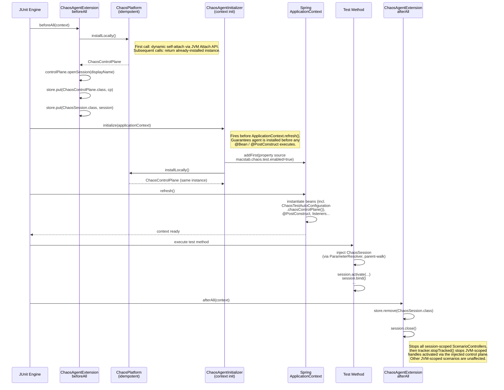
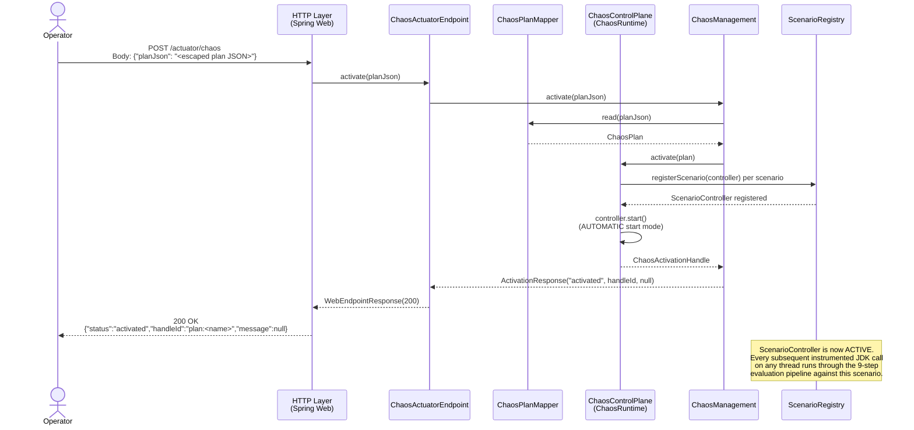

<!--
━━━━━━━━━━━━━━━━━━━━━━━━━━━━━━━━━━━━━━━━━━━━━━━━━━━━━━━━━━━━━
  Engineered by  Christian Schnapka
                 Embedded Principal+ Engineer
                 Macstab GmbH · Hamburg, Germany
                 https://macstab.com
━━━━━━━━━━━━━━━━━━━━━━━━━━━━━━━━━━━━━━━━━━━━━━━━━━━━━━━━━━━━━
-->

# Spring Integration — macstab-chaos-jvm-agent

> Technical reference for the four Spring Boot integration modules: test starters for Boot 3 and Boot 4, runtime starters for Boot 3 and Boot 4.
>
> *Engineered by* **[Christian Schnapka](https://macstab.com)** — Embedded Principal+ Engineer · [Macstab GmbH](https://macstab.com) · Hamburg, Germany

---

## 1. Module Overview

The Spring integration layer is organized along two independent axes:

- **Scope axis**: test-time vs runtime deployment
- **Version axis**: Spring Boot 3.x vs Spring Boot 4.x

This gives four modules, each compiled against its own Spring Boot BOM and carrying its own `Automatic-Module-Name`. No module carries a runtime Spring Boot dependency — all Spring artifacts are declared `compileOnly` so the starters are inert unless the consuming application supplies Spring Boot on the classpath.

| Module                                  | Scope                                  | Spring Boot | Automatic-Module-Name                           | Base Package                              |
|-----------------------------------------|----------------------------------------|-------------|-------------------------------------------------|-------------------------------------------|
| `chaos-agent-spring-boot3-test-starter` | Test (JUnit 5 + `@SpringBootTest`)     | 3.5.16      | `com.macstab.chaos.jvm.agent.spring.boot3.test` | `com.macstab.chaos.jvm.spring.boot3.test` |
| `chaos-agent-spring-boot4-test-starter` | Test (JUnit 5 + `@SpringBootTest`)     | 4.1.2       | `com.macstab.chaos.jvm.agent.spring.boot4.test` | `com.macstab.chaos.jvm.spring.boot4.test` |
| `chaos-agent-spring-boot3-starter`      | Runtime (production / soak / game day) | 3.5.16      | `com.macstab.chaos.jvm.agent.spring.boot3`      | `com.macstab.chaos.jvm.spring.boot3`      |
| `chaos-agent-spring-boot4-starter`      | Runtime (production / soak / game day) | 4.1.2       | `com.macstab.chaos.jvm.agent.spring.boot4`      | `com.macstab.chaos.jvm.spring.boot4`      |

The test and runtime starters are intentionally separate. Combining them in a single artifact would put Actuator plumbing on the test classpath and test-only classes in production JARs. The separation enforces the blast-radius boundary at the Gradle dependency level rather than requiring callers to remember which scope to use.

---

## 2. Test Starter — `@ChaosTest` and `ChaosAgentExtension`

### 2.1 What the Test Starter Does (Floor 0)

Add the dependency, put `@ChaosTest` on your test class, and declare a `ChaosSession` parameter on any test method. The starter self-attaches the chaos agent into the test JVM, boots a full `@SpringBootTest` application context, and hands you a live session you can use to inject faults. No `-javaagent` flag, no XML, no manual lifecycle wiring.

### 2.2 `@ChaosTest` — Meta-Annotation Composition

`@ChaosTest` is a meta-annotation, not a standalone mechanism. It is assembled from three annotations:

```java
@SpringBootTest
@ExtendWith(ChaosAgentExtension.class)
@ContextConfiguration(initializers = ChaosAgentInitializer.class)
public @interface ChaosTest { ... }
```

The following `@SpringBootTest` attributes are re-declared on `@ChaosTest` and forwarded via `@AliasFor`:

| Attribute        | Forwarded to                     | Type                                                  |
|------------------|----------------------------------|-------------------------------------------------------|
| `properties`     | `@SpringBootTest.properties`     | `String[]`                                            |
| `classes`        | `@SpringBootTest.classes`        | `Class<?>[]`                                          |
| `webEnvironment` | `@SpringBootTest.webEnvironment` | `WebEnvironment` (default `MOCK`)                     |
| `args`           | `@SpringBootTest.args`           | `String[]`                                            |

This means callers pay zero annotation-composition cost. `@ChaosTest(webEnvironment = WebEnvironment.RANDOM_PORT)` works exactly as `@SpringBootTest(webEnvironment = RANDOM_PORT)` does, with the chaos extension layered on top.

The `@Inherited` meta-annotation on `@ChaosTest` means it propagates to subclasses. A base class annotated with `@ChaosTest` passes the extension and Spring Boot test wiring to every extending test class automatically.

### 2.3 `ChaosAgentExtension` — JUnit 5 Lifecycle

`ChaosAgentExtension` implements five JUnit 5 interfaces:

```
BeforeAllCallback
AfterAllCallback
BeforeEachCallback
AfterEachCallback
ParameterResolver
```

#### `beforeAll` — agent installation and session open

JUnit calls `beforeAll` for the test class and again for each of its `@Nested` classes. The outermost class installs the agent, wraps the control plane in a `TrackingChaosControlPlane`, opens the session and puts both into its store. A nested class finds them in its outer class's store and reuses them. Every class then activates its own class-level `@WithChaos` scenarios and keeps their handles in its own store.

`ChaosPlatform.installLocally()` is idempotent — it uses a JVM-wide lock and returns the same `ChaosControlPlane` instance on every call within the same JVM process. The first call triggers dynamic self-attach of the chaos agent via the JVM Attach API. Subsequent calls, from subsequent `@ChaosTest` classes or nested tests in the same forked JVM, return the already-installed instance without attempting re-attachment.

The raw control plane is wrapped in a `TrackingChaosControlPlane` before being stored. This wrapper records every `ChaosActivationHandle` returned from `controlPlane.activate()` during the test class's lifecycle. `afterAll` calls `tracker.stopTracked()` to stop any JVM-scoped handles the test activated — preventing JVM-scoped scenario leakage into subsequent test classes in the same JVM.

`tracker.openSession(context.getDisplayName())` creates a new `ChaosSession` scoped to this test class's execution. The display name (the class name or whatever `@DisplayName` provides) is stored as the session's human-readable identifier, which appears in diagnostics snapshots.

Both the tracking control plane and the session are stored in the extension's `ExtensionContext.Store` under the type-keyed namespace:

```java
static final ExtensionContext.Namespace NAMESPACE =
    ExtensionContext.Namespace.create(ChaosAgentExtension.class);
```

This is a deliberate design choice. JUnit's `ExtensionContext.Namespace` creates a logically isolated keyspace per extension class. Storing by type (`ChaosControlPlane.class`, `ChaosSession.class`) rather than by string avoids collision with other extensions that might store values in the same context.

#### `afterAll` — session close and JVM-scoped handle cleanup

`afterAll` first stops the class's own class-level `@WithChaos` scenarios. A nested class stops nothing else: the session and the tracker belong to its outer class. The outermost class then closes the session, which stops every session-scoped scenario, and calls `tracker.stopTracked()` in a `finally` block, which stops the JVM-scoped scenarios the class activated through the injected control plane. JVM-scoped scenarios not created through it are unaffected.

Scenarios activated through an injected `ChaosControlPlane` bean are released when the last running chaos test class ends. Spring caches an application context across test classes, so one bean serves every class that uses the context. Releasing at the end of one class would stop what another class, nested or running in parallel, still depends on. They are also released when their context closes. In a parallel run, what classes sharing one cached context activate through its bean stays active until the last of them ends: they share the bean, so its activations cannot be told apart per class. To keep a class's chaos to that class, activate it through the injected `ChaosSession`: its session-scoped scenarios reach only the class's own threads and end with the class.

#### `ParameterResolver` — `ChaosSession` and `ChaosControlPlane` injection

The resolver supports two types:

```java
public boolean supportsParameter(ParameterContext parameterContext,
                                  ExtensionContext extensionContext) {
    final Class<?> parameterType = parameterContext.getParameter().getType();
    return parameterType == ChaosSession.class || parameterType == ChaosControlPlane.class;
}
```

Resolution walks the context hierarchy:

```java
public Object resolveParameter(ParameterContext parameterContext,
                                ExtensionContext extensionContext) {
    final Class<?> parameterType = parameterContext.getParameter().getType();
    ExtensionContext current = extensionContext;
    while (current != null) {
        final Object value = current.getStore(NAMESPACE).get(parameterType, parameterType);
        if (value != null) {
            return value;
        }
        current = current.getParent().orElse(null);
    }
    throw new ParameterResolutionException("ChaosAgentExtension: no ... available — ...");
}
```

Walking upward through `current.getParent()` is what makes `@Nested` classes work. In JUnit 5, a `@Nested` class has its own `ExtensionContext`, which is a child of the outer class's context. Its `beforeAll` stores no session of its own, so the walk finds the outer class's session and returns the same instance. All `@Nested` classes within a single `@ChaosTest` class share one session, one session ID, and one cleanup in the outer class's `afterAll`.

This is the only correct design for nested tests. Alternatives would either require each nested class to redeclare the extension (defeating the purpose of `@ChaosTest`) or open multiple sessions per outer-class lifecycle (making cleanup ambiguous). The walk ensures the model is: one `@ChaosTest` outer class = one session, regardless of nesting depth.

### 2.4 `ChaosAgentInitializer` — `ApplicationContextInitializer`

`ChaosAgentInitializer` implements `ApplicationContextInitializer<ConfigurableApplicationContext>`. Its role is to ensure the chaos agent is fully installed *before the application context is refreshed* — specifically before any `@Bean` method or `@PostConstruct` callback runs.

```java
public void initialize(final ConfigurableApplicationContext applicationContext) {
    applicationContext.getEnvironment().getPropertySources().addFirst(
        new MapPropertySource("macstabChaosTestEnabled",
            Map.of("macstab.chaos.test.enabled", "true")));
    ChaosPlatform.installLocally();
}
```

Why is this needed separately from the JUnit extension?

The JUnit extension's `beforeAll` fires before the test class methods run, but `@SpringBootTest` starts an `ApplicationContext` as part of test setup — potentially before `beforeAll` has run if the context is loaded from a shared context cache. The initializer fires at a precisely-defined point in the Spring context lifecycle: after the context is created but before `refresh()` is invoked. This guarantees that beans instantiated during refresh — `CommandLineRunner`, `ApplicationRunner`, beans with `@PostConstruct` that call instrumented JDK methods — see the chaos agent already installed.

Without the initializer, there would be a window where Spring is starting beans and the agent is not yet installed. Any instrumented JDK call happening inside a bean constructor during that window would pass through the uninstalled fast path. The initializer closes that window.

The initializer does not register the control plane itself. It opts **this context** in by prepending a per-context property source named `macstabChaosTestEnabled` with `macstab.chaos.test.enabled=true`; `ChaosTestAutoConfiguration` then creates the `ChaosControlPlane` bean through the normal `@Bean` lifecycle, so `@MockBean`, `@Primary` and other override paths keep working. The flag lives only in this context's environment — no JVM-wide system property is set — so a plain `@SpringBootTest` context in the same JVM, before or after a `@ChaosTest` context, does not get the bean.

#### Registration

The initializer is **not** registered globally (the test starters' `META-INF/spring.factories` contain no initializer entry). It is applied only to contexts of classes annotated with `@ChaosTest`, through `@ContextConfiguration(initializers = ChaosAgentInitializer.class)` on the annotation. Boot 3 and Boot 4 test starters behave identically here.

### 2.5 `ChaosTestAutoConfiguration` — Auto-Configuration in Tests

`ChaosTestAutoConfiguration` is an `@AutoConfiguration` that exposes `ChaosControlPlane` as a Spring bean in contexts opted in by `@ChaosTest`:

```java
@AutoConfiguration(before = ChaosAutoConfiguration.class)
public class ChaosTestAutoConfiguration {

    @Bean(destroyMethod = "")
    @ConditionalOnMissingBean(ChaosControlPlane.class)
    @ConditionalOnProperty(name = "macstab.chaos.test.enabled", havingValue = "true")
    public ChaosControlPlane chaosControlPlane() {
        return ChaosAgentExtension.contextPlane(ChaosPlatform.installLocally());
    }
}
```

The bean is a tracking control plane: what a test activates through it is released when its context closes (by default each `@MicronautTest` class has its own) or when the last running chaos test class ends.

`before = ChaosAutoConfiguration.class` orders it ahead of the application starter's configuration, which declares a `chaosControlPlane` bean too: with `macstab.chaos.enabled=true` in a test, the tracked plane is the one registered, also for the actuator endpoint and the startup plan of that context.

`@ConditionalOnProperty(name = "macstab.chaos.test.enabled")` matches only in contexts where `ChaosAgentInitializer` added its per-context property source, i.e. contexts of `@ChaosTest` classes. A plain `@SpringBootTest` context never self-attaches the agent through this configuration.

`destroyMethod = ""` is required: `ChaosControlPlane` is `AutoCloseable`, so Spring's inferred destroy method would call `close()` whenever any test context shuts down and tear down the JVM-wide runtime shared by every context.

`@ConditionalOnMissingBean(ChaosControlPlane.class)` is the standard back-off contract. If a test configuration already declares a `ChaosControlPlane` bean — for example a stub implementation for isolated unit testing without agent attachment — the auto-configuration steps aside. This is the same pattern used by `ChaosAutoConfiguration` in the runtime starters, keeping the override contract consistent across all four modules.

#### Registration

Both Boot 3 and Boot 4 test starters register via the standard auto-configuration SPI:

```
META-INF/spring/org.springframework.boot.autoconfigure.AutoConfiguration.imports
  → com.macstab.chaos.jvm.spring.boot3.test.ChaosTestAutoConfiguration
  → (Boot 4 variant)   com.macstab.chaos.jvm.spring.boot4.test.ChaosTestAutoConfiguration
```

The `ImportAutoConfiguration.imports` layout is consulted only when the test class carries `@ImportAutoConfiguration` (directly or via a slice annotation), so it would leave the bean absent from plain `@SpringBootTest` and `@ChaosTest` contexts. Standard auto-configuration discovery runs for every `@SpringBootTest` context; the property condition above keeps the bean out of contexts that did not opt in. The test starters belong on the test classpath only, so the configuration never reaches production scanning.

### 2.6 Sequence Diagram — Test Lifecycle



---

## 3. Runtime Starter — `ChaosAutoConfiguration` and Actuator

### 3.1 What the Runtime Starter Does (Floor 0)

Add the dependency, set `macstab.chaos.enabled=true` in `application.yml`, and the starter installs the chaos agent and exposes `ChaosControlPlane` as a Spring bean. Optionally point it at a JSON plan file to activate scenarios on startup. Optionally enable the Actuator endpoint to activate and stop scenarios at runtime via HTTP — no application restart required.

This is the deployment path for pre-production soak tests, game days, and controlled production experiments. It intentionally exposes no test APIs and uses no JUnit types.

Starting with the current release, the agent is self-attached during the Spring Boot environment preparation phase — before the application context is refreshed and before any Spring beans are instantiated. This is earlier than context-refresh time, which means instrumented JDK classes (Socket, HTTP client, JDBC connections) are rewritten before any Spring bean creates them. The `ChaosControlPlane` bean in `ChaosAutoConfiguration` is still created during context refresh but is now a no-op attachment (the agent is already installed); its purpose is solely to expose the control plane as a Spring-managed bean. The bean is declared with `destroyMethod = ""`, so closing the context never closes the JVM-wide control plane.

### 3.2 `ChaosAgentEnvironmentPostProcessor` — Early Attach

```java
public class ChaosAgentEnvironmentPostProcessor implements EnvironmentPostProcessor, Ordered {
    static final int ORDER = ConfigDataEnvironmentPostProcessor.ORDER + 1;

    @Override
    public void postProcessEnvironment(
            final ConfigurableEnvironment environment,
            final SpringApplication application) {
        final TrustedChaosEnablement.Decision decision = TrustedChaosEnablement.evaluate(environment);
        if (decision == TrustedChaosEnablement.Decision.REJECTED_UNTRUSTED_SOURCE) {
            // WARNING logged: flag ignored, set macstab.chaos.allow-remote-enable=true via a trusted source
            return;
        }
        if (decision != TrustedChaosEnablement.Decision.ENABLED) {
            return;
        }
        ChaosPlatform.installLocally();   // failures are logged at WARNING, startup continues
        environment.getPropertySources().addFirst(/* macstab.chaos.agent.attach-phase marker */);
    }

    @Override
    public int getOrder() {
        return ORDER;
    }
}
```

`EnvironmentPostProcessor` is the earliest Spring Boot extension point that has access to the resolved environment. This processor runs **directly after `ConfigDataEnvironmentPostProcessor`** (`ORDER = ConfigDataEnvironmentPostProcessor.ORDER + 1`), so `application.properties` / `application.yml` (including profile-specific variants) are already loaded and visible, but the `ApplicationContext` does not yet exist — no bean constructors, `@PostConstruct` callbacks, or Tomcat binding have run. When the context is subsequently created and refreshed, all instrumented JDK classes are already rewritten.

On a successful attach the processor prepends a single-entry property source `macstabChaosAgentAttachMarker` with `macstab.chaos.agent.attach-phase=spring-boot-3` (or `spring-boot-4`), so integration tests can assert that the early attach fired.

#### Trusted sources for `macstab.chaos.enabled`

Attaching a JVM agent is a launch-time decision, so `macstab.chaos.enabled=true` is honoured only when the property source that wins for the key is a local, launch-time source (`TrustedChaosEnablement`):

- JVM system properties, environment variables, command-line arguments
- config data bundled on the classpath (`application.properties` / `.yml`, including profile-specific variants)
- property sources created by Spring's test support (`@SpringBootTest(properties)`, `@TestPropertySource(properties)`, `@DynamicPropertySource`, `TestPropertyValues`)

Every other source — Spring Cloud Config, Consul, Vault, any remote or runtime override, and config files outside the classpath — is ignored with a warning. To allow such sources, set `macstab.chaos.allow-remote-enable=true` through a trusted source (the opt-in is itself subject to the same check). The same decision gates **both** this processor and `ChaosAutoConfiguration` (via `OnTrustedChaosEnablementCondition`), so an untrusted source cannot attach the agent through the auto-configuration either.

**Why the `ChaosAutoConfiguration.chaosControlPlane()` bean still exists**: `ChaosAgentEnvironmentPostProcessor` attaches the agent but does not register the `ChaosControlPlane` as a Spring bean. The bean in `ChaosAutoConfiguration` is still needed to:
- Expose `ChaosControlPlane` as an injectable bean for application code and the Actuator endpoint.
- Back off via `@ConditionalOnMissingBean` when user code provides its own control plane.

The bean is never closed with the context (`destroyMethod = ""`). Per-context cleanup stops only what the context activated: the startup plan (`ChaosHandleRegistry`) and the plans activated through the actuator endpoint.

Both registrations call `ChaosPlatform.installLocally()`, which is idempotent — whichever runs first performs the actual attach; the second returns the already-installed instance in nanoseconds.

**Registration difference between Spring Boot 3 and Spring Boot 4**:

In Spring Boot 3, `EnvironmentPostProcessor` lives in `org.springframework.boot.env` and is registered via `META-INF/spring.factories` (Boot 3 discovers this SPI only through `spring.factories`):
```properties
org.springframework.boot.env.EnvironmentPostProcessor=\
  com.macstab.chaos.jvm.spring.boot3.ChaosAgentEnvironmentPostProcessor
```

In Spring Boot 4, the interface moved to `org.springframework.boot.EnvironmentPostProcessor` (no `.env` sub-package). Spring Boot 4 loads `EnvironmentPostProcessor` instances via `SpringFactoriesLoader` reading `META-INF/spring.factories`, so registration uses the legacy factories format:
```properties
org.springframework.boot.EnvironmentPostProcessor=\
  com.macstab.chaos.jvm.spring.boot4.ChaosAgentEnvironmentPostProcessor
```

The interface package (and therefore the `spring.factories` key) is the only meaningful difference between the Boot 3 and Boot 4 runtime starters.

### 3.3 `ChaosProperties` — Configuration Binding

`ChaosProperties` is a `@ConfigurationProperties("macstab.chaos")` class with flat properties and one nested object:

```java
@ConfigurationProperties("macstab.chaos")
public class ChaosProperties {
    private boolean enabled = false;
    private String configFile;
    private boolean debugDumpOnStart = false;
    private Actuator actuator = new Actuator();

    public static class Actuator {
        private boolean enabled = false;
    }
}
```

Every field defaults to off or null. The explicit opt-in design is non-negotiable: a chaos starter that activates by default would be a deployment incident waiting to happen. The default state — all flags false, no config file, no actuator — means the starter is a completely inert presence on the classpath until an operator deliberately enables it.

### 3.4 `ChaosAutoConfiguration` — Bean Wiring and Lifecycle

The top-level auto-configuration:

```java
@AutoConfiguration
@Conditional(OnTrustedChaosEnablementCondition.class)
@EnableConfigurationProperties(ChaosProperties.class)
public class ChaosAutoConfiguration { ... }
```

`@AutoConfiguration` is the Boot 3/4 replacement for `@Configuration` + manual `AutoConfiguration.imports` registration. It carries slightly different processing semantics than `@Configuration` — notably, it is processed after user-defined `@Configuration` classes, giving user beans priority over auto-configured beans by default.

`OnTrustedChaosEnablementCondition` is a hard gate. If `macstab.chaos.enabled` is absent from the environment, is not `true`, or comes from an untrusted property source without `macstab.chaos.allow-remote-enable=true` (see §3.2), the entire configuration class is skipped. No beans from this class reach the application context. The `@EnableConfigurationProperties(ChaosProperties.class)` binding also does not activate — property binding is conditional on the configuration class being processed.

#### `chaosControlPlane` — the primary bean

```java
@Bean(destroyMethod = "")
@ConditionalOnMissingBean
public ChaosControlPlane chaosControlPlane() {
    return ChaosPlatform.installLocally();
}
```

`destroyMethod = ""` disables Spring's inferred destroy method. The control plane is the JVM-wide runtime: it outlives any single application context, is shared by every context in the JVM (common in test suites) and by a `-javaagent` startup plan. Because `ChaosControlPlane` is `AutoCloseable`, the inferred destroy method would call `close()` on context shutdown and tear down every scenario, listener and the JFR sink JVM-wide. Instead, when the context closes, `ChaosHandleRegistry` (a `DisposableBean`) stops the handles this starter registered — the startup plan and Actuator activations — which also releases their stressor threads.

`@ConditionalOnMissingBean` without a type argument defaults to checking for any existing bean of the same type — `ChaosControlPlane`. This is the standard override contract: if a user configuration already declares a `ChaosControlPlane` bean (e.g., a test double, a mock, or a custom implementation wrapping the real one), the auto-configuration backs off cleanly.

#### `chaosHandleRegistry` — activation handle tracking

```java
@Bean
@ConditionalOnMissingBean
public ChaosHandleRegistry chaosHandleRegistry() {
    return new ChaosHandleRegistry();
}
```

`ChaosHandleRegistry` (section 3.6) holds the startup plan's handle until the context closes.

#### `chaosStartupApplier` — `ApplicationReadyEvent` listener

```java
@Bean
@ConditionalOnMissingBean(name = "chaosStartupApplier")
public ApplicationListener<ApplicationReadyEvent> chaosStartupApplier(
        final ChaosControlPlane controlPlane,
        final ChaosProperties properties,
        final ChaosHandleRegistry handleRegistry,
        final ConfigurableEnvironment environment) {
    return event -> applyStartup(controlPlane, properties, handleRegistry, environment);
}
```

`ApplicationReadyEvent` fires after the context is fully refreshed and all `SmartLifecycle` beans have started. Using this event instead of `@PostConstruct` or `ContextRefreshedEvent` ensures that the chaos plan is activated only when the application is genuinely ready to receive load — specifically, after embedded web servers have bound their ports and all `SmartLifecycle.start()` callbacks have run.

The startup logic (`applyStartup`) performs two independent operations:

1. **Startup plan activation**: if `macstab.chaos.config-file` is non-blank and comes from a trusted property source (an untrusted one is ignored with a warning), reads the file via `StartupConfigLoader.loadPlanFromFile(configFile)` (the same hardening as the agent's `configFile`: symlink rejection, 1 MiB cap, world-writable rejection), calls `controlPlane.activate(plan)`, and registers the resulting `ChaosActivationHandle` in `handleRegistry`. `ConfigLoadException` and other `RuntimeException`s are caught and logged at `SEVERE` without propagating — a missing or malformed chaos plan file does not crash the application.

2. **Diagnostics dump**: if `macstab.chaos.debug-dump-on-start` is true, calls `controlPlane.diagnostics().debugDump()` and logs the full text at `INFO`. This snapshot captures the activated scenario list, their states and counters, and JVM runtime details. It is intended as a one-shot startup confirmation that the plan loaded and the scenarios are in `ACTIVE` state.

`@ConditionalOnMissingBean(name = "chaosStartupApplier")` uses name-based matching rather than type-based matching. `ApplicationListener<ApplicationReadyEvent>` is a parameterized type; Spring's condition infrastructure checks the raw type without generic parameter matching by default. Name-based matching is more precise here — it allows a user to override specifically the startup applier behavior while keeping other `ApplicationListener<ApplicationReadyEvent>` beans in the context.

#### `ActuatorConfiguration` — nested, double-gated

```java
@Configuration(proxyBeanMethods = false)
@ConditionalOnClass(Endpoint.class)
@ConditionalOnProperty(prefix = "macstab.chaos.actuator", name = "enabled", havingValue = "true")
public static class ActuatorConfiguration { ... }
```

Two independent conditions must both be true:

1. `@ConditionalOnClass(Endpoint.class)` — Spring Boot Actuator must be on the classpath. If the host application does not include `spring-boot-actuator`, the entire nested configuration is skipped at class-presence check time, before any property resolution.

2. `@ConditionalOnProperty("macstab.chaos.actuator.enabled", havingValue = "true")` — explicit operator opt-in. Even with Actuator present, the chaos endpoint does not appear unless deliberately enabled.

This double-guard is the minimum safe design for an endpoint that can activate arbitrary fault injection. Classpath presence prevents `NoClassDefFoundError` on environments without Actuator; the property guard prevents accidental endpoint exposure on environments that have Actuator for other reasons (health checks, metrics) but don't intend to expose chaos operations.

### 3.5 `ChaosActuatorEndpoint` — Runtime Operations via HTTP

```java
@Endpoint(id = "chaos")
public class ChaosActuatorEndpoint implements AutoCloseable { ... }
```

The endpoint is a thin adapter over `ChaosManagement` (in the agent), the same implementation the Micronaut endpoint and the Quarkus route use: the three answer with the same outcomes and HTTP statuses, and only plans activated through the endpoint can be stopped through it. Spring closes the endpoint with the context, which stops those plans.

`@Endpoint(id = "chaos")` registers the endpoint under the path `/actuator/chaos`. Spring Boot Actuator's endpoint infrastructure maps the operation annotations to HTTP verbs automatically:

| Annotation                    | HTTP method | Path                   | Description                                                 |
|-------------------------------|-------------|------------------------|-------------------------------------------------------------|
| `@ReadOperation`              | `GET`       | `/actuator/chaos`      | Returns `ChaosDiagnostics.Snapshot`                         |
| `@WriteOperation`             | `POST`      | `/actuator/chaos`      | Activates a plan; body `{"planJson": "<escaped plan JSON>"}` |
| `@DeleteOperation` (stopAll)  | `DELETE`    | `/actuator/chaos`      | Stops all plans activated through the endpoint              |
| `@DeleteOperation` (selector) | `DELETE`    | `/actuator/chaos/{id}` | Stops one plan by handle id (`plan:<name>`) or plan name    |

Both delete operations are `@DeleteOperation`s; the `@Selector` path segment keeps them routable. (Two `@WriteOperation`s without distinguishing selectors would collide on the same verb and path, and Actuator refuses to start.)

#### Operations

| Operation | Answer |
|-----------|--------|
| `GET /actuator/chaos` | 200, the `ChaosDiagnostics.Snapshot`: every scenario with its state and counters, the activation failures and the runtime details |
| `POST /actuator/chaos` | 200 `activated` with `handleId` (`plan:<name>`); 400 `invalid` (blank, malformed or failing validation); 409 `conflict` (a scenario id is already active, a running plan has the plan's name, or a plan of that name is being activated; every plan without a name is named `default`); 422 `rejected` (the runtime could not run it; the detail is logged, not returned) |
| `DELETE /actuator/chaos/{id}` | 200 `stopped`; 404 `not-found`; 409 `conflict` (the plan is being activated; stop it once it is) or `unmanaged` (a scenario activated elsewhere, or a scenario of a plan: stop the plan by its handle id); 400 for an id with a malformed escape |
| `DELETE /actuator/chaos` | 200 with `stoppedCount`, the plans stopped (one that fails to stop is logged and skipped) |

Actuator binds the `String planJson` parameter **by name** from a JSON object body, so the request body is `{"planJson": "<plan JSON as an escaped string>"}`, not the raw plan document:

```bash
curl -X POST http://localhost:8080/actuator/chaos \
  -H 'Content-Type: application/json' \
  -d '{"planJson": "{\"metadata\":{\"name\":\"soak\"},\"scenarios\":[...]}"}'
```

The plan is read with `ChaosPlanMapper`, which rejects unknown fields, so a typo fails instead of being ignored. Parse failures report a position and reason, never the parser's excerpt of the input; a validation message may quote the offending field value, sanitised and capped.

#### Security note

`ChaosActuatorEndpoint` is protected by whatever security the host application applies to the Actuator namespace. The endpoint must not be reachable from the public internet without authentication. A `POST /actuator/chaos` endpoint that accepts arbitrary chaos plan JSON and activates it in the live JVM is an extremely high-impact surface. Protect it as you would a shutdown endpoint.

Standard Spring Security configuration for Actuator:

```yaml
management:
  endpoints:
    web:
      exposure:
        include: health,info,chaos
  endpoint:
    chaos:
      access: restricted
```

And a security rule restricting actuator access to an internal role or network:

```java
http.requestMatcher(EndpointRequest.to(ChaosActuatorEndpoint.class))
    .authorizeHttpRequests(a -> a.anyRequest().hasRole("CHAOS_OPERATOR"));
```

### 3.6 `ChaosHandleRegistry`

The registry holds the handle of the startup plan (`macstab.chaos.config-file`), so that plan stops when the application context closes. It is a `DisposableBean`: `destroy()` sets a closing flag, so a registration racing the shutdown stops its own handle instead of outliving the context, and stops every held handle, continuing past one whose `close()` fails. The startup plan is not managed by the actuator endpoint, which stops only the plans activated through it.

### 3.7 Sequence Diagram — POST `/actuator/chaos`



---

## 4. Spring Boot 3 vs Spring Boot 4 Differences

### What Differs

There is one meaningful difference between the Boot 3 and Boot 4 variants: the `EnvironmentPostProcessor` interface package, and therefore its registration key.

**Boot 3 runtime starter**: `org.springframework.boot.env.EnvironmentPostProcessor` (the interface is in the `.env` sub-package). Registered via `META-INF/spring.factories` using the `org.springframework.boot.env.EnvironmentPostProcessor` key.

**Boot 4 runtime starter**: `org.springframework.boot.EnvironmentPostProcessor` (interface moved to the top-level `org.springframework.boot` package in Boot 4). Registered via `META-INF/spring.factories` using the `org.springframework.boot.EnvironmentPostProcessor` key, because Boot 4's `EnvironmentPostProcessorsFactory.fromSpringFactories()` still uses `SpringFactoriesLoader` for this type.

The `ApplicationContextInitializer` of the test starters is registered identically in both versions — not globally, but through `@ContextConfiguration(initializers = ChaosAgentInitializer.class)` on `@ChaosTest`. Both the auto-configuration registration (runtime starters) and the test auto-configuration registration (test starters) use the same `*.imports` file in Boot 3 and Boot 4:

| File                                           | Boot 3                                                                                       | Boot 4                                                                                   |
|------------------------------------------------|----------------------------------------------------------------------------------------------|------------------------------------------------------------------------------------------|
| Runtime auto-configuration                     | `org.springframework.boot.autoconfigure.AutoConfiguration.imports`                           | Same                                                                                     |
| Test auto-configuration                        | `org.springframework.boot.autoconfigure.AutoConfiguration.imports`                           | Same                                                                                     |
| `ApplicationContextInitializer` (test starter) | `@ContextConfiguration` on `@ChaosTest` (no global registration)                             | Same                                                                                     |
| `EnvironmentPostProcessor` (runtime starter)   | `META-INF/spring.factories` keyed on `org.springframework.boot.env.EnvironmentPostProcessor` | `META-INF/spring.factories` keyed on `org.springframework.boot.EnvironmentPostProcessor` |

### What is Identical

Everything else is source-identical between Boot 3 and Boot 4 variants. The differences are limited to:

- Package names (`spring.boot3` vs `spring.boot4`)
- The `Automatic-Module-Name` in the JAR manifest
- The Spring Boot BOM version used for compilation (`3.5.16` vs `4.1.2`)
- The `EnvironmentPostProcessor` interface package and `spring.factories` key (as described above)

All class names, method signatures, annotation usages, `@ConditionalOn*` expressions, JUnit 5 extension logic, parameter resolution, session lifecycle, and property key names are identical. The Java source of `ChaosProperties`, `ChaosAutoConfiguration`, `ChaosActuatorEndpoint`, `ChaosHandleRegistry`, `ChaosAgentExtension`, `ChaosAgentInitializer`, `ChaosTestAutoConfiguration`, and `@ChaosTest` contain no conditional logic — they compile against their respective BOMs and work identically at runtime.

`ChaosAgentEnvironmentPostProcessor` carries the same logic in both Boot 3 and Boot 4. The only differences are the import (`org.springframework.boot.env.EnvironmentPostProcessor` in Boot 3 vs `org.springframework.boot.EnvironmentPostProcessor` in Boot 4), the `spring.factories` key, and the attach-marker value (`spring-boot-3` / `spring-boot-4`).

The duplication is intentional and has a concrete justification: Spring Boot 3 and Spring Boot 4 have incompatible `@AutoConfiguration` processing semantics and compile-time annotation processor outputs. A shared module compiled against Boot 3 cannot be used in a Boot 4 application without classloader issues, and vice versa. The clean separation means each module's JAR has a single, unambiguous compile-time dependency graph.

---

## 5. Configuration Reference

All properties live under the `macstab.chaos` prefix and apply to both Boot 3 and Boot 4 runtime starters.

| Property                            | Type      | Default | Description                                                                                                          |
|-------------------------------------|-----------|---------|----------------------------------------------------------------------------------------------------------------------|
| `macstab.chaos.enabled`             | `boolean` | `false` | Master switch. Gates the early attach and all beans in `ChaosAutoConfiguration`; honoured only from trusted sources. |
| `macstab.chaos.allow-remote-enable` | `boolean` | `false` | Lets `macstab.chaos.enabled` come from any property source. Itself honoured only from a trusted source.              |
| `macstab.chaos.config-file`         | `String`  | `null`  | Absolute or relative path to a JSON plan file. Loaded on `ApplicationReadyEvent`. Null or blank = no startup plan. Honoured only from trusted sources. |
| `macstab.chaos.debug-dump-on-start` | `boolean` | `false` | If `true`, logs the full `controlPlane.diagnostics().debugDump()` output at `INFO` after the startup plan activates. |
| `macstab.chaos.actuator.enabled`    | `boolean` | `false` | Enables `ChaosActuatorEndpoint`. Requires both this flag and `spring-boot-actuator` on the classpath. Honoured only from trusted sources. |
| `macstab.chaos.session-propagation.enabled` | `boolean` | `true` | Registers `ChaosSessionFilter` in servlet applications: a request carrying `X-Chaos-Session` runs in that chaos session, so session-scoped scenarios reach the server side of calls a test makes. The test starters register it in every test application; the runtime starters only together with `macstab.chaos.enabled`. It only joins sessions already open in this JVM. |

Full YAML example showing all options:

```yaml
macstab:
  chaos:
    enabled: true                           # explicit opt-in required
    config-file: /etc/chaos/soak-plan.json  # optional; loads and activates on startup
    debug-dump-on-start: true               # logs scenario list and state at startup
    actuator:
      enabled: true                         # exposes /actuator/chaos endpoint
```

Minimal configuration to enable the agent with no startup plan and no Actuator:

```yaml
macstab:
  chaos:
    enabled: true
```

All properties participate in Spring's full environment abstraction — they can be set via `application.yml`, `application.properties`, system properties (`-Dmacstab.chaos.enabled=true`), environment variables (`MACSTAB_CHAOS_ENABLED=true` using Spring's relaxed binding), or any `PropertySource` registered in the context. The exception is `macstab.chaos.enabled` (and `macstab.chaos.allow-remote-enable`): they take effect only from system properties, environment variables, command-line arguments, classpath config data or Spring test property sources — see §3.2.

---

## 6. Test Coverage

| Test Class                            | Module                                  | What It Verifies                                                                                                                                                                                                                                                                        | Test Count |
|---------------------------------------|-----------------------------------------|-----------------------------------------------------------------------------------------------------------------------------------------------------------------------------------------------------------------------------------------------------------------------------------------|------------|
| `ChaosAgentExtensionTest` (Boot 3)    | `chaos-agent-spring-boot3-test-starter` | `ChaosSession` parameter injection; `ChaosControlPlane` parameter injection; session id non-null; session open and `bind()` usable during test; session identity stable across methods in a class; `@TestInstance(PER_CLASS)` + bind lifecycle                                          | 6          |
| `ChaosAgentExtensionTest` (Boot 4)    | `chaos-agent-spring-boot4-test-starter` | Same contract as Boot 3 variant; exercises Boot 4 Spring Boot BOM                                                                                                                                                                                                                       | 6          |
| `ChaosAutoConfigurationTest` (Boot 3) | `chaos-agent-spring-boot3-starter`      | `ChaosControlPlane` bean present when `enabled=true`; `ChaosHandleRegistry` bean present when `enabled=true`; no bean when `enabled` absent (default); no bean when `enabled=false`; user-supplied `ChaosControlPlane` overrides auto-config (`@ConditionalOnMissingBean`)              | 5          |
| `ChaosAutoConfigurationTest` (Boot 4) | `chaos-agent-spring-boot4-starter`      | Same contract as Boot 3 variant                                                                                                                                                                                                                                                         | 5          |
| `ChaosActuatorEndpointTest` (Boot 3)  | `chaos-agent-spring-boot3-starter`      | Endpoint bean present when `actuator.enabled=true`; absent when default; absent when `actuator.enabled=false`; `snapshot()` returns non-null with non-null `scenarios()` and `runtimeDetails()`; `stop()` returns `not-found` for unknown ID; `stopAll()` returns 0 when registry empty | 6          |
| `ChaosActuatorEndpointTest` (Boot 4)  | `chaos-agent-spring-boot4-starter`      | Same contract as Boot 3 variant                                                                                                                                                                                                                                                         | 6          |
| `ChaosPropertiesTest` (Boot 4)        | `chaos-agent-spring-boot4-starter`      | `enabled` defaults to `false`; `actuator.enabled` defaults to `false`; `configFile` defaults to `null`; `debugDumpOnStart` defaults to `false`                                                                                                                                          | 4          |

All test classes use `ApplicationContextRunner` for the Spring wiring tests (lightweight, no embedded server) and `@ExtendWith(ChaosAgentExtension.class)` for the extension tests (no Spring context needed to verify JUnit lifecycle). Stub `ChaosControlPlane` implementations avoid attaching the real agent in tests that only verify Spring bean wiring, keeping those tests fast and environment-agnostic.

---

<div align="center">

*Architecture, implementation, and documentation crafted with Love and Passion by*

**[Christian Schnapka](https://macstab.com)**
Embedded Principal+ Engineer
[Macstab GmbH](https://macstab.com) · Hamburg, Germany

*Building systems that operate correctly at the edges — including the ones you deliberately break.*

</div>
